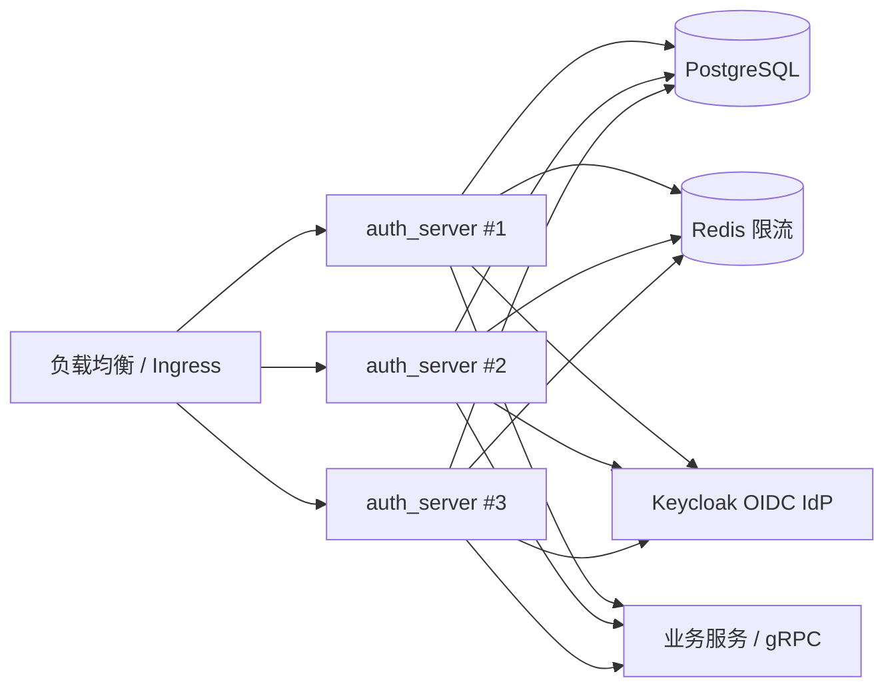

# 🏭 Garrison 参考生产案例（v1.0 门禁产物完成·自托管参考）

> **定位声明**：本文是 v1.0「生产案例文档」门禁的**仓库侧产物**，已完成。案例均为**自托管参考部署**（仓库内 `auth_server` / `examples` / `docker-compose` 可复现），**不是客户案例**，不含客户名称、采购规模或未经测量的生产指标；1.0.0 须待第三方审计等外部条件完成后另行发布（见 ROADMAP「v1.0.0 稳定版」门禁表）。欢迎按文末模板提交真实部署经验（脱敏后由维护者评审入库）。

## 📋 目录

- [案例 A：auth_server 多实例 + PostgreSQL + Redis + Keycloak](#-案例-aauth_server-多实例--postgresql--redis--keycloak)
- [案例 B：嵌入式单机](#-案例-b嵌入式单机)
- [案例提交模板](#-案例提交模板)
- [诚实边界](#-诚实边界)

---

## 🧭 案例 A：auth_server 多实例 + PostgreSQL + Redis + Keycloak

**适用场景**：微服务 / 多系统共享认证中心；需要跨实例会话吊销、OIDC 联邦与集中审计。

### 拓扑



### 容量假设（设计口径，非实测承诺）

| 维度 | 参考取值 | 说明 |
|------|---------|------|
| 实例数 | 3 | 无状态部署，可水平扩展 |
| 峰值登录 RPS | 500 | 登录含 Argon2 慢哈希，按 `argon2_pool_size` 与 CPU 预算反推 |
| 无状态校验 RPS | 5000 | `check_login_stateless` / `check_permission` 热路径 |
| 会话存储 | 实例本地 DAO（oxcache） | 多实例需 sticky session 或 stateless JWT；需要全局会话共享时评估候选 A（整 DAO 切 Redis，未采纳） |
| 限流存储 | 独立 Redis（`rate-limit-redis`） | 登录 hook 与 `RateLimitStrategy` 跨实例共享计数 |
| 数据库 | PostgreSQL 16 | 迁移随启动 auto-migrate 或离线执行 |

### 关键配置

```bash
# 参考部署（auth_server）
GARRISON_RATE_LIMIT_BACKEND=redis
GARRISON_REDIS_URL=rediss://redis-limiter.example:6380/0
GARRISON_STRICT_SECURITY=true
GARRISON_INTERNAL_API_KEY=<openssl rand -hex 32>
GARRISON_EXTERNAL_BIND=0.0.0.0   # 仅容器内；宿主直跑默认回环
```

- `rate-limit-redis` 覆盖**登录防火墙 hook**（`fw:ip:*` / `fw:acct:*`）与 `RateLimitStrategy`；其余限流面（`BruteForceStrategy` 封禁账本 / `DDoSStrategy` / OAuth2 `/token` / 邀请码 / SMS/email 配额 / API Key 与账号锁定 / 边缘 `rate_limit_middleware`）仍按各自后端独立运作（见 [ROADMAP](./ROADMAP.md) · rc.4 已知限制）。
- Redis 故障语义：启动连接失败拒绝启动；运行期错误向上传播（登录 fail-closed），不静默回退内存。
- 建议限流 Redis 与业务缓存分实例/分 DB，`fw:*` / `rl:*` 不与 oxcache 缓存键混用。

### 故障演练

| 演练 | 预期 | 证据 |
|------|------|------|
| Redis 限流实例宕机 | 新实例启动失败（fail-closed）；运行中实例登录请求返回错误而非放行 | `tests/redis_limiter_backend.rs` 的不可达用例；`scripts/chaos_redis.sh` |
| PostgreSQL 主库切换 | 会话/审计写入短暂失败后恢复；无静默丢写（DAO 错误向上传播） | `docker/docker-compose.e2e.yml` + `scripts/e2e_matrix.sh` S3pg |
| TLS 证书轮换 | `tls-cert-watch` 进程内热加载，无需重启 | [DEPLOYMENT · TLS](./DEPLOYMENT.md) |
| Keycloak 不可达 | OIDC 登录失败显性返回；本地密码登录不受影响 | `tests/keycloak_oidc.rs` / e2e S3kc |

### 可复现证据

- 端到端矩阵：`scripts/e2e_matrix.sh` → `logs/e2e_matrix_report.md`
- 性能验收：`scripts/e2e_run.sh` → `logs/perf.jsonl` + `scripts/e2e_analyze.py`
- 限流双实例：`GARRISON_TEST_REDIS_URL=... cargo test --features full --test redis_limiter_backend`
- 安全证据：`scripts/security_evidence.sh` → `logs/security-evidence.md`

---

## 📦 案例 B：嵌入式单机

**适用场景**：单体应用、边缘节点、开发/测试环境；单实例或允许按实例放大的限流口径。

| 维度 | 参考取值 | 说明 |
|------|---------|------|
| 部署形态 | 库嵌入业务进程 | `backend-embedded` |
| 存储 | SQLite（`db-sqlite`） | 单写者；多实例需换 PostgreSQL/MySQL |
| 限流 | `rate_limit_backend=memory`（默认） | 进程内计数；多实例实际限额按实例数放大 |
| 会话 | 进程内 oxcache | 进程重启会话失效；需要持久会话时启用 `field-encryption` + 外部 KV |

**边界**：单机案例不提供跨实例会话共享、跨实例限流或高可用承诺；生产多实例请参考案例 A。

---

## 📝 案例提交模板

> 提交方式：GitHub Issue / PR 更新本文；请脱敏客户名称、域名、密钥与精确流量。维护者按「可复现、可验证、无夸大」标准评审。

```markdown
### 案例名称
- 行业 / 规模（可选，脱敏）：
- 部署形态：嵌入式 / auth_server / 混合
- 拓扑：实例数、数据库、缓存、IdP、网关
- 版本：garrison 版本 + 关键 feature 组合
- 关键配置：会话 / 限流 / 加密 / 审计（脱敏）
- 容量与 SLO：峰值 RPS、P99、可用性目标（注明实测 or 设计口径）
- 遇到的问题与解决：现象 → 根因 → 处置 → 回归证据
- 证据链接：日志 / 报告 / 复现脚本（可公开的部分）
```

---

## 🧾 诚实边界

- 本文案例是**参考部署**，不是客户背书；不包含客户 logo、合同规模或未经测量的生产数字。
- 容量表为设计口径；实际容量随 CPU、Argon2 参数、数据库与网络变化，需按 [PERFORMANCE](./PERFORMANCE.md) 的同机基线方法自行压测。
- 限流覆盖面以 [ROADMAP](./ROADMAP.md) · rc.4 已知限制为准；不要把 `rate-limit-redis` 理解为「所有限流面都已分布式化」。
- 安全审计状态以 [SECURITY_AUDIT](./SECURITY_AUDIT.md) 为准；参考部署不等同于第三方认证或合规认证。
