# 📘 Garrison API Reference

This reference collects Garrison's public APIs: the global manager and static facade, the business-callback trait, the storage-layer trait, the annotation macros, the error types, and the feature-gated modules. The document assumes the corresponding feature is enabled; without it the API does not compile. Online docs (auto-generated on docs.rs): <https://docs.rs/garrison>.

> Applicable version: 0.9.0 (the rate-limit backend APIs added in 0.9.0-rc.4 are at the end). rustdoc is authoritative for full signatures; this document is organized as "module → trait/type → method tables" for quick lookup.

## 📋 Table of Contents

- [Overview](#-overview)
- [The prelude re-exports](#-the-prelude-re-exports)
- [The Global Manager](#-the-global-manager)
- [The Static Facade GarrisonUtil](#️-the-static-facade-garrisonutil)
- [Token Context](#-token-context)
- [The Business Callback GarrisonInterface](#-the-business-callback-garrisoninterface)
- [The Storage Layer GarrisonDao](#️-the-storage-layer-garrisondao)
- [Permission Strategies](#-permission-strategies)
- [Sessions and State](#-sessions-and-state)
- [Web Integration and Annotation Macros](#-web-integration-and-annotation-macros)
- [Plugins and Listeners](#-plugins-and-listeners)
- [The Repository Layer](#️-the-repository-layer)
- [Password Hashers (`account-credential`)](#-password-hashers-account-credential)
- [Error Types](#-error-types)
- [Module Map](#️-module-map)
- [Related Documents](#-related-documents)

---

## 🎯 Overview

<div align="center">



</div>

### API design principles

| Principle | Description |
|:-----|:-----|
| **Static facade** | Business code only touches `GarrisonManager` (initialized once) and `GarrisonUtil` (static methods) |
| **Callback injection** | The framework assumes nothing about data sources; permission/role data is provided by the business via the `GarrisonInterface` callback |
| **Replaceable traits** | `GarrisonDao`, `GarrisonPermissionStrategy`, `GarrisonPlugin`, `GarrisonListener` can all be custom-implemented to replace default behavior |
| **Feature gating** | Optional capabilities (protocols, firewall, web adapters etc.) compile independently per feature; see the [feature flags matrix](#feature-matrix) |

### Import style

```rust
use garrison::prelude::*;          // the core APIs in one line
use garrison::stp::with_current_token; // the token context (also in the prelude)
```

---

## 📦 The prelude re-exports

`garrison::prelude` (`src/prelude.rs`) aggregates the most-used types; `use garrison::prelude::*` covers all dependencies of the README's minimal example:

| Export | Description |
|--------|------|
| `GarrisonConfig` | The configuration type |
| `GarrisonContext` / `GarrisonRequest` / `GarrisonResponse` / `GarrisonStorage` | Context abstractions |
| `AuthRequest` / `Decision` / `DecisionReason` | Authorization request and decision (`core-advanced`) |
| `GarrisonDao` | The storage trait |
| `GarrisonError` / `GarrisonResult` | The error type and Result alias |
| `GarrisonManager` | The global manager |
| `GarrisonPlugin` | The plugin trait |
| `GarrisonInterceptor` / `GarrisonRouter` | Routing and interceptors |
| `GarrisonSession` | Sessions |
| `GarrisonPermissionStrategy` / `GarrisonPermissionStrategyDefault` | The permission strategy trait and its default implementation |
| `Annotation` | Annotations (`annotation-macros`) |
| `GarrisonDaoOxcache` | The oxcache DAO implementation (`cache-*`) |
| `LoginParams` | Login parameters |
| `with_current_token` / `current_token` | The token context |
| `CreditMeteringListener` etc. | Metering listeners (`credit-metering`) |

---

## 🏢 The Global Manager

`GarrisonManager` (`src/manager/`) — the global singleton; internal logic is read lock-free via `arc_swap::ArcSwapOption`.

```rust
GarrisonManager::builder()
    .dao(dao)               // Arc<dyn GarrisonDao>
    .config(config)         // Arc<GarrisonConfig>
    .interface(interface)   // Arc<dyn GarrisonInterface>
    .build().await?;        // initializes the global singleton
```

| Item | Description |
|----|------|
| `GarrisonManager::builder()` | Returns the builder; enabling any `firewall-*` auto-injects the firewall check hooks |
| Initialization ordering | `build()` may run only once globally; concurrent initialization is CAS semantics |
| Backend modes | `backend-embedded` (default, in-process auth) / `backend-remote` (HTTP calls to a remote Auth Server, with circuit breaking) |

---

## 🛠️ The Static Facade GarrisonUtil

`GarrisonUtil` (`src/stp/util/mod.rs`) — all associated functions, reading the current task_local token context to execute. The actual public API (grouped by topic):

### Login / logout

| Method | Description |
|------|------|
| `login(id, params: &LoginParams) -> GarrisonResult<String>` | Logs in and returns the token |
| `login_simple(id) -> GarrisonResult<String>` | Login with default parameters |
| `logout() -> GarrisonResult<()>` | Logs out the current token |
| `logout_by_login_id(login_id) -> GarrisonResult<()>` | Logs out by subject |
| `kickout(login_id) -> GarrisonResult<()>` | Kicks a user offline |
| `kickout_by_token(token) -> GarrisonResult<()>` | Kicks by token |
| `login_by_token(token) -> GarrisonResult<()>` | Restores a login state from an existing token |
| `invalidate_sessions_after_password_change(...) -> GarrisonResult<()>` | Invalidates historical sessions after a password change |

### Login-state checks

| Method | Description |
|------|------|
| `check_login() -> GarrisonResult<bool>` | Verifies login state, throwing `NotLogin` when not logged in |
| `check_login_sync() -> GarrisonResult<bool>` | The synchronous version |
| `get_login_id() -> GarrisonResult<Option<String>>` | The current subject |
| `get_login_id_by_token(token) -> GarrisonResult<Option<String>>` | The subject for a given token |

### Permissions / roles

| Method | Description |
|------|------|
| `check_permission(permission) -> GarrisonResult<()>` | Verifies a permission, throwing `NotPermission` on failure |
| `check_role(role) -> GarrisonResult<()>` | Verifies a role, throwing `NotRole` on failure |
| `check_permission_sync(perm)` / `check_role_sync(role)` | The synchronous versions |
| `has_permission(permission) -> GarrisonResult<bool>` / `has_role(role)` | The boolean variants |
| `get_permission_list() -> GarrisonResult<Vec<String>>` / `get_role_list()` | Reads the current subject's permission / role lists |

### Tokens and protocols

| Method | Description | Feature |
|------|------|---------|
| `verify_token(token) -> GarrisonResult<String>` | Verifies a token | — |
| `revoke_token(token) -> GarrisonResult<()>` | Revokes a token (RFC 7009 semantics) | — |
| `refresh_token(token) -> GarrisonResult<String>` | RefreshToken rotation | `protocol-jwt` |
| `check_access_token()` / `check_client_token()` / `check_temp_token()` | The three OAuth2 token checks | `protocol-oauth2` |
| `check_api_key(namespace) -> GarrisonResult<()>` | API Key verification (fail-closed `Config` error when the feature is off) | `protocol-apikey` |

**Refresh-token reuse detection and the grace window** (`RefreshTokenRotation`, the `protocol-jwt` + `db-sqlite` features; the SQL targets SQLite, with the service gated by `db-sqlite` overall): a replayed old token is disposed by the three-tier classification (`RecentPrev`/`OrphanedBranch` dispatched per configuration, `StaleLineage` always revoking the whole chain); the full disposal table is in [THREAT.md](THREAT.md). The relevant `GarrisonConfig` fields:

| Field | Default | Description |
|------|------|------|
| `recent_reuse_behaviour` | `TheftDetected` | Disposal for `RecentPrev`/`OrphanedBranch` reuse: `TheftDetected` revokes the whole chain + `TokenRevoked`; `Unauthorised` only rejects this attempt (401) without revoking. Invalid values fail-fast at startup |
| `refresh_grace_period_secs` | `0` (off) | The grace-window seconds — within the window, an already-rotated old token presented again returns the existing new token (no re-rotation, tolerating concurrent double refresh; the redeemed credential is staged in-process, so only the issuing instance hits it in multi-instance setups) |
| `refresh_grace_max_uses` | `1` | The maximum redemptions of the same old token within the window; replays inside the window after exhaustion are disposed per `recent_reuse_behaviour` (revoking the whole chain by default); effective only when the window > 0 |

The corresponding environment variables: `GARRISON_RECENT_REUSE_BEHAVIOUR` / `GARRISON_REFRESH_GRACE_PERIOD_SECS` / `GARRISON_REFRESH_GRACE_MAX_USES`. **Effectiveness precondition**: the fields above are read by the injected `RefreshTokenRotation` — when the application injects the rotation service via `TokenHandler::with_refresh_rotation`, it must also wire the config values with `with_reuse_behaviour` / `with_grace_window` (the framework does not auto-wire them; without injection, refresh takes the DAO fallback path and the configuration has no effect).

### OAuth2 discovery and multi-kid JWKS rotation (`oauth2-server`)

**The discovery endpoint** (`OAuth2State::oidc_discovery_enabled`, defaulting to follow the `protocol-oidc` feature, overridable at runtime): `GET /.well-known/openid-configuration` (OIDC Discovery 1.0) and `GET /.well-known/oauth-authorization-server` (RFC 8414). Unconfigured issuer or the switch off → 404 (fail-closed). Metadata derives from actual capabilities (not a static template):

| Field | Derivation source |
|------|---------|
| `issuer` / `authorization_endpoint` / `token_endpoint` and other endpoint paths | `OAuth2State::issuer` + fixed routes |
| `grant_types_supported` | The token endpoint's existing capabilities (authorization_code/refresh_token/client_credentials); `password` is advertised only after the deployer injects a password verifier and sets `password_grant_advertised` |
| `scopes_supported` | The union of registered client scopes (derived by a runtime query; derivation failure is a 500 exposed explicitly, an empty set falls back to `openid`) |
| `jwks_uri` / `jwks_algorithms` (the id_token signing algorithms) | Appear only when a JWKS is actually published (preventing dead links from misleading clients) |
| `code_challenge_methods_supported` | PKCE enforced → `S256` only |

The response carries `Cache-Control: public, max-age=300`.

**Multi-kid JWKS rotation** (`oauth2_server::jwks::JwksKeystore`; once injected into `OAuth2State::jwks_keystore`, the JWKS endpoint publishes from the library first): keys have three states — `Active` (signing) / `Passive` (retired but kept for verification, still published) / `Disabled` (removed from publishing and verification). The three-view semantics: signing takes Active, verification takes Active∪Passive (a `kid` hitting a Passive old key verifies successfully; a missing kid falls back to Active; an unknown kid errors explicitly), and the JWKS output takes Active∪Passive. Rotation commits through a DAO `compare_and_swap` ledger (defending multi-instance races: of concurrent rotations exactly one wins, and the loser reads the winner-consistent state); a Passive key past `jwks_retention_secs` (default 7200 = 2× the access token TTL, see [CONFIGURATION.md](CONFIGURATION.md)) becomes Disabled and leaves the JWKS. The JWKS endpoint's `Cache-Control: max-age` is computed dynamically as half the retention.

### The two-phase authorize ticket and consent memory (`oauth2-server`, R18)

**The two-phase flow**: `GET /oauth2/authorize` passes validation (response_type/PKCE S256/redirect allowlist) → a 32-char random ticket is issued staging the full request (TTL 600s) → `LoginRequired` redirects to the login page (`return_to=/oauth2/authorize/resume?ticket=...`) → after successful login `GET /oauth2/authorize/resume?ticket=...` atomically consumes the ticket using the session identity and continues the flow to issue the authorization code. The ticket is not bound to a subject (the continued flow's subject is the session); consumption is one-shot (a second consumption / expiry / unknown all explicitly reject with `invalid_ticket`, leaking no state).

**The prompt semantics** (OIDC Core §3.1.2.1; effective when the `AuthorizeRequest.prompt` field appears explicitly): `none` → not logged in or insufficient consent always yields `interaction_required` (no interaction pages at all); `login` → forces a full login round-trip even when logged in.

**Consent memory**: the key `oauth2:consent:{tenant}:{user}:{client}` persists the granted scope set + a dual-granularity hash of the attribute snapshot (ATTRIBUTE_NAME / ATTRIBUTE_VALUE, SHA-512, configurable via `with_attribute_granularity`). On re-authorization: if the requested scopes ⊆ granted and the attribute snapshot is unchanged → pass without prompting; new scopes → merge into a superset; a snapshot that cannot be parsed → fail-safe and re-prompt. `reconcile_consents` cleans orphan rows of deleted clients, idempotently; the framework's `listen()` runs it automatically at startup (fail-open: failure only warns and does not block startup; the next startup or an explicit ops call retries).

**Wiring contract**: the prompt=none silent renewal compares snapshots against an empty attribute view — users approved via the consent page (a non-empty attribute view) need the deployer to pass a consistent attribute view, otherwise `interaction_required` re-triggers (fail-safe; documented in `with_consent_url`).

### Second-factor checks and bans

| Method | Description |
|------|------|
| `check_safe() -> GarrisonResult<()>` | Verifies second-factor completion, throwing `NotSafe { reason }` when incomplete |
| `check_disable() -> GarrisonResult<()>` | Verifies the account ban state, throwing `DisableService { service, until }` when banned |

> There is also `garrison::stp::util::init_backend(backend)` to initialize the backend (the `backend-*` architecture face).

---

## 🎯 Token Context

`garrison::stp` (`src/stp/context.rs`) — the task_local carrying the current token; web middleware binds it automatically:

| Function | Description |
|------|------|
| `with_current_token(token, fut)` | Binds the token while `fut` executes (chainable and nestable) |
| `current_token()` | Reads the current token (`Option<String>`) |

---

## 🔌 The Business Callback GarrisonInterface

`garrison::GarrisonInterface` (`src/stp/interface.rs`) — implemented by the business, providing permission/role data.

| Method | Default implementation | Description |
|------|----------|------|
| `get_permission_list(&self, login_id) -> GarrisonResult<Vec<String>>` | Must implement | The permission identifiers of the given subject |
| `get_role_list(&self, login_id) -> GarrisonResult<Vec<String>>` | Must implement | The role identifiers of the given subject |
| `get_permission_list_with_type(&self, login_id, login_type)` | Delegates to `get_permission_list` | Multi-account systems isolate per `login_type` (the default strategy passes the value configured by `with_login_type`) |
| `get_role_list_with_type(&self, login_id, login_type)` | Delegates to `get_role_list` | Same (the role dimension) |

The data source is the business's choice (database / config / external service); `GarrisonPermissionStrategyDefault` string-matches the lists it receives.

---

## 🗄️ The Storage Layer GarrisonDao

`garrison::GarrisonDao` (`src/dao/mod.rs`) — the uniform KV abstraction masking the oxcache / dbnexus backend differences. Core methods (all `async`, returning `GarrisonResult`):

### Basic KV

| Method | Description |
|------|------|
| `get(key) -> Option<String>` | Read |
| `set(key, value, ttl_seconds)` | Write (with TTL) |
| `set_permanent(key, value)` | Permanent write (the default implementation calls `set` with ttl=0) |
| `set_if_absent(key, value, ttl_seconds)` | Write only if absent (atomic semantics) |
| `update(key, value)` | Update (preserving the original TTL) |
| `expire(key, seconds)` | Reset the TTL |
| `get_timeout(key) -> Option<Duration>` | Read the remaining TTL (the default implementation returns `NotImplemented`) |
| `get_with_ttl(key) -> Option<(String, Option<Duration>)>` | Value + remaining TTL |
| `delete(key)` | Delete |
| `keys(pattern) -> Vec<String>` | List by pattern |
| `rename(old_key, new_key)` | Rename (a missing key returns `InvalidParam`; atomically preserves the original TTL) |
| `get_and_delete(key) -> Option<String>` | Atomically take and delete |
| `incr(key, ttl_seconds) -> u64` / `decr(key) -> u64` | Atomic counters |

### Extended contracts

| Method | Description | Feature |
|------|------|---------|
| `compare_and_update_if_greater(...)` | Update after numeric comparison (the rate-limit counter foundation) | — |
| `compare_and_swap(...)` | CAS | — |
| `find_social_binding(...)` / `insert_social_binding(...)` | Social-account bindings | `social-*` |
| `query_role_hierarchy_edges(...)` / `insert_role_hierarchy_edge(...)` / `delete_role_hierarchy_edge(...)` | Role-hierarchy edge storage | — |
| `eval_lua(...)` | Lua scripts (passed through on the redis face) | `cache-redis` |
| `insert_credit_consumption(...)` / `query_credit_consumption(...)` | Credit-consumption records | `credit-metering` |

### Built-in implementations

| Type | Feature | Description |
|------|---------|------|
| `GarrisonDaoOxcache` | `cache-memory` / `cache-redis` | L1 memory (per-entry TTL, exact semantics: explicit `ttl_jitter(0.0)`) + L2 redis |
| The dbnexus DAO | `db-sqlite` / `db-postgres` / `db-mysql` | SQL persistence + the Repository layer (below) |
| The in-memory Mock DAO | — | `src/stp/mock.rs` (for tests) |

### The conformance test suite `dao::testing`

One ruler for all backends: the group-assertion function library tiers by capability, and the `dao_conformance_tests!` macro instantiates and runs them for every
`GarrisonDao` implementation (built-in or custom). Under `cfg(test)` they run with the unit tests;
the `testing` feature build face is open to downstream reuse.

| Group-assertion function | Capability tier | Content |
|-----------|--------|------|
| `run_basic(&Arc<dyn GarrisonDao>, prefix)` | `basic` | get/set/update/delete/expire, permanent keys, the three get_with_ttl states, the full incr/decr semantics, CAS-if-greater, rename (missing key `InvalidParam`) |
| `run_atomic(&Arc<dyn GarrisonDao>, prefix)` | `atomic` | set_if_absent / get_and_delete / compare_and_swap single-threaded atomic semantics |
| `run_concurrent(&Arc<dyn GarrisonDao>, prefix)` | `concurrent` | multi_thread true concurrency: SETNX exactly-one-winner, GETDEL one-shot consumption, the incr/decr return permutations of exactly one, monotonic CAS |
| `run_ttl(&Arc<dyn GarrisonDao>, prefix)` | `ttl` | Expired keys do not revive; update/rename/incr preserve the original window; `expire(k, 0)` converts to permanent (wall clock, one 3s sleep) |
| `run_keys(&Arc<dyn GarrisonDao>, prefix)` | `keys` | glob `*`/`?` exact matching, empty Vec, delete/rename scan sync |

One-line wiring (a custom backend):

```rust
garrison::dao_conformance_tests! {
    backend: my_dao,
    make: || async { MyDao::new().await.map(|d| Arc::new(d) as Arc<dyn GarrisonDao>) },
    caps: [basic, atomic, concurrent],   // undeclared tiers generate no tests
    // serial: true,                      // optional: #[serial_test::serial] (test builds only)
    // ignore: "requires X",             // optional: #[ignore = "..."]
}
```

`make` creates a fresh empty instance per test (fresh storage per test, compatible with shared-storage backends); all key names are isolated with the
`<backend>:` prefix; construction failure panics (fail-loud).

---

## 🧮 Permission Strategies

`garrison::GarrisonPermissionStrategy` (`src/strategy/`) — the authorization decision entry point, replaceable as a whole:

| Item | Description |
|----|------|
| `GarrisonPermissionStrategyDefault` | The default implementation: fetches data via the `GarrisonInterface` callback then string-matches; `with_login_type` sets the multi-account login_type |
| `firewall_hook_injected()` | A diagnostic method returning whether the builder injected the firewall hooks |
| ABAC | The `abac` feature: the Cedar DSL policy engine (`garrison::abac`), the `#[check_abac]` annotation + the `set_abac_missing_feature_policy` escape hatch |
| Decision provenance | `core-advanced`: `authorize(AuthRequest) -> Decision` (`Allow` / `Deny` + `DecisionReason`) |

---

## 💼 Sessions and State

| Type | Description |
|------|------|
| `GarrisonSession` (`src/session/`) | The session operations face; `session::dao()` is not feature-gated and is `pub(crate)` within the crate (callers include `protocol-apikey` / `db-postgres` / `db-mysql` / `cache-redis` / `protocol-jwt`) |
| `TokenState` (`src/state/`, re-exported at the crate root) | The token state machine |
| `UserStatus` | The user-state enum (also re-exported at the crate root) |
| `GarrisonPrincipal` / `TenantContext` / `TENANT` (`src/context/`) | The request principal and tenant context (`tenant-isolation`); `TENANT.scope(tenant, fut)` enters the tenant scope |
| `ClaimTenantResolver` | The resolver parsing tenants from claims |

---

## 🌐 Web Integration and Annotation Macros

### Routing and interception

| Type | Description |
|------|------|
| `GarrisonRouter` | The unified routing abstraction; the actix face provides `with_tenant_resolver(resolver)` / `with_header_tenant()` |
| `GarrisonInterceptor` | The request interceptor, entering the `GarrisonUtil` static APIs |
| `garrison::web` (`web-axum`) | The axum extractors and middleware |
| `garrison::web_actix` / `garrison::web_warp` | The actix-web / warp adapters |
| `garrison::grpc` (`grpc`) | The tonic auth layer |

### The single Set-Cookie construction point (the context layer, always-on)

`garrison::context::cookie` — the sole production point of all Set-Cookie write paths (the three framework adapters, the axum renewal middleware, the CSRF middleware); a pure function with no framework dependencies:

| Type / function | Description |
|------|------|
| `CookieScope` | The closed enum of legal SameSite × HttpOnly combinations: `LaxHttpOnly` / `StrictHttpOnly` / `NoneHttpOnly` (HttpOnly constant) |
| `CookiePath` | The path scope: `Root` (`Path=/`) / `Of(String)` (reserved: short-lived tokens on a limited path; no production write sites currently) |
| `CookieType` | The construction parameters (`name` / `scope` / `path` / `domain` / `max_age`); `CookieType::token(&config)` covers the session-token cookie, `session(name, &config)` covers other session cookies; `resolved_name(secure)` emits the read-side parsing name |
| `build_set_cookie_value(&CookieType, value, secure)` | Builds the Set-Cookie value; on validation failure it returns an error and the caller must not emit any Set-Cookie |
| `token_cookie_name(&config)` | The read-side uniform entry for the session-token cookie (the same name the write side produces) |

The invariants (enforced by the construction point, unbypassable at write sites):

1. **HttpOnly constant**: all three `CookieScope` variants emit HttpOnly.
2. **The SameSite allowlist fail-fast**: anything outside `["Lax", "Strict", "None"]` errors (the legal values correspond one-to-one with the startup config-validation allowlist `COOKIE_SAME_SITE_VALUES`, drift locked by cross-reference tests).
3. **The None→Lax downgrade**: when `cookie_secure=false` (the deterministic non-Secure-context signal), `SameSite=None` downgrades to `Lax` (warn once).
4. **The production prefixes**: under the `production` feature + a Secure context, `Path=/` with no Domain → `__Host-<name>`; a limited path or a Domain → `__Secure-<name>`; an http downgrade emits no prefix. The read side must parse the same name via `token_cookie_name` / `CookieType::resolved_name`.
5. **Injection protection**: name/value reuse `validate_cookie_name_value`, rejecting `;`, control characters and other delimiters; the path rejects `;` and control characters, and the domain allows only hostname characters (alphanumerics, hyphens, dots).

### The annotation macros (the `annotation-macros` feature, the proc-macro crate `garrison-macros`)

13 attribute macros (the wrappers generate axum `Response`s): 10 axum wrapper macros + 3 sdforge `#[forge]` route variants.

| Macro | Corresponding check |
|----|----------|
| `#[check_login]` | Login state (`NotLogin` → 401) |
| `#[check_role("...")]` / `#[check_permission("...")]` | Role / permission |
| `#[check_access_token]` / `#[check_client_token]` / `#[check_temp_token]` | The OAuth2 token types |
| `#[check_api_key("...")]` | API Key (fail-closed when the feature is off) |
| `#[check_disable]` | Ban state |
| `#[check_mfa]` | Second factor |
| `#[check_abac(policy = "...")]` | ABAC policy (`abac`) |
| `#[check_login_forge]` / `#[check_role_forge]` / `#[check_permission_forge]` | The sdforge dynamic-route variants |

---

## 🧩 Plugins and Listeners

| trait | Registration | Description |
|-------|----------|------|
| `GarrisonPlugin` (`src/plugin/`) | Compile-time `inventory::submit!` | Lifecycle-hook injection |
| `GarrisonListener` (`src/listener/`) | Compile-time `inventory::submit!` | 31 event variants (Login / Logout / Kickout / PermissionCheck / RoleCheck / TokenExpired / LoginFailure / PasswordRehashed / TokenRefresh / RevokeToken / SessionTimeout / AccountLocked / FirewallBlock / TokenRotate / TempCredentialConsumed / SocialLogin / TenantSwitch / DeviceBlock / DeviceUnblock / ConfigReload / AnomalousLoginDetected / Replaced / CreditConsumed / CreditAlert / InvitationCreated / InvitationRevoked / InvitationRedeemed / QrLoginCreated / QrLoginScanned / QrLoginConfirmed / QrLoginCancelled); the trait side is a single `async fn on_event` callback (not per-event hooks), and event payloads have tokens masked uniformly |
| `AuditLogListener` / `AuditConfig` / `AuditEntry` / `AuditQuery` (`listener::audit`, `audit-log`) | — | The audit-log listener and queries |

---

## 🗃️ The Repository Layer

Under the `db-*` features, `src/dao/repository/` provides typed repositories (13 traits); lib.rs re-exports 9 of the SQLite implementations at the top level:

| Re-export | Description |
|-----------|------|
| `DbnexusUserRepository` / `DbnexusRoleRepository` / `DbnexusPermissionRepository` | Users / roles / permissions |
| `DbnexusUserRoleRepository` / `DbnexusRolePermissionRepository` | The join tables |
| `DbnexusAuthMethodRepository` / `DbnexusSessionRepository` / `DbnexusLoginLogRepository` / `DbnexusUserExtRepository` | Auth methods / sessions / login logs / extension fields |
| `UserIdentifierRepository` (`app_user_identifier`) | Atomic unique registration of login identifiers (phone / email). On a `register` unique-constraint conflict, ownership is re-checked **within the tenant scope** (`find_owner_in_tenant`, the SQL carrying a `tenant_id` predicate): same-tenant conflicts return `Taken { by_user_id }`; cross-tenant conflicts return the neutral `Registered` (without `by_user_id`, leaking no ownership to the other tenant). `find_owner` is the global-dimension reverse-lookup primitive (in multi-tenant deployments, untrusted input must use `find_owner_in_tenant` instead, avoiding leaking other tenants' user_ids) |
| `UserDeviceRepository` (`app_user_device`) | Device registration and the `MAX_DEVICES` cap |
| `WebauthnCredentialRepository` (`app_webauthn_credential`) | WebAuthn credential binding and queries |
| `PasswordHistoryRepository` (`app_password_history`) | Historical password hashes (`account-policy` reuse rejection) |
| `RoleHierarchyService` / `RoleHierarchyRecord` | Role hierarchy (SQL placeholders adapt per backend) |
| `init_dbnexus_with_pool_config(url, PoolConfig)` | Passes connection-pool parameters through dbnexus's `DbPoolBuilder` (max/min connections, timeouts) |

Protocol-layer additional re-exports: `RefreshTokenRecord` / `RefreshTokenRotation` (`protocol-jwt`).

---

## 🔑 Password Hashers (`account-credential`)

`account::credential::password` provides the `PasswordHasher` trait and built-in implementations (one-shot construction via the `config.password_hasher.build_hasher()` factory):

| API | Description |
|-----|------|
| `PasswordHasher::hash(password) / verify(password, hash)` | Synchronous hashing / verification (wrap slow-hash call sites in `spawn_blocking`) |
| `PasswordHasher::concurrency_gate() -> Option<&Arc<Semaphore>>` | The concurrency-gate probe (default `None`, zero changes for custom implementations); when `Some`, the pooled wrapper serializes hash execution per permit |
| `Argon2Hasher::with_params(m, t, p).with_pool(pool_size)` | The Argon2id hasher + the concurrency token pool (`pool_size` 0 clamps to 1); no pool by default (backward compatible) |
| `BcryptHasher::with_cost(cost)` | The bcrypt hasher, **not pooled** (a single execution's workspace is KB-scale; pooling yields no memory-protection benefit) |
| `PasswordCredential::verify(input)` | Credential verification: `spawn_blocking` offload + permit-bounded when pooled; queuing not rejection |

**Concurrency-token-pool behavior notes**: the permit is acquired async before `spawn_blocking` and **moved into the closure** — the permit's lifetime == the hash execution, so when the caller's future is cancelled the orphaned blocking task keeps holding the permit until completion; the Argon2 memory-residency upper bound equals `pool_size × m_cost` under any cancellation ordering (no oversell); waiting callers queue asynchronously (not rejected); after the semaphore's `close()` it returns `Internal("account-argon2-pool-closed::...")` explicitly, never silently succeeding. The pool size is configured via `password_hasher.argon2_pool_size` (range `[1, 256]`, default 1).

---

## ❗ Error Types

`garrison::GarrisonError` (`src/error.rs`, `thiserror`-derived) — the unified error enum, with `GarrisonResult<T> = Result<T, GarrisonError>`.

Display behavior: the i18n base layer compiles unconditionally, and `to_string()` switches between Chinese and English per the thread-local locale (defaulting to system-language detection).

| Variant | HTTP semantics | Description |
|------|-----------|------|
| `NotLogin(String)` | 401 | Not logged in |
| `NotPermission(String)` / `NotRole(String)` | 403 | No permission / no role |
| `InvalidToken(String)` / `ExpiredToken(String)` / `TokenRevoked(String)` | 401 | Token invalid / expired / revoked (RFC 7009) |
| `Dao(String)` | 500 | Storage-layer error |
| `Config(String)` | 500 | Configuration error (including fail-closed missing features, e.g. calling `check_api_key` without `protocol-apikey` enabled) |
| `Internal(String)` | 500 | Internal error |
| `Session(String)` | 500 | Session creation / query / expiry / renewal errors |
| `Annotation(String)` | 500 | Annotation validation failure / combination conflict |
| `Context(String)` | 500 | GarrisonContext / Request / Response / Storage anomalies |
| `Exception(Box<GarrisonException>)` | — | Business exceptions (Boxed to control the enum size, crossing the `result_large_err` threshold) |
| `OAuth2(String)` | 500 | OAuth2 protocol errors (the `error_id` is `oauth.error` — the format constraint forbids digits, so the module segment uses the root `oauth`) |
| `Network(String)` / `InvalidResponse(String)` | 502 | Network layer / upstream response parse failures (mutually exclusive semantics) |
| `InvalidParam(String)` | 400 | Invalid parameter |
| `NotImplemented(String)` | 501 | A default implementation not covered |
| `FirewallBlocked(String)` | 403 | Firewall interception (carrying the strategy name and reason, for audit-log subscription) |
| `DisableService { service, until }` | 403 | Account ban (`until = None` means permanent; leaks no user_id / tenant_id) |
| `NotSafe { reason }` | 400 | Second factor not completed (e.g. `MFA_TOTP_REQUIRED`) |
| `InvalidStateTransition { from, to }` | 500 | An illegal state-machine transition |
| `SmsRateLimitExceeded { window }` / `SmsVerifyMaxAttempts` / `SmsCodeNotFound` / `SmsChannelRecycled` | 429/400 | SMS verification codes (`sms-rate-limit`) |
| `EmailRateLimitExceeded { window }` etc. | 429/400 | Email verification (the `email-verification` gated variants) |
| `RateLimited { retry_after_secs }` | 429 | Gateway-layer rate limiting (carrying the `Retry-After` response header; used by the `server` rate-limit middleware and the limiteron bridge) |

### The unified error response body (R04)

The HTTP error response body of `GarrisonError` / `GarrisonException` (identical shape across the axum / actix-web / warp frameworks):

```json
{
  "error_code": "NOT_LOGIN",
  "error_id": "auth.not_login",
  "message": "Not logged in",
  "request_id": "550e8400-e29b-41d4-a716-446655440000"
}
```

- `error_code`: the **legacy code** (`UPPER_SNAKE_CASE`), frozen at its original values and still emitted, not deprecated.
- `error_id`: the **new code** (module-prefixed `<module>.<snake>`), coexisting with the old; the single source of truth is the
  private function `parts_and_msg_key` (each arm written explicitly and statically, not auto-derived). The API is
  `GarrisonError::prefixed_code()`.
- `request_id`: the current request's request id (injected into the task-local by the `X-Request-ID` middleware).
  **When there is no request id the field is omitted** (omitempty semantics).
- The `Exception` variant additionally carries the `code` field (the `i32` business code).
- `message`: the i18n'd generic description, excluding variant details (leak prevention).

The legacy code → `error_id` mapping table (complete; the `Exception` variant splits three ways by business `code` into `exception.*`):

| Legacy error_code | error_id | Legacy error_code | error_id |
|---------------|----------|---------------|----------|
| `NOT_LOGIN` | `auth.not_login` | `NOT_SAFE` | `auth.not_safe` |
| `INVALID_TOKEN` | `auth.invalid_token` | `INVALID_STATE_TRANSITION` | `state.invalid_transition` |
| `TOKEN_REVOKED` | `auth.token_revoked` | `RATE_LIMITED` | `ratelimit.rate_limited` |
| `EXPIRED_TOKEN` | `auth.expired_token` | `SMS_RATE_LIMIT_EXCEEDED` | `sms.rate_limit_exceeded` |
| `NOT_PERMISSION` | `auth.not_permission` | `SMS_VERIFY_MAX_ATTEMPTS` | `sms.verify_max_attempts` |
| `NOT_ROLE` | `auth.not_role` | `SMS_CODE_NOT_FOUND` | `sms.code_not_found` |
| `DAO_ERROR` | `dao.error` | `SMS_CHANNEL_RECYCLED` | `sms.channel_recycled` |
| `CONFIG_ERROR` | `config.error` | `EMAIL_RATE_LIMIT_EXCEEDED` | `email.rate_limit_exceeded` |
| `INTERNAL_ERROR` | `internal.error` | `EMAIL_VERIFY_MAX_ATTEMPTS` | `email.verify_max_attempts` |
| `SESSION_ERROR` | `session.error` | `EMAIL_CODE_NOT_FOUND` | `email.code_not_found` |
| `ANNOTATION_ERROR` | `annotation.error` | `EMAIL_CHANNEL_RECYCLED` | `email.channel_recycled` |
| `CONTEXT_ERROR` | `context.error` | `CREDIT_INSUFFICIENT` | `credit.insufficient` |
| `OAUTH2_ERROR` | `oauth.error` | `NOT_LOGIN` (Exception -1) | `exception.not_login` |
| `NETWORK_ERROR` | `network.error` | `NOT_PERMISSION` (Exception -2) | `exception.not_permission` |
| `INVALID_RESPONSE` | `network.invalid_response` | `EXCEPTION` (other) | `exception.default` |
| `INVALID_PARAM` | `validation.invalid_param` | | |
| `NOT_IMPLEMENTED` | `internal.not_implemented` | | |
| `FIREWALL_BLOCKED` | `firewall.blocked` | | |
| `DISABLE_SERVICE` | `account.disable_service` | | |

The response-header semantics (the header names are **fixed constants, not configuration**; see ADR-0004):

| Header | Semantics | Condition |
|----|------|------|
| `X-Request-ID` | Echoes the request identifier (a legal inbound id echoes as-is; illegal/missing echoes a generated UUID v4) | All responses once the request-id middleware is mounted |
| `Retry-After` | delta-seconds integer (floor 1), only for the `RateLimited` variant | When `retry_after_secs()` is `Some` |

Inbound `X-Request-ID` validation (untrusted input): non-empty, length ≤ 128, all visible ASCII
(`0x21..=0x7E`); CRLF / non-ASCII / over-length are discarded and regenerated, defending header / log injection.

---

## 🗺️ Module Map

The public modules of `src/lib.rs` (unmarked = the always-compiled core; the rest are feature-gated, see the [feature flags matrix](#feature-matrix)):

| Module | Description |
|------|------|
| `stp` | The static facade layer (login / checks / the token context / util) |
| `core` / `manager` / `strategy` / `session` / `dao` | The core engine |
| `annotation` / `router` | Annotations and routing |
| `config` / `context` / `state` / `json` / `exception` / `constants` / `error` / `prelude` | Configuration / context / state / JSON templates / exceptions / constants / errors / the prelude |
| `plugin` / `listener` | Plugins / event listening |
| `cache` (`cache-*`) | Cache backends |
| `limiteron` | The distributed rate-limit adapter (compiles unconditionally, the public foundation) |
| `credit` (`credit-metering`) | Metering |
| `secure` (`secure-*`) | The security toolkit |
| `account` (`account-*`) | The account security engine |
| `protocol` (`protocol-*`) | The authentication protocol layer |
| `protocol::qrlogin` (`protocol-qrlogin`) | First-party QR login (the two-ticket separated state machine + HMAC-signed tickets) |
| `abac` (`abac`) | Cedar attribute access control |
| `compliance` (`data-erasure`) | The data-erasure service and erasure reports |
| `web` / `web_actix` / `web_warp` (`web-*`) | The web framework adapters |
| `server` (`auth-server`) | The standalone authentication server |
| `oauth2_server` (`oauth2-server`) | The OAuth2 Server |
| `backend` (`backend-*`) | The backend architecture (embedded / remote / kit) |
| `grpc` (`grpc`) | The gRPC interceptor |
| `observability` (`tracing-log` / `metrics-prometheus` / `otlp`) | Observability |
| `health` | Health checks |
| `testing` (`testing`) | Test helpers (the acceptance-matrix companion) |

`protocol::qrlogin` (`protocol-qrlogin`), wired via `GarrisonAuthServer::with_qrlogin`, exposes 4 HTTP endpoints (create / poll anonymous; scan / confirm require a Bearer App session token):

| Endpoint | Auth | Description |
|------|------|------|
| `POST /qrlogin/create` | anonymous | The web side creates a QR session (the response carries the qr_id + bind_token two tickets) |
| `POST /qrlogin/poll` | anonymous | Two-ticket polling; on Confirmed, atomically consumes the bind_token to exchange and issue a session |
| `POST /qrlogin/scan` | Bearer App token | The app scans, the server locks the scanner's identity (401 on failure) |
| `POST /qrlogin/confirm` | Bearer App token | The app confirms (enforcing confirmer == scanner, distrusting the request body) |

---

## 🆕 rc.3 security-audit remediation APIs

> A quick view of the public APIs added/expanded in 0.9.0-rc.3 (rustdoc is authoritative for full signatures), grouped by capability domain.

### At-rest field encryption (`secure::encryption`, `field-encryption`)

`CryptoValue` (the `enc:v1:<key_id>:<base64(nonce|ciphertext)>` codec: `encode` / `decode` / `is_clean` / `is_digest_form`) · `AadBinding` (bound to `garrison:{tenant}:{table}:{key}`) · `FieldCipher` (`encrypt` / `decrypt` / `seal` / `open`) · the key providers `StaticFieldKeyProvider` (`new` / `with_primary`) and `ConfersFieldKeyProvider` (`from_key_entries`) · `FieldEncryptionDao` (the transparent encrypt/decrypt switching DAO) · the ops reports `ChangeKeyReport` / `CheckKeyReport`.

### WebAuthn / Passkey (`protocol::webauthn`, `protocol-webauthn`)

`WebauthnService` (registration/authentication ceremony orchestration) · `RelyingParty` (rp_id/origins derived from the issuer) · `WebauthnCredential` (`to_row` / `from_row` / `to_passkey`) · `ChallengeStore` (one-shot consumption against replay) · `ChallengePayload` / `FactorPurpose` / `FactorPolicy` / `WebauthnConfig` (the passwordless / second_factor dual policy) · `WebauthnAuthentication` · `WebauthnCeremonyError`.

### Password reset (`account::password_reset`, `account-password-reset`)

`ActionTokenService` (`issue` / `verify` / `with_ttl` / `with_rate_limit`) · `ActionTokenClaims` · `ActionTokenConsumer` (one-shot consumption) · `IssuedActionToken` · `EmailResetMailSender` (enumeration-safe, reusing the email-verification facilities).

### OIDC Back-Channel Logout (`oauth2_server::backchannel`, `backchannel-logout`)

`BackChannelLogoutListener` (enqueues on session logout events) · `BackChannelDeliverer` (`queue` / `issue` / `spawn_drain_loop` / `has_activity` / `retry_backoff_millis` / `with_backoff` / `with_queue`; redirects not followed + exponential backoff).

### The MFA / step-up orchestration foundation (`stp::mfa`, `mfa-recovery` etc.)

`AmrEntry` (the session factor ledger) · `RequiredActionProvider` (the three-phase trait: evaluate→challenge→process) with its `TotpRequiredActionProvider` / `WebauthnRequiredActionProvider` implementations · `RequiredActionChallenge` / `RequiredActionContext` · `RecoveryCodeManager` (verify/consume separation, CAS atomic consumption) · `MfaChainDecision` · `resolve_mfa_chain` / `validate_mfa_chains` / `first_unmet_chain_factor` / `ledger_max_aal` / `assert_freshness` / `amr_claim`.

### The deprecated-config-key registry (`config::deprecation`, always-on)

`Deprecation` (`key` / `since_version` / `new_key` / `auto_map` / `map_fn`) · `apply_deprecations` (load-time migration/warnings, fail-closed from `current_version ≥ 1.0.0`) · `is_mappable`.

---

## 🆕 rc.4 rate-limit backend switching APIs (`rate-limit-redis`)

| Item | Description |
|----|------|
| `limiteron::LimiterBackend` | The rate-limit execution trait (a `DistributedLimiter` superset): `atomic_check_and_incr` / `reset_prefix` / `allow_sliding_window` (gated by `firewall-ratelimit`) |
| `limiteron::LimiterRuntime` | The rate-limit runtime (`limiter()` / `storage()`); `dao(dao)` is the default DAO backend; `from_config(&GarrisonConfig, dao).await` picks Memory/Redis per `rate_limit_backend` |
| `limiteron::RedisLimiterBackend` | The Redis runtime (gated by `rate-limit-redis`): oxcache `RedisBackend` + limiteron `RedisDistributedLimiter`; implements `LimiterBackend` + `Storage` |
| `strategy::firewall::RateLimitStrategy::with_runtime` | Constructs the strategy with an explicit runtime |
| `strategy::firewall::RateLimitStrategy::from_garrison_config` | Constructs per the application config (gated by `rate-limit-redis`); connection failure is fail-closed |
| `strategy::hooks::GarrisonFirewallCheckHookDefault::with_limiter_backend` | Injects an independent rate-limit backend into the login firewall hook |

## 📚 Related Documents

| Document | Description |
|------|------|
| [📖 User Guide](USER_GUIDE.md) | The complete tutorial from installation to advanced usage |
| [🏗️ Architecture](ARCHITECTURE.md) | Design principles, module layout, and data flow |
| [⚙️ Configuration](CONFIGURATION.md) | The full `GarrisonConfig` config items |
| [🧪 Test Scenarios](TEST_SCENARIOS.md) | The acceptance scenario inventory and feature combination matrix |
| [💻 Online API docs](https://docs.rs/garrison) | The latest docs auto-generated on docs.rs |

---

<a id="feature-matrix"></a>

## 🎨 Feature Flags Matrix (migrated from README)

The table below summarizes the main `[features]` of `Cargo.toml` grouped by capability domain (100+ flags; the full list is authoritative in `Cargo.toml`'s `[features]`), where `default = ["backend-embedded"]`.

<details>
<summary>📋 Table</summary>

<table style="width:100%; border-collapse: collapse">
<tr><th style="text-align:left">Feature</th><th style="text-align:center">Default</th><th style="text-align:left">Description</th></tr>
<tr><td><code>backend-embedded</code></td><td align="center">✅</td><td>Embedded backend mode (in-process auth, delegates to GarrisonManager)</td></tr>
<tr><td><code>backend-remote</code></td><td align="center">❌</td><td>Remote backend adapter (auth via HTTP to remote Auth Server)</td></tr>
<tr><td><code>backend-kit</code></td><td align="center">❌</td><td>trait-kit typestate DI construction</td></tr>
<tr><td><code>auth-server</code></td><td align="center">❌</td><td>Standalone auth server (sdforge declarative routing + TLS)</td></tr>
<tr><td><code>abac</code></td><td align="center">❌</td><td>Cedar DSL-based attribute-based access control engine</td></tr>
<tr><td><code>oauth2-server</code></td><td align="center">❌</td><td>Full OAuth2 Server 4 endpoints</td></tr>
<tr><td><code>cache-memory</code></td><td align="center">❌</td><td>In-memory cache backend (oxcache L1)</td></tr>
<tr><td><code>cache-redis</code></td><td align="center">❌</td><td>Redis cache backend (oxcache L2)</td></tr>
<tr><td><code>db-sqlite</code></td><td align="center">❌</td><td>SQLite database backend</td></tr>
<tr><td><code>db-postgres</code></td><td align="center">❌</td><td>PostgreSQL backend</td></tr>
<tr><td><code>db-mysql</code></td><td align="center">❌</td><td>MySQL backend</td></tr>
<tr><td><code>web-axum</code></td><td align="center">❌</td><td>axum Web framework adapter</td></tr>
<tr><td><code>web-actix</code></td><td align="center">❌</td><td>actix-web framework adapter</td></tr>
<tr><td><code>web-warp</code></td><td align="center">❌</td><td>warp framework adapter</td></tr>
<tr><td><code>web-cors</code> / <code>web-csrf</code></td><td align="center">❌</td><td>CORS / CSRF middleware (WAF merged into <code>firewall-waf</code>)</td></tr>
<tr><td><code>protocol-jwt</code></td><td align="center">❌</td><td>JWT issuance &amp; validation (HS256 / HS384 / HS512, plus RS / ES / EdDSA asymmetric algorithms + refresh)</td></tr>
<tr><td><code>protocol-oauth2</code></td><td align="center">❌</td><td>OAuth2 four modes</td></tr>
<tr><td><code>protocol-sso</code> / <code>protocol-sso-server</code></td><td align="center">❌</td><td>SSO ticket / SSO Server abstraction</td></tr>
<tr><td><code>protocol-sign</code></td><td align="center">❌</td><td>API signing + nonce anti-replay</td></tr>
<tr><td><code>protocol-apikey</code></td><td align="center">❌</td><td>API Key auth</td></tr>
<tr><td><code>protocol-temp</code></td><td align="center">❌</td><td>Temporary credentials</td></tr>
<tr><td><code>protocol-qrlogin</code></td><td align="center">❌</td><td>First-party QR-code login (Web displays QR + App confirms, two-ticket separation)</td></tr>
<tr><td><code>protocol-oidc</code></td><td align="center">❌</td><td>OIDC id_token issuance/validation + discovery</td></tr>
<tr><td><code>protocol-invitation</code></td><td align="center">❌</td><td>Invitation-code directed registration (one-shot / multi-use, TTL, revocation, brute-force protection)</td></tr>
<tr><td><code>oauth2-scope-handler</code></td><td align="center">❌</td><td>OAuth2 scope handler registry (ScopeHandler trait + ScopeRegistry)</td></tr>
<tr><td><code>protocol-httpbasic</code> / <code>protocol-httpdigest</code></td><td align="center">❌</td><td>HTTP Basic / Digest auth</td></tr>
<tr><td><code>protocol-saml</code></td><td align="center">❌</td><td>SAML 2.0 skeleton</td></tr>
<tr><td><code>protocol-zeroize</code></td><td align="center">❌</td><td>Protocol-layer key zeroization</td></tr>
<tr><td><code>secure-totp</code></td><td align="center">❌</td><td>TOTP (RFC 6238)</td></tr>
<tr><td><code>secure-sign</code></td><td align="center">❌</td><td>HMAC-SHA256/SHA512 utilities</td></tr>
<tr><td><code>secure-confusable</code> / <code>secure-masking</code> / <code>secure-xss</code> / <code>secure-sanitize</code></td><td align="center">❌</td><td>Security toolset</td></tr>
<tr><td><code>secure-simple-token</code> / <code>secure-ct-eq</code></td><td align="center">❌</td><td>Signing / constant-time comparison</td></tr>
<tr><td><code>account-credential</code> / <code>account-policy</code> / <code>account-lockout</code> / <code>account-authflow</code></td><td align="center">❌</td><td>Account security engine</td></tr>
<tr><td><code>firewall</code> / <code>firewall-*</code></td><td align="center">❌</td><td>Security suite (brute-force / rate-limit / anomalous / GeoIP / DDoS / WAF)</td></tr>
<tr><td><code>listener</code></td><td align="center">❌</td><td>Event listeners (31 event variants)</td></tr>
<tr><td><code>tracing-log</code> / <code>metrics-prometheus</code> / <code>otlp</code></td><td align="center">❌</td><td>Observability</td></tr>
<tr><td><code>annotation-macros</code></td><td align="center">❌</td><td>13 attribute macros</td></tr>
<tr><td><code>tenant-isolation</code></td><td align="center">❌</td><td>Multi-tenant logical isolation</td></tr>
<tr><td><code>social-wechat</code> / <code>social-alipay</code></td><td align="center">❌</td><td>Social login</td></tr>
<tr><td><code>core-advanced</code> / <code>session-extra</code></td><td align="center">❌</td><td>Core enhancements / Session enhancements merged</td></tr>
<tr><td><code>email-verification</code> / <code>email-verification-smtp</code></td><td align="center">❌</td><td>Email verification codes</td></tr>
<tr><td><code>config-*</code></td><td align="center">❌</td><td>Config file encryption/validation/hot-reload/interpolation/dynamic/toggle (confers passthrough)</td></tr>
<tr><td><code>i18n-icu</code></td><td align="center">❌</td><td>Internationalization (the base i18n layer needs no feature; ICU integration is gated here)</td></tr>
<tr><td><code>protocol-webauthn</code></td><td align="center">❌</td><td>WebAuthn / Passkey credential registration &amp; authentication ceremony (challenge replay-guard / sign_count clone detection)</td></tr>
<tr><td><code>backchannel-logout</code></td><td align="center">❌</td><td>OIDC Back-Channel Logout (logout token issuance + persistent delivery queue)</td></tr>
<tr><td><code>keycloak-oidc</code></td><td align="center">❌</td><td>Keycloak OIDC Relying Party (RP) integration</td></tr>
<tr><td><code>field-encryption</code></td><td align="center">❌</td><td>AES-256-GCM at-rest encryption of sensitive DB fields (AAD tenant/table/key binding + migration-time dual-read)</td></tr>
<tr><td><code>mfa-recovery</code></td><td align="center">❌</td><td>MFA recovery-code manager (SHA-256 hashed at rest + atomic consumption)</td></tr>
<tr><td><code>account-password-reset</code></td><td align="center">❌</td><td>Password-reset flow (enumeration-safe / ActionToken one-time consumption / two-phase race guard)</td></tr>
<tr><td><code>policy-hibp</code></td><td align="center">❌</td><td>HIBP breached-password check (k-anonymity range search)</td></tr>
<tr><td><code>credential-zeroize</code></td><td align="center">❌</td><td>Credential key zeroization (zeroized on Drop)</td></tr>
<tr><td><code>tls</code></td><td align="center">❌</td><td>HTTPS/TLS termination (axum-server + rustls)</td></tr>
<tr><td><code>tls-cert-watch</code></td><td align="center">❌</td><td>In-process TLS certificate hot reload (no restart; both ports pick up new handshakes)</td></tr>
<tr><td><code>server-health-check</code> / <code>server-graceful-shutdown</code></td><td align="center">❌</td><td>Liveness/readiness probes / graceful shutdown</td></tr>
<tr><td><code>web-security</code> / <code>web-security-headers</code></td><td align="center">❌</td><td>Web security middleware bundle (CORS+CSRF+headers) / standalone security response headers</td></tr>
<tr><td><code>cache-lock</code> / <code>cache-batch</code> / <code>cache-invalidation</code> / <code>cache-audit</code> / <code>cache-hotkey</code> / <code>ban-sync</code></td><td align="center">❌</td><td>Cache enhancements: distributed lock / batch / cross-instance invalidation / audit event stream / hot-key observability / ban sync (oxcache passthrough)</td></tr>
<tr><td><code>db-retry</code> / <code>db-sharding</code> / <code>db-replica</code> / <code>db-saga</code></td><td align="center">❌</td><td>Database enhancements: retry / sharding / read-replica / Saga (dbnexus passthrough)</td></tr>
<tr><td><code>three-tier-cache</code></td><td align="center">❌</td><td>Three-tier cache architecture (L1 local + L2 redis + DB)</td></tr>
<tr><td><code>security-alert</code> / <code>device-binding</code> / <code>session-hijack-detection</code></td><td align="center">❌</td><td>Security alerting / device binding / session hijack detection</td></tr>
<tr><td><code>grpc</code></td><td align="center">❌</td><td>gRPC async auth layer (tonic interceptor)</td></tr>
<tr><td><code>credit-metering</code></td><td align="center">❌</td><td>Credit/quota metering (throttled write-path aggregation for activity)</td></tr>
<tr><td><code>audit-log</code></td><td align="center">❌</td><td>Audit logging (DB persistence + HMAC tamper-evident event chain)</td></tr>
<tr><td><code>audit-inklog</code> / <code>audit-inklog-http</code> / <code>audit-inklog-siem</code></td><td align="center">❌</td><td>inklog structured audit logging / HTTP / SIEM export</td></tr>
<tr><td><code>alone-cache</code> / <code>parameter-query</code></td><td align="center">❌</td><td>DAO single-flight cache (breakdown protection) / STP parameterized query</td></tr>
<tr><td><code>api-docs</code> / <code>cli-ops</code></td><td align="center">❌</td><td>OpenAPI docs / ops subcommands (single garrison binary)</td></tr>
<tr><td><code>data-erasure</code></td><td align="center">❌</td><td>Data-subject erasure orchestration (GDPR / PIPL right-to-delete)</td></tr>
<tr><td><code>authorize-api</code> / <code>manager-explicit</code></td><td align="center">❌</td><td>Core extensions: request-object authorization API / explicit Manager API</td></tr>
<tr><td><code>miette</code> / <code>embedded-migrations</code></td><td align="center">❌</td><td>Rich diagnostic errors (miette::Diagnostic) / embedded migration files</td></tr>
<tr><td><code>full</code> / <code>production</code> / <code>development</code></td><td align="center">❌</td><td>Aggregate features</td></tr>
</table>

</details>

> **v0.9.0 Feature Rename Mapping**:
>
> | Old Name (≤0.8.x) | New Name (≥0.9.0) | Description |
> |-------------------|--------------------|-------------|
> | `secure-saml` | `protocol-saml` | SAML 2.0 signature verification |
> | `secure-httpbasic` | `protocol-httpbasic` | HTTP Basic auth |
> | `secure-httpdigest` | `protocol-httpdigest` | HTTP Digest auth |
> | `observability-otlp` | `otlp` | OpenTelemetry OTLP |
> | `decision-trace` / `permission-registry` / `safe-defaults` | `core-advanced` | Core enhancements merged |
> | `dynamic-active-timeout` / `login-token-map-persistence` / `anonymous-session` / `session-search` | `session-extra` | Session enhancements merged |
