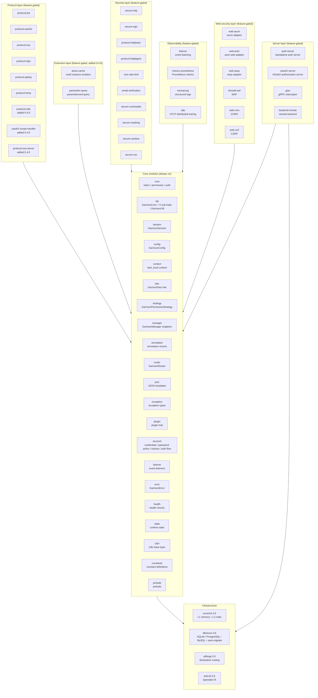
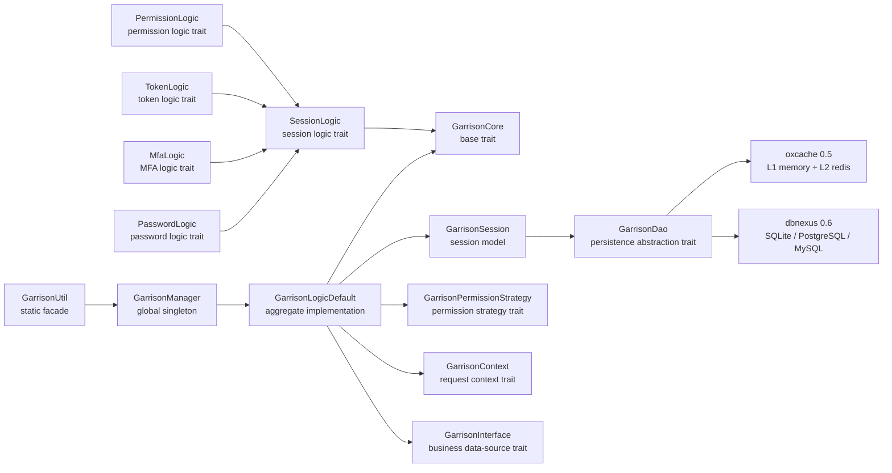
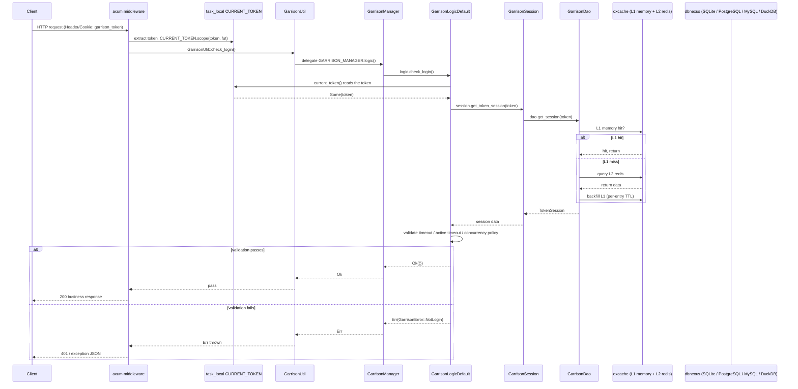

# 🏗️ Garrison Architecture Design Document

> Garrison is a one-stop authentication and authorization framework for the Rust ecosystem.
>
> - Version: 0.9.0-rc.4 (release candidate, 2026-10-20: SHA-256-digested session keys + DAO atomic-contract fixes (set_if_absent / MySQL ensure_table) + the vacuum_expired primitive + the Redis rate-limit backend landed + v1.0 gate repository-side artifacts / tightened cookie security defaults)
> - Runtime: tokio 1.x
> - Web adapters: axum 0.8 / actix-web 4 / warp 0.4
> - Storage: dbnexus 0.6 (SQLite / PostgreSQL / MySQL + auto-migrate; `migrations/duckdb/` keeps the four-dialect migration files, but garrison has no `db-duckdb` feature, no DuckDB code path exists in `src/`, and users cannot select that backend) + a Repository layer (13 traits + `Dbnexus*Repository` implementations, tenant_id isolation). Exceptions and patches: `app_user_identifier` (login-identifier uniqueness) uses `(id_type, id_value)` as the global primary key, with the tenant dimension via the tenant-scoped `find_owner_in_tenant` re-check — on a unique-constraint conflict at registration, same-tenant returns `Taken { by_user_id }` while hitting another tenant's row returns the neutral `Registered` (leaking no other tenant's user_id); password reset (`account-password-reset`) writes a code-tenant binding when issuing the token, and reset validates that the request's tenant matches the issuing tenant (fail-closed refusal when the binding is missing)
> - Cache: oxcache 0.5 (L1 memory + L2 redis, per-entry TTL + ttl_sync queries)
> - License: Apache-2.0
> For config fields see the [⚙️ Configuration Guide](./CONFIGURATION.md); for development standards see [🛠️ Development Standards](./DEVELOPMENT.md).

## 📋 Table of Contents

- [Architecture Overview](#-architecture-overview)
- [Module Layout](#-module-layout)
- [Key Trait Relationship Diagram](#-key-trait-relationship-diagram)
- [Data Flow: Request Processing Chain](#-data-flow-request-processing-chain)
- [Design Decisions](#-design-decisions)

---

## 🎯 Architecture Overview

Garrison adopts a **dual abstraction layer + global singleton** architecture, with these core design goals:

1. Business code programs only against traits; storage backends can be swapped smoothly;
2. Dependencies are injected once at startup, runtime calls are stateless, and business code uses everything through the `GarrisonManager` static APIs.

### 1.1 The dual abstraction layers

- **The DAO abstraction layer**: the `GarrisonDao` trait masks storage-backend differences; underneath, `dbnexus` (databases) + `oxcache` (cache) implement it, so switching SQLite / PostgreSQL / MySQL / DuckDB requires no changes above.
- **The cache abstraction layer**: `oxcache` 0.5 provides two cache tiers — L1 (oxcache memory) + L2 (distributed redis) — with fine-grained per-entry TTL expiry control, presenting a uniform `get / set / remove` semantics upward.

### 1.2 The global singleton

- `GarrisonManager` holds `Arc<GarrisonLogicDefault>` through `arc_swap::ArcSwapOption` (lock-free read path; migrated from `parking_lot::RwLock` in v0.8.1; since v0.5.2 the `GarrisonLogic` trait is split into the `GarrisonCore` base trait + 5 sub-traits: `SessionLogic` / `PermissionLogic` / `TokenLogic` / `MfaLogic` / `PasswordLogic`); `GarrisonManager::builder().build().await` injects dao / config / interface once at startup.
- `GarrisonLogicFactoryEntry` registers at compile time via `inventory::submit!`; at runtime `inventory::iter` selects the default implementation.
- `GarrisonUtil` exposes static methods (`login` / `check_login` / `logout` etc.), all delegating internally to the `GARRISON_MANAGER` singleton — stateless calls for the business side.

### 1.3 Dual-mode sessions

Garrison maintains two session dimensions simultaneously:

- **Account-Session**: keyed by `login_id`, storing account-level long-lived data (roles, permissions, user profile).
- **Token-Session**: keyed by `token`, storing that login's temporary data (device, login time, temporary grants).

The `is_share` / `is_concurrent` configuration controls the multi-device sharing and concurrent-login policies.

---

## 🧩 Module Layout

Garrison divides into four module layers, compiled and trimmed by feature flags:

<div align="center">



</div>



### 2.1 Core modules (always on, no feature flags)

| Module | Responsibility |
|------|------|
| `core/` | Core layer: `core/token` (token generation/verification), `core/permission` (permission checks), `core/auth` (login authentication) |
| `stp/` | `GarrisonCore` + 5 sub-traits (`SessionLogic` / `PermissionLogic` / `TokenLogic` / `MfaLogic` / `PasswordLogic`) + the `GarrisonInterface` trait + the `GarrisonUtil` static facade |
| `session/` | The `GarrisonSession` session model (Account + Token dual mode) |
| `config/` | `GarrisonConfig` global configuration + hot reload |
| `context/` | The `GarrisonContext` request-context abstraction + the axum adapter + task_local |
| `dao/` | The `GarrisonDao` trait + the dbnexus implementation + the conformance test suite (`dao::testing`, one ruler for all backends) |
| `strategy/` | The `GarrisonPermissionStrategy` permission strategy |
| `manager/` | The `GarrisonManager` global singleton + inventory compile-time registration |
| `annotation/` | Auth annotation enums |
| `router/` | `GarrisonRouter` + Interceptor route interception |
| `json/` | JSON templates and serialization abstraction |
| `exception/` | Framework exception types |
| `plugin/` | The `GarrisonPlugin` trait and compile-time registration |

### 2.2 Protocol layer (feature-gated, off by default)

| Module | Feature | Description | Introduced |
|------|---------|------|---------|
| `protocol/jwt` | `protocol-jwt` | JWT issuance and verification (HS256/384/512, RS256/384/512, ES256/384, EdDSA + refresh) | 0.2.0 |
| `protocol/oauth2` | `protocol-oauth2` | OAuth2 four modes (authorization code / client credentials / password / RefreshToken) | 0.2.0 (RefreshToken extended in 0.4.0) |
| `protocol/sso` | `protocol-sso` | SSO single-sign-on tickets (one-shot 60s TTL) | 0.2.0 |
| `protocol/sign` | `protocol-sign` | API signing + nonce anti-replay | 0.2.0 |
| `protocol/apikey` | `protocol-apikey` | API Key authentication (generate/verify/revoke/rotate) | 0.2.0 |
| `protocol/temp` | `protocol-temp` | Temporary credentials (issue/get/revoke/consume) | 0.2.0 |
| `protocol/oauth2/oidc` | `protocol-oidc` | OIDC id_token issuance/verification + discovery + triple anti-replay (iss/aud/nonce) | 0.4.0 |
| `protocol/oauth2/scope` | `oauth2-scope-handler` | The `ScopeHandler` trait + the `ScopeRegistry` registry, OAuth2Client delegating validation | 0.4.0 |
| `protocol/sso/server` | `protocol-sso-server` | The `SsoServer` trait + `CenterIdConverter` + `SsoChannel` + `DefaultSsoServer` | 0.4.0 |
| `protocol/sso/saml` | `protocol-sso` | The SAML 2.0 skeleton: the `SamlProvider` trait + `DefaultSamlProvider` (quick-xml parsing) | 0.6.0 |
| `protocol/sso/oidc` | `protocol-sso` | The OIDC RP skeleton: the `OidcProvider` trait + `DefaultOidcProvider` (discovery + token exchange) | 0.6.0 |
| `protocol/sso/channel` | `cache-redis` + `protocol-sso-server` | `RedisPubSubSsoChannel`: a Redis pub/sub cross-instance SsoChannel implementation | 0.6.0 |

### 2.3 Extension layer (feature-gated, off by default, added 0.4.0)

| Module | Feature | Description |
|------|---------|------|
| `dao/alone_cache` | `alone-cache` | The `AloneCache` decorator (implements GarrisonDao, key_prefix isolation) + `AloneCacheManager` (multi-instance management) |
| `stp/parameter` | `parameter-query` | The `ParameterQuery` trait + `ParameterQueryBuilder` (chained with_login_id/with_device/with_token + async check_permission/check_role) |

### 2.4 Security layer (feature-gated, off by default)

| Module | Feature | Description |
|------|---------|------|
| `secure/totp` | `secure-totp` | TOTP dynamic verification codes (RFC 6238) |
| `secure/sign` | `secure-sign` | HMAC signing utilities |
| `secure/httpbasic` | `protocol-httpbasic` | HTTP Basic authentication |
| `secure/httpdigest` | `protocol-httpdigest` | HTTP Digest authentication |
| `secure/sms` | `sms-rate-limit` | SMS verification-code rate limiting |
| `secure/email` | `email-verification` | Email verification codes (rate limiting + anomaly detection; `email-verification-smtp` adds built-in SMTP sending) |
| `secure/confusable` | `secure-confusable` | Unicode homoglyph detection |
| `secure/masking` | `secure-masking` | Sensitive-data masking (real regex-based masking) |
| `secure/sanitize` | `secure-sanitize` | General input sanitization |
| `secure/xss` | `secure-xss` | XSS protection |

---

### MFA/step-up orchestration foundation (stp::mfa)

The core abstractions and data flow of MFA orchestration:

- **The factor ledger**: the session embeds an `AmrEntry{method, aal, completed_at}` list + `auth_time` (the primary-authentication moment). Login seeds `pwd`/aal 1; after a step-up completes a Required Action, the ledger upgrades per `(method, aal)`. At token issuance the ledger maps to the RFC 8176 `amr` claim (deduplicated in completion order) and the OIDC `auth_time` claim.
- **The chain's three states**: `mfa.global_chain` is the global default; a missing `per_client_chains` key falls back to the global, an empty array disables explicitly, and a non-empty array is a mandatory set. A chain referencing an unknown factor is fail-closed at startup.
- **The Required Action three-phase**: `evaluate` (freshness assertion: expired `auth_time`/ledger AAL → trigger) → `challenge` (produce the client-action payload) → `process` (upgrade the ledger after verification). TOTP and WebAuthn (via the R07 ceremony + registry) each have one implementation.
- **Recovery codes**: verify and consume are separated; consume uses DAO `compare_and_swap` to atomically mark used (preventing double-spend races between verify and consume); the `recovery_misuse_tolerance` misuse-exemption counter (default 0) locks fail-closed when exceeded.
- **The MFA remember cookie**: HMAC-bound (stage + credential_id + exp), produced via the R01 single cookie construction point; a valid cookie skips repeated challenges and is not portable across credentials.

### The Back-Channel Logout delivery chain (backchannel-logout)

The full chain from logout to RP notification (aligned with OIDC Back-Channel Logout 1.0):

1. **Issuance** (`backchannel::token`): the logout token reuses the protocol/jwt key material, carrying only `sub`/optional `sid` and the `events` claim (`http://schemas.openid.net/event/backchannel-logout`), with no identity data.
2. **Enqueue** (`backchannel::listener`): triggered by `GarrisonEvent::Logout`, writing one row per RP into `oauth2_backchannel_queue`. Two dispatch semantics — transactional logouts buffer via `GarrisonEventTx::on_commit` (living and dying with the business write; rollbacks never enqueue); auto-commit logout paths take the Immediately tier.
3. **Delivery** (`backchannel::deliver`): a background task drains in batches by `next_attempt_at` (batch 32), POSTing the `logout_token` to RP endpoints; 5s per-RP timeout, redirects not followed (preventing a POST downgrade to GET losing the token); failures increment the retry counter with exponential backoff, and past MaxTtl (24h) rows become `failed` with an explicit warn.

Architecture trade-off: RP endpoints are configured by the deployer per client (no RP discovery fetch, no push-subscription management plane) — the delivery guarantee's boundary is "persistence + bounded retries + explicit failure", not "guaranteed arrival".

## 🔗 Key Trait Relationship Diagram

Garrison's core abstractions decouple through traits; the business implements the traits to plug in:

<div align="center">



</div>



### Trait responsibilities

| trait | Responsibility | Default implementation |
|-------|------|---------|
| `GarrisonCore` | base trait (1 method) | `GarrisonLogicDefault` |
| `SessionLogic` | Session logic: login, logout, verification, kickout (13 methods, inherits GarrisonCore) | `GarrisonLogicDefault` |
| `PermissionLogic` | Permission logic: check_permission / check_role / has_permission / has_role / get_permission_list / get_role_list (6 methods, inherits SessionLogic) | `GarrisonLogicDefault` |
| `TokenLogic` | Token logic: check_access_token / check_client_token / check_temp_token / verify_token / refresh_token (5 methods, inherits SessionLogic) | `GarrisonLogicDefault` |
| `MfaLogic` | MFA logic: second-factor and account-disable checks (6 async methods + 2 associated functions, inherits SessionLogic) | `GarrisonLogicDefault` |
| `PasswordLogic` | Password logic: login_with_password (1 method, inherits SessionLogic) | `GarrisonLogicDefault` |
| `GarrisonInterface` | The business data-source integration point: queries user permissions, roles, etc. | Must be implemented by the business |
| `GarrisonDao` | Persistence abstraction: session CRUD, token mapping + the `RedisDeploymentMode` configuration | Implemented by dbnexus + oxcache |
| `GarrisonContext` | Request context: reads the current token, headers, cookies | Implemented by the axum adapter |
| `GarrisonPermissionStrategy` | Permission strategy: the `check_permission` decision | A default implementation is provided |
| `SessionExpiryListener` | Session-expiry callback: fires an async callback when a session expires (added 0.6.0) | A default implementation is provided |

> All traits follow the **trait + Default pattern**: the framework provides default implementations that the business may override. Any component can be replaced with a custom implementation; the framework's defaults apply only when not overridden.

---

## 🔄 Data Flow: Request Processing Chain

Using the axum integration as an example, the complete processing chain of a protected request:

<div align="center">



</div>



---

## 💡 Design Decisions

### 1. Why inventory compile-time registration?

**Problem**: Rust has no reflection, so trait implementations cannot be enumerated and selected automatically at runtime. Runtime registration would need global mutable state and locks, complicating startup.

**Approach**:

- The `inventory::submit!` macro registers `GarrisonLogicFactoryEntry` into the global link list at compile time.
- At startup `GarrisonManager::builder().build().await` walks `inventory::iter::<GarrisonLogicFactoryEntry>()` and selects the default implementation by `name`.
- Benefits: **no reflection, no runtime overhead, cross-crate registration**, combining with feature flags for on-demand enablement.

### 2. Why a task_local context?

**Problem**: an async request-scoped token cannot be passed by parameter through `Arc<dyn GarrisonLogic>` (trait method signatures are fixed), and thread_local is unsafe across `.await`.

**Approach**:

- The `context` module defines `CURRENT_TOKEN: tokio::task_local`.
- The axum middleware extracts the token at the request entrance and sets it with `CURRENT_TOKEN.scope(token, fut)`.
- `GarrisonUtil::current_token()` reads via `CURRENT_TOKEN.get()`, automatically scoped to the current request.
- Benefits: lock-free, no thread-through, safe across `.await`.

### 3. Why the trait + Default pattern?

**Problem**: the framework must provide "out-of-the-box" default behavior while allowing the business to replace any component on demand.

**Approach**:

- All core abstractions (`GarrisonCore` + 5 sub-traits / `GarrisonDao` / `GarrisonContext` / `GarrisonPermissionStrategy` / `GarrisonListener`) are defined as traits.
- The framework provides default implementations; the business implements the trait and overrides by injecting via `GarrisonManager::builder().build().await`.
- Benefits: clear extension points, matching Rust's zero-cost abstraction philosophy.

### 4. Why the dual abstraction layers (DAO + cache)?

**Problem**: storage backends are diverse (SQLite/PostgreSQL/MySQL/DuckDB/Redis) and cache strategies vary; business code should not know specific backends.

**Approach**:

- The `GarrisonDao` trait defines the uniform interface (`get_session` / `set_session` / `delete_token` etc.); dbnexus + oxcache implement it underneath.
- `oxcache` is the cache abstraction: L1 is the oxcache in-memory LRU layer, L2 is distributed redis, with fine per-entry TTL control.
- Switching storage backends only replaces the `GarrisonLogicFactoryEntry` implementation — **zero changes above**.

### 5. Why feature gating?

**Problem**: not every project needs the protocol/security/observability layers; force-compiling everything bloats dependencies.

**Approach**:

- 13 feature domains compile independently, trimmed at compile time via `#[cfg(feature = "...")]`.
- The default is `default = ["backend-embedded"]` (embedded backend only), and `development` enables the common combination (cache-memory + db-sqlite + web-axum) in one shot.
- The aggregate features `full` / `production` / `development` enable a group of features in one line.

---

### 6. Why does Set-Cookie converge on a single construction point (`context::cookie`)?

All Set-Cookie write paths (the axum / actix / warp adapters' `set_cookie*`, the axum renewal middleware, the CSRF middleware) produce uniformly through `context::cookie::build_set_cookie_value`; write sites no longer assemble attribute strings themselves. The design absorbs Keycloak `DefaultCookieProvider.set(CookieType, …)`'s typed cookies and Pocket-ID's `__Host-` / `__Secure-` prefix naming, redesigned as a pure-function free builder (no framework dependencies, unit-testable without HTTP):

- **Invariants enforced centrally, unbypassable at write sites**: HttpOnly constant (the `CookieScope` closed enum), SameSite allowlist fail-fast (legal values correspond one-to-one with `COOKIE_SAME_SITE_VALUES`, cross-reference tests lock against drift), the non-Secure-context `None→Lax` downgrade (warn once), the `production` + Secure context forcing `__Host-`/`__Secure-` prefixes, name/value injection validation (reusing `validate_cookie_name_value`) + path/domain character discipline (path rejects `;` and control characters, domain allows only hostname characters).
- **Same name for write and read**: the read side's uniform entry `token_cookie_name` (and CSRF / `CookieType::resolved_name`) resolves through the same prefix as the write side, eliminating the breakage of "writes carry the prefix, reads use the bare name".
- **Names come from configuration**: garrison's cookie names come from configuration (`token_name` / the CSRF `cookie_name`) rather than hard-coded enums, so `CookieType` is a constructible pub struct + convenience constructors (`token(config)` / `session(name, config)`), not a Keycloak-style hard-coded registry.
- **A deterministic signal**: the write path has no request context to sense UA / `X-Forwarded-Proto`, so `config.cookie_secure=false` serves as the deterministic "non-Secure context" signal; protocol-header probing is a separate future enhancement, not mixed into the construction point.

### 7. Why does event dispatch have Immediately / OnCommit tiers (transaction binding)?

**Problem**: garrison's existing DAOs all go through `Session::connection()` on auto-commit paths; "business DB write + event broadcast" is two independent actions — if the event is lost after a successful write (or vice versa), the business table and the audit-event chain diverge.

**Approach** (the `listener` feature + any db backend feature; `GarrisonEventTx` lives in the `dao` module):

- **The Immediately tier** (`GarrisonListenerManager::broadcast`): events dispatch as produced, not bound to transactions; listener failures only warn — suited to side-channel events where loss is tolerable.
- **The OnCommit tier** (`GarrisonEventTx` + `broadcast_after_commit`): `begin` obtains an independent `Session` from the `DbPool` and opens a transaction, SQL writes go through the guard's `execute` (the in-tx route of `Session::execute_raw`), and events buffer in the guard; after `commit(mut self)` succeeds they dispatch FIFO and return `DispatchOutcome { dispatched, failed }` (listener `Err`/panic counts into `failed`, making audit-chain gaps explicit).
- **Transaction guard lifecycle**: `commit` / `rollback` consume `self` ("unusable after commit" expressed at the type level); on rollback, drop without commit, commit failure, or cancellation mid-dispatch after a successful commit (tokio timeouts / task abort), the buffered (or remaining) events do not dispatch (`Drop` backstops with a warn stating the dropped count and event-type summary, distinguishing uncommitted / commit-failed / dispatch-cancelled reasons, with dispatched/total carried for cancellations; opening a transaction relies on dbnexus cascading rollback).
- **Transaction routing boundary**: SQL through the guard's `execute` **joins this transaction**; existing DAO / Repository SQL through `session.connection()` **does not join** (auto-commit) — when mixing, the caller guarantees ordering. `execute` goes through the admin privileged direct channel (dbnexus skips all table-level permission checks for the admin role and likewise passes on SQL parse failure), so the SQL content itself is the permission boundary — concatenating untrusted input is forbidden.

"Login-log SQL write + `Login` event" is the canonical assembly target for the two-tier mechanism (wiring later); this round delivers the mechanism only and does not force-migrate the existing 37 `broadcast` call sites.

## 6. Extension Points

### 1. A custom GarrisonDao implementation

Replace the storage backend (e.g. PostgreSQL / MongoDB / an in-house store):

```rust
#[async_trait]
impl GarrisonDao for MyDao {
    async fn get_session(&self, key: &str) -> GarrisonResult<Option<SessionData>> {
        // custom query logic
    }
    // ...
}
```

Inject via `GarrisonManager::builder().build().await`; business code above changes zero.

With the `testing` feature enabled, custom implementations can be validated against the conformance test suite
(atomicity / TTL / glob etc., the same ruler as the built-in backends):

```rust
garrison::dao_conformance_tests! {
    backend: my_dao,
    make: || async { MyDao::new().await.map(|d| Arc::new(d) as Arc<dyn GarrisonDao>) },
    caps: [basic, atomic],
}
```

Capability tiers and assertion contents are in the `dao::testing` section of [API_REFERENCE.md](API_REFERENCE.md).

### 2. A custom GarrisonLogicFactoryEntry

Replace the core logic (e.g. custom token-generation rules, custom login strategies):

```rust
inventory::submit! {
    GarrisonLogicFactoryEntry {
        name: "my-logic",
        factory: || Arc::new(MyLogic) as Arc<GarrisonLogicDefault>,
    }
}
```

### 3. A custom GarrisonPermissionStrategy

Replace the permission strategy (e.g. ABAC-based, or backed by an external policy engine):

```rust
#[async_trait]
impl GarrisonPermissionStrategy for MyStrategy {
    async fn check_permission(&self, login_id: &str, permission: &str) -> GarrisonResult<bool> {
        // custom permission decision
        Ok(/* ... */ true)
    }
}
```

---

## 📚 Related Documents

| Document | Description |
|------|------|
| [⚙️ Configuration Guide](./CONFIGURATION.md) | Full configuration reference |
| [🛠️ Development Standards](./DEVELOPMENT.md) | TDD workflow and code standards |
| [🗺️ Roadmap](./ROADMAP.md) | Version evolution plan |
| [🚀 Deployment Guide](./DEPLOYMENT.md) | Production deployment notes |

- Early domain-modeling reference
- specmark specs: `specmark/specs/*`
