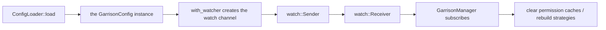

# ⚙️ Garrison Configuration Guide

> Garrison configuration is managed uniformly by `GarrisonConfig`, supporting three-tier config-source merging and `tokio::sync::watch` hot reload.
>
> - Applicable version: 0.9.0 (core config + the extension configs for JWT / signing / SSO / remember-me / Redis deployment modes / multi-tenancy / the account security engine / the microservice architecture / ABAC / the OAuth2 Server etc.; since rc.4 `rate_limit_backend` actually drives the rate-limit backend switch)
> - The config type: `GarrisonConfig`, implementing `serde::Serialize / Deserialize`
> For architecture see the [🏗️ Architecture doc](./ARCHITECTURE.md); for deployment configuration see the [🚀 Deployment Guide](./DEPLOYMENT.md).

## 📋 Table of Contents

- [Config Source Priority](#-config-source-priority)
- [The Full Config Table](#-the-full-config-table)
- [Config File Examples](#-config-file-examples)
- [The Hot-Reload Mechanism](#-the-hot-reload-mechanism)
- [Config Validation Rules](#-config-validation-rules)

---

## 🎯 Config Source Priority

<div align="center">



</div>

Garrison merges configuration in this priority order (**higher overrides lower**):

```text
environment variables (GARRISON_*)  >  toml file (garrison.toml)  >  code defaults (GarrisonConfig::default_config())
```

| Priority | Source | Description |
|--------|------|------|
| High | Environment variables | The `GARRISON_` prefix + the field name upper-snake-cased, e.g. `GARRISON_TIMEOUT`, `GARRISON_JWT_SECRET` |
| Medium | The toml file | Loaded via `GarrisonConfig::load(Some(path))` (based on confers 0.6; file loading switched to confers `FileSource` — confers 0.6.0-rc.4+ allows Windows drive-letter prefixes, and the hand-written `TomlContentSource` workaround was deleted) |
| Low | Code defaults | The defaults inlined in `GarrisonConfig::default_config()` |

> The three-source merge completes in `GarrisonConfig::load()`: load the toml first (using code defaults when `None`), then override with environment variables, and finally `validate()`.

---

## 📋 The Full Config Table

### 2.1 Core configuration (0.1.0)

| Field | Type | Default | Env var | Description |
|--------|------|--------|----------|------|
| `timeout` | `i64` | `2592000` | `GARRISON_TIMEOUT` | Session timeout seconds (default 30 days, must be > 0) |
| `active_timeout` | `i64` | `-1` | `GARRISON_ACTIVE_TIMEOUT` | Active timeout seconds; `-1` disables it (follows the overall session timeout) |
| `is_share` | `bool` | `false` | `GARRISON_IS_SHARE` | Whether an account's devices share the session |
| `is_concurrent` | `bool` | `true` | `GARRISON_IS_CONCURRENT` | Whether concurrent logins are allowed |
| `token_name` | `String` | `"garrison_token"` | `GARRISON_TOKEN_NAME` | The token field name in cookies / headers |
| `token_style` | `String` | `"uuid"` | `GARRISON_TOKEN_STYLE` | The token style: `uuid` / `random_64` / `simple` / `jwt` |
| `is_read_cookie` | `bool` | `true` | `GARRISON_IS_READ_COOKIE` | Whether to read the token from the cookie |
| `is_read_header` | `bool` | `true` | `GARRISON_IS_READ_HEADER` | Whether to read the token from the header |
| `is_write_header` | `bool` | `true` | `GARRISON_IS_WRITE_HEADER` | Whether to write the header after login |
| `throw_on_not_login` | `bool` | `true` | `GARRISON_THROW_ON_NOT_LOGIN` | Whether to throw when not logged in (returns `false` when `false`) |
| `cookie_secure` | `bool` | `true` (`false` for the `development` profile) | `GARRISON_COOKIE_SECURE` | Whether cookies are marked `Secure` (HTTPS-only transport); the default follows the profile: `false` when the `development` aggregate feature is enabled (local HTTP debugging), `true` otherwise (since rc.4 both profiles are explicitly overridable) |
| `cookie_same_site` | `String` | `"Lax"` | `GARRISON_COOKIE_SAME_SITE` | The cookie `SameSite` policy (`Lax` / `Strict` / `None`; `None` only takes effect when `cookie_secure=true` — in non-Secure contexts the construction point downgrades to `Lax`) |
| `is_read_body` | `bool` | `false` | `GARRISON_IS_READ_BODY` | Whether to read the token from the request body |
| `is_write_cookie` | `bool` | `false` | `GARRISON_IS_WRITE_COOKIE` | Whether to write the renewed token into the cookie |
| `frontend_separation` | `bool` | `false` | `GARRISON_FRONTEND_SEPARATION` | Whether front/back-end separation mode is enabled |
| `session_hover_timeout` | `i64` | `-1` | `GARRISON_SESSION_HOVER_TIMEOUT` | Session hover timeout seconds (-1 disables) |
| `auto_renewal_threshold` | `i64` | `-1` | `GARRISON_AUTO_RENEWAL_THRESHOLD` | The auto-renewal threshold percentage (-1 disables, 0-100) |
| `token_map_cleanup_interval_secs` | `i64` | `300` | `GARRISON_TOKEN_MAP_CLEANUP_INTERVAL_SECS` | The token-map cleanup interval seconds |
| `max_login_count` | `u32` | `0` | `GARRISON_MAX_LOGIN_COUNT` | The maximum login count (0 = unlimited) |
| `device_binding_mode` | `String` | `"disabled"` | `GARRISON_DEVICE_BINDING_MODE` | The device-binding mode (`strict` / `loose` / `disabled`) |
| `replaced_login_exit_mode` | `String` | `"old_device"` | `GARRISON_REPLACED_LOGIN_EXIT_MODE` | The displacement kick policy |
| `overflow_logout_mode` | `String` | `"logout"` | `GARRISON_OVERFLOW_LOGOUT_MODE` | The overflow policy |
| `audit_mask_mode` | `String` | `"partial"` | `GARRISON_AUDIT_MASK_MODE` | The audit-log masking mode |
| `seed_primary_amr` | `bool` | `true` | `GARRISON_SEED_PRIMARY_AMR` | Whether login seeds the primary authentication factor into the session (`amr=["pwd"]` / AAL 1 / `auth_time`). The default `true` preserves the existing "login is primary auth" contract; **security-sensitive deployments are advised to set `false` explicitly** — credential-delegated / zero-credential login paths never verify a password, and seeding `pwd` would assert a never-happened authentication into the amr_ledger and the JWT claims, misleading downstream step-up decisions (`assert_freshness` / `ledger_max_aal`). When off, the session's `amr_ledger` is empty, `auth_time` is `None`, and JWTs carry no `amr`/`auth_time` claims (MFA step-up additions are unaffected) |
| `login_id_max_len` | `u32` | `255` | `GARRISON_LOGIN_ID_MAX_LEN` | The byte-length cap on login_id at the stp login choke points (`login` / `login_with_token` / `login_by_token`); over-limit refuses to issue a session; `0` = no framework-level cap. The HTTP request layer's `LoginRequest` deserialization always caps at 255 (the wire layer does not read runtime config), so this config can only tighten further |
| `require_tenant_bound_jwt` | `bool` | `false` | `GARRISON_REQUIRE_TENANT_BOUND_JWT` | Strict choke: stateless JWTs (`token_style="jwt"` + `jwt_mode=Stateless`) within a tenant context must carry the issuing-tenant binding claim `tid`. Default `false` — existing tokens without `tid` (issued without a tenant context / historically issued) pass (backward compatible; the binding semantics converge as tokens rotate naturally); `true` makes `check_login_stateless` explicitly reject tokens without `tid` (`stp-check-login-tenant-unbound`), closing the window where legacy unbound tokens escape tenant constraints (the revocation-escape surface of the jti blocklist's cross-request-tenant namespace miss). Deployments without a tenant context are unaffected; before enabling, confirm legacy tokens have rotated (or that their explicit invalidation is acceptable). Coverage: see the "tenant-binding strict-switch coverage matrix" below — this item covers Stateless only; session mode is covered by `require_session_tenant_binding` |
| `require_session_tenant_binding` | `bool` | `false` | `GARRISON_REQUIRE_SESSION_TENANT_BINDING` | Strict choke: session mode (`jwt_mode=Simple` / `Mixin`) within a tenant context must hold the session-tenant binding (the attr `__garrison_tenant_id`). Default `false` — legacy sessions without a binding (produced by logins before this field and the binding mechanism existed, including `remember_me` 90-day long sessions) pass (backward compatible; bindings are written only at login time, so legacy sessions can only converge by natural TTL expiry); `true` makes `check_login` explicitly error on unbound sessions (`stp-check-login-session-tenant-unbound`), closing the window where old sessions escape tenant constraints. Deployments without a tenant context are unaffected; before enabling, confirm legacy unbound sessions have rotated (or that their explicit invalidation is acceptable). Coverage: see the matrix below — this item does not cover Stateless (covered by `require_tenant_bound_jwt`) |

#### The tenant-binding strict-switch coverage matrix

The two switches each cover half; **enabling one does not tighten everything**:

| `jwt_mode` | Token binding check | Session binding check |
|---|---|---|
| `Stateless` | `require_tenant_bound_jwt` (reads the `tid` claim) | Not applicable (no session storage) |
| `Mixin` | Does not check `tid` (signature verification only) | `require_session_tenant_binding` |
| `Simple` | Not applicable | `require_session_tenant_binding` |

Bindings are written only at login time (`create_token_session_inner` writes the attr when the `TENANT` context exists); the framework **does no lazy re-binding** — `X-Tenant-Id` is a client-controlled input, and re-binding would trade the "exempt surface" for a "pinnable DoS".

### 2.2 Extension configuration (added 0.2.0)

| Field | Type | Default | Env var | Description |
|--------|------|--------|----------|------|
| `jwt_algorithm` | `String` | `"HS256"` | `GARRISON_JWT_ALGORITHM` | The JWT signing algorithm; an allowlist of 6 values: `HS256` / `HS384` / `HS512` / `RS256` / `ES256` / `EdDSA` (asymmetric algorithms need the matching private-key PEM field) |
| `jwt_secret` | `String` | `""` | `GARRISON_JWT_SECRET` | The JWT signing key (required when `protocol-jwt` is enabled) |
| `sign_window_seconds` | `i64` | `300` | `GARRISON_SIGN_WINDOW_SECONDS` | The API-signing time window (seconds), anti-replay |
| `sso_ticket_ttl_seconds` | `u64` | `60` | `GARRISON_SSO_TICKET_TTL_SECONDS` | The SSO ticket validity (seconds) |

### 2.3 remember-me configuration (added 0.6.0)

| Field | Type | Default | Env var | Description |
|--------|------|--------|----------|------|
| `remember_me_enabled` | `bool` | `false` | `GARRISON_REMEMBER_ME_ENABLED` | Whether the remember-me extended session timeout is enabled |
| `remember_me_timeout` | `i64` | `7776000` (90 days) | `GARRISON_REMEMBER_ME_TIMEOUT` | The remember-me session timeout seconds (must be > `timeout`) |

### 2.4 Multi-tenant isolation configuration (added 0.5.0)

| Field | Type | Default | Env var | Description |
|--------|------|--------|----------|------|
| `tenant_isolation.enabled` | `bool` | `false` | `GARRISON_TENANT_ISOLATION__ENABLED` | Whether multi-tenant isolation is enabled |
| `tenant_isolation.resolver` | `String` | `"header"` | `GARRISON_TENANT_ISOLATION__RESOLVER` | The tenant resolver type (`header` / `subdomain` / `claim`) |

> After enabling, the `tenant-isolation` Cargo feature + `tenant_resolution_middleware` are also required for effect.

### 2.5 Password-hashing configuration (password_hasher)

The construction parameters driving `Argon2Hasher` / `BcryptHasher` (the `config.password_hasher.build_hasher()` factory, injected afterwards via `with_password_hasher`). The defaults equal the OWASP-recommended tier; the selection rationale is in ADR-0001.

| Field | Type | Default | Description |
|--------|------|--------|------|
| `password_hasher.algorithm` | `String` | `"argon2id"` | The new-hash algorithm (`"argon2id"` / `"bcrypt"`); the verify path auto-detects from the hash prefix and is unaffected by this field |
| `password_hasher.argon2_m_cost` | `u32` | `19456` | The Argon2id memory cost (KiB), floor 19456 |
| `password_hasher.argon2_t_cost` | `u32` | `2` | The Argon2id time cost (iterations), floor 1 |
| `password_hasher.argon2_p_cost` | `u32` | `1` | The Argon2id parallelism, floor 1 |
| `password_hasher.argon2_pool_size` | `u32` | `1` | The Argon2 concurrency token-pool size, allowed range `[1, 256]`; the cap on simultaneously executing Argon2 hash/verify, with the process memory-residency upper bound ≈ `argon2_pool_size × argon2_m_cost` KiB (no oversell under any cancellation ordering); waiting callers queue asynchronously, never rejected. Default 1 (secure-by-default); bcrypt is not pooled (a single execution's workspace is KB-scale, so pooling gains no memory protection — CPU DoS is handled by rate limiting and cost validation) |
| `password_hasher.bcrypt_cost` | `u32` | `12` | The bcrypt cost, allowed range `[10, 15]` |
| `password_hasher.allow_weak_argon2_params` | `bool` | `false` | Explicit risk acceptance: allows `argon2_m_cost` below 19456 (the escape hatch for memory-constrained deployments), emitting a warn log when granted |

**Validation rules (`validate_core`, fail-closed)**: `algorithm` outside the allowlist is rejected; Argon2id `m_cost < 19456` without explicit risk acceptance is rejected, a zero `t_cost`/`p_cost` is rejected, `argon2_pool_size` outside `[1, 256]` is rejected (0 = zero permits, permanent starvation, fail-fast; 256 × 19 MiB ≈ 4.8 GiB is the misconfiguration upper bound); a bcrypt cost outside `[10, 15]` is rejected.

**Pool-size tuning**: the environment variable `GARRISON_PASSWORD_HASHER__ARGON2_POOL_SIZE`. Capacity model: one Argon2id execution resides at ≈ `argon2_m_cost` KiB (default 19 MiB); with `argon2_pool_size = N` the process's Argon2 memory upper bound ≈ `N × 19 MiB`; **the verify path's per-permit residency upper bound counts from the stored hash's embedded `m_cost` (PHC self-describing)**, so mixed legacy deployments (old and new parameters coexisting) evaluate by `max(configured m_cost, stored m_cost)`, not by the configured `m_cost` alone; size by `acceptable memory budget ÷ m_cost` while keeping `pool_size ≤ the login QPS rate-limit threshold` (rate limiting governs the QPS dimension, the pool the memory-residency dimension — two-layer protection).

> Only affects **new hashes**; legacy hash parameters are parsed from the self-describing PHC string (verifiable without migration), and parameter upgrades follow the natural evolution of "re-hash on new password / re-login".

### 2.6 JWKS key-rotation configuration

Drives the multi-kid JWKS keystore (`oauth2_server::jwks::JwksKeystore`, effective once injected into `OAuth2State::jwks_keystore`; the single-static-key form `jwks_source` is unaffected by this section). Key states are three: `Active` (signing) / `Passive` (rotated out but kept for verification, still published in the JWKS) / `Disabled` (retired, removed from publishing and verification).

| Field | Type | Default | Description |
|--------|------|--------|------|
| `jwks_retention_secs` | `u64` | `7200` | How long a Passive key is retained (seconds): after rotation the old key becomes Passive, and past this duration becomes `Disabled` and leaves the JWKS publication face (legacy-token verification fails from then on; re-authentication required). Default 7200 = 2 × the access token TTL (1h), guaranteeing access tokens issued before the rotation remain verifiable for their entire validity. It also decides the JWKS endpoint's `Cache-Control: max-age` (half the retention — an engineering compromise, not a precise security bound) |

**Validation rules (`validate`, fail-closed)**: `0` is rejected (equivalent to retiring old keys the instant of rotation, interrupting legacy-token verification immediately).

**Tuning**: retention must be ≥ the access token validity (otherwise old keys retire before their issued tokens expire, creating verification-failure windows); for relaxed verification needs (extra-long TTL tokens), size by `2 × the maximum access TTL`.

### 2.7 Password-hash import constraints (R11)

The password-hash validation gate `validate_imported_hash` on bulk-import / credential-write paths (allowlist + parameter ceilings; violations rejected whole-value with explicit errors). Prevents per-login OOM / CPU DoS (aligned with zitadel passwap's `ValidateEncodedHash` defensive intent).

| Constraint | Allowed values | Description |
|------|--------|------|
| The format allowlist | `$argon2id$` / `$2b$` / `$2a$` / `$2y$` prefixes | Prefixes outside the allowlist are rejected (`$argon2i$` etc. no longer importable) |
| `ARGON2_IMPORT_MAX_M_COST` | ≤ 1 GiB (`1_048_576` KiB) | The Argon2 memory-cost ceiling |
| `ARGON2_IMPORT_MAX_T` | ≤ 10 | The Argon2 iteration ceiling |
| `ARGON2_IMPORT_MAX_P` | ≤ 4 | The Argon2 parallelism ceiling |
| bcrypt cost | ≤ 15 | The per-login verify cost ceiling |

**Lazy login-time upgrades**: legacy low-tier hashes automatically re-hash to the currently configured tier after a successful login verify (through the Argon2 concurrency token pool; failure does not block login) — the import constraint guards only the entrance; legacy evolution converges naturally through lazy upgrades.

### 2.8 Deprecated config keys (R12)

The registry in `src/config/deprecation.rs` (load-time handling: mappable keys auto-migrate + warn; unmappable keys warn through in 0.x and **error unconditionally from 1.0**):

| Deprecated key | since | Migration target | Disposition |
|--------|-------|---------|------|
| `waf_config` | 0.9.0 | (none — capability removed) | 0.x warn guidance; from 1.0 a load error |

New deprecated keys are registered per key with each Breaking change (one mapping/error test per key); fictitious keys are never registered.

### 2.9 At-rest field encryption (field-encryption, R17)

With the `field-encryption` feature enabled, the selected sensitive columns (`oauth2:atoken:` / `oauth2:rtoken:` / `oauth2:codeused:` / `totp:seed:`) are encrypted automatically at rest as `enc:v1:<key_id>:<base64(nonce|ciphertext)>` (AES-256-GCM, AAD bound to `garrison:{tenant}:{table}:{key}`). Keys reuse the existing config-encryption facilities (multi key_id supported); **enabling the feature without a key → fail-closed Err at startup**. The read path is compatible with legacy plaintext rows (dual-read migration semantics); the write path encrypts fully. Key rotation uses the `change_key` / `check_key` ops interfaces (the garrison-cli wiring is in R16).

### 2.10 WebAuthn/Passkey configuration (protocol-webauthn, R07)

`protocol::webauthn::WebauthnConfig` (immutable after construction; injected via `WebauthnService::new`). The RP configuration is not a standalone config item — it derives from the issuer: `rp_id` = the issuer URL host, `origins` = [issuer] (rp_id follows issuer changes).

| Field | Type | Default | Description |
|------|------|--------|------|
| `issuer` | `String` | none (required) | The RP derivation source (e.g. `https://sso.example.com`); invalid URLs are rejected explicitly |
| `challenge_ttl_secs` | `u64` | `120` | The ceremony challenge staging TTL (seconds); consuming after expiry is rejected explicitly (the same error surface as replay) |
| `passwordless.enabled` | `bool` | `false` | Admission for the passwordless purpose; when off, registration/authentication for that purpose is rejected explicitly |
| `second_factor.enabled` | `bool` | `false` | Admission for the 2FA second-factor purpose (full MFA orchestration belongs to R09); the 2FA wiring point registers via `stp::mfa::webauthn_factor::register_webauthn_factor` |

**Cargo feature**: `protocol-webauthn` (depends on webauthn-rs 0.5; its rustc ≥ 1.88 requirement is below this repo's MSRV 1.97.1; toolchain scope in [DEVELOPMENT.md](DEVELOPMENT.md)).

### 2.11 MFA/step-up orchestration configuration (mfa, R09)

`GarrisonConfig.mfa` (the `MfaConfig`). The chain-factor vocabulary: `otp` / `webauthn` (`pwd` is the primary factor and never enters a chain); referencing an unknown factor is fail-closed at startup.

```toml
[mfa]
global_chain = ["otp"]              # the global default chain (empty = MFA not enforced)
recovery_misuse_tolerance = 0       # the recovery-code misuse exemption (default 0, lockout beyond it)

[mfa.per_client_chains]
"legacy-client" = []                # empty array = explicitly disabled (even with a global default chain)
"admin-console" = ["webauthn"]      # non-empty = this set is enforced
```

| Field | Type | Default | Description |
|------|------|--------|------|
| `mfa.global_chain` | `Vec<String>` | `[]` | The global default enforced chain; empty = not enforced |
| `mfa.per_client_chains` | `HashMap<String, Vec<String>>` | `{}` | Per-client overrides (the three-state semantics above) |
| `mfa.recovery_misuse_tolerance` | `u32` | `0` | The exemption count of consecutive invalid recovery-code verifies; beyond it, lockout (fail-closed, correct codes also rejected) |

### 2.12 Password-reset configuration (account-password-reset, R14)

The `account::password_reset` module (the `account-password-reset` feature, depending on protocol-jwt + account-credential + account-policy + email-verification). Behavior constants and security invariants:

| Item | Default | Description |
|----|--------|------|
| Anti-enumeration rate-limit window | 3600 seconds | The per-identifier request-counting window (the same scope as email-verification's hourly window); unknown identifiers take the same path with dummy issuance — response shapes indistinguishable |
| ActionToken TTL | Short-lived (a constructor parameter) | A self-contained JWT with `purpose=password_reset`; jti one-shot consumption (DAO set_if_absent + atomic consumption; exactly one concurrent attempt succeeds) |
| Password-history comparison | Aligned with HistoryRule's hard cap (24 entries) | A successful reset appends `app_password_history`; reusing a historical password is rejected and the token is not consumed |
| Restricted session | The `pwdreset_restricted` marker | The recovery session can only reach the password-change endpoint (everything else 403) |

**Ops note**: the `app_password_history` table is created with the `016_password_history.sql` migration; appends on the registration/regular-change paths are the host's responsibility to wire (so that "the previous password" is queryable in history).

### 2.13 JWT revocation and the rate-limit backend configuration (added 0.9.x)

| Field | Type | Default | Env var | Description |
|--------|------|--------|----------|------|
| `enable_jwt_revocation` | `bool` | `false` | `GARRISON_ENABLE_JWT_REVOCATION` | Enables the JWT revocation blocklist: `logout` / `kickout` write the `jti` into the DAO (TTL = remaining validity), and `check_login_stateless` pre-checks after signature verification, returning `TokenRevoked` for revoked tokens; effective only with `protocol-jwt` + `token_style="jwt"` |
| `allow_stateless_jwt_no_revocation` | `bool` | `false` | `GARRISON_ALLOW_STATELESS_JWT_NO_REVOCATION` | Explicit risk acceptance: allows the combination of `token_style="jwt"` + `JwtMode::Stateless` + revocation not enabled (an irrevocable permanent JWT credential; `jwt_mode` is a code-injected `JwtMode` enum, not a config field); normal deployments should use `enable_jwt_revocation=true` or `JwtMode::Mixin` |
| `rate_limit_backend` | `String` | `"memory"` | `GARRISON_RATE_LIMIT_BACKEND` | The rate-limit backend choice (`memory` / `redis`). **Effective surfaces**: the login firewall hook (the `fw:ip:*` / `fw:acct:*` counters) and `RateLimitStrategy` (including `from_garrison_config` / `with_runtime`); `memory` follows the main DAO (in-process oxcache), `redis` uses an independent Redis rate-limit runtime (oxcache `RedisBackend` + limiteron `RedisDistributedLimiter`), while session / token / geo / device data still go through the main DAO. `redis` requires the `rate-limit-redis` feature and `GARRISON_REDIS_URL`; a failed connection at startup refuses to start (fail-closed), and runtime errors propagate upward. Non-TLS `redis://` is subject to oxcache policy: use `rediss://` in production; dev/test may set `OXCACHE_ALLOW_INSECURE_REDIS=I_UNDERSTAND_THE_RISKS`. **Not covered**: `BruteForceStrategy`'s ban ledger, `DDoSStrategy`, OAuth2 `/token` rate limiting, invitation-code brute-force protection, SMS/email quotas, API Key lockout, account lockout, and the auth_server edge `rate_limit_middleware` (in-process token bucket) still operate independently on their own backends |

---

### 2.14 Refresh-token reuse detection and the grace window (oauth2-server, R06)

Drives `RefreshTokenRotation`'s (via `TokenHandler::with_refresh_rotation`) reuse detection and concurrent-double-refresh tolerance. The reuse three-tier classification: `RecentPrev` (hits the surviving chain head's parent, 1 hop back) / `OrphanedBranch` (>1 hop back) / `StaleLineage` (no surviving lineage, always revoking the whole chain as theft, unaffected by this config group). All three load from `garrison.toml`.

| Field | Type | Default | Description |
|--------|------|--------|------|
| `recent_reuse_behaviour` | `RecentReuseBehaviour` | `TheftDetected` (the toml value `theft_detected`) | The disposal dispatch for `RecentPrev` / `OrphanedBranch`: `TheftDetected` (default; revokes the whole chain + `TokenRevoked`) / `Unauthorised` (only rejects this request with 401, no revocation); invalid values fail-fast at startup |
| `refresh_grace_period_secs` | `i64` | `0` | The concurrent-double-refresh grace window seconds (`0` = off). Within the window, an already-rotated old token presented again returns the existing new token from the rotation (no re-rotation); redeemed credentials stage in-process without persistence, so in multi-instance setups only the issuing instance hits it and others fall back to the regular reuse disposal. Negative values are rejected by validation |
| `refresh_grace_max_uses` | `u32` | `1` | The maximum redemptions of the same old token within the grace window; replays inside the window after the budget is exhausted are disposed per `recent_reuse_behaviour`. Effective only when `refresh_grace_period_secs > 0`; `0` is rejected by validation (the window would be moot) |

---

## 📝 Config File Examples

### 3.1 `garrison.toml`

Create `garrison.toml` in the project root:

```toml
# The Garrison configuration file
# see docs/en/CONFIGURATION.md for details

# Session policy
timeout = 2592000            # session timeout 30 days
active_timeout = -1          # -1 follows timeout
is_share = true              # an account's devices share the session
is_concurrent = true         # concurrent logins allowed

# Token policy
token_name = "garrison_token"
token_style = "uuid"         # options: uuid / random_64 / simple / jwt
is_read_cookie = true
is_read_header = true
is_write_header = true

# Anomalous behavior
throw_on_not_login = true

# Cookie policy
cookie_secure = true
cookie_same_site = "Lax"

# 0.2.0 extensions (omittable when protocol-* is not enabled)
# jwt_algorithm = "HS256"
# sign_window_seconds = 300
# sso_ticket_ttl_seconds = 60

# 0.6.0 remember-me extended session timeout
# remember_me_enabled = false
# remember_me_timeout = 7776000  # 90 days

# 0.5.0 multi-tenant isolation
# [tenant_isolation]
# enabled = false
# resolver = "header"

# Password-hashing parameters (the defaults are already the OWASP-recommended tier; usually no config needed)
# [password_hasher]
# algorithm = "argon2id"       # options: argon2id / bcrypt
# argon2_m_cost = 19456        # KiB, floor 19456 (below it needs allow_weak_argon2_params = true)
# argon2_t_cost = 2
# argon2_p_cost = 1
# argon2_pool_size = 1         # the concurrency token pool, range [1, 256]; memory bound ≈ pool_size × m_cost
# bcrypt_cost = 12             # effective only when algorithm = "bcrypt", range [10, 15]
```

### 3.2 The full environment-variable list

Inject via `.env` or container environment (in production, prefer container/orchestrator environment injection):

```env
# Session policy
GARRISON_TIMEOUT=2592000
GARRISON_ACTIVE_TIMEOUT=-1
GARRISON_IS_SHARE=true
GARRISON_IS_CONCURRENT=true

# Token policy
GARRISON_TOKEN_NAME=garrison_token
GARRISON_TOKEN_STYLE=uuid
GARRISON_IS_READ_COOKIE=true
GARRISON_IS_READ_HEADER=true
GARRISON_IS_WRITE_HEADER=true
GARRISON_IS_READ_BODY=false
GARRISON_IS_WRITE_COOKIE=false
GARRISON_THROW_ON_NOT_LOGIN=true

# Front/back separation
GARRISON_FRONTEND_SEPARATION=false

# Cookie policy
GARRISON_COOKIE_SECURE=true
GARRISON_COOKIE_SAME_SITE=Lax

# 0.2.0 extensions
GARRISON_JWT_SECRET=change-me-in-production
GARRISON_JWT_ALGORITHM=HS256
GARRISON_SIGN_WINDOW_SECONDS=300
GARRISON_SSO_TICKET_TTL_SECONDS=60

# 0.6.0 remember-me
GARRISON_REMEMBER_ME_ENABLED=false
GARRISON_REMEMBER_ME_TIMEOUT=7776000

# 0.9.x JWT revocation and the rate-limit backend
GARRISON_ENABLE_JWT_REVOCATION=false
GARRISON_ALLOW_STATELESS_JWT_NO_REVOCATION=false
GARRISON_RATE_LIMIT_BACKEND=memory

# Session management
GARRISON_SESSION_HOVER_TIMEOUT=-1
GARRISON_AUTO_RENEWAL_THRESHOLD=-1
GARRISON_TOKEN_MAP_CLEANUP_INTERVAL_SECS=300
GARRISON_MAX_LOGIN_COUNT=0
GARRISON_DEVICE_BINDING_MODE=disabled

# Multi-tenant isolation
GARRISON_TENANT_ISOLATION__ENABLED=false
GARRISON_TENANT_ISOLATION__RESOLVER=header

# Password hashing (optional)
GARRISON_PASSWORD_HASHER__ARGON2_POOL_SIZE=1

# Database and cache
# note: the database URL does not go through environment variables — the framework does not read
# GARRISON_DB_URL; the host passes it programmatically to garrison::dao::init_dbnexus(&db_url)
# (the CLI's counterpart is --db-url).
GARRISON_REDIS_URL=redis://127.0.0.1:6379/0

# Logging
RUST_LOG=garrison=info
```

> Loading-order note: the `.env` file is loaded by the application's own choice of a crate like `dotenvy`; Garrison reads only process environment variables. When `garrison.toml` and environment variables coexist, the environment variables win.

---

## 🔄 The Hot-Reload Mechanism

Garrison broadcasts configuration changes via a `tokio::sync::watch` channel; subscribers respond upon notification:

### 4.1 The workflow



### 4.2 A usage example

```rust
use garrison::config::GarrisonConfig;

// create a config instance with a watcher
let config = GarrisonConfig::default_config();

// subscribe to config changes
let mut rx = config.watch().expect("default_config should have a watcher");

// closure-style config modification with broadcast (auto-validated)
config.update(|c| {
    c.timeout = 3600;
}).unwrap();

// subscribers receive the new config
let new_config = rx.borrow_and_update();
assert_eq!(new_config.timeout, 3600);
```

### 4.3 Hot-reload semantics

| Behavior | Affects existing sessions? |
|------|---------------------|
| Changing `timeout` / `active_timeout` | No; only sessions created afterwards |
| Changing `token_style` | No; already-issued tokens are unaffected |
| Changing `is_share` / `is_concurrent` | No; only subsequent logins |
| Changing `jwt_algorithm` | No; already-issued JWTs verify under the old key until it is retired |

> Configurations modified in the `update()` closure are automatically validated by `validate()`; invalid values are rejected and not broadcast (a no-op).

---

## ✅ Config Validation Rules

`GarrisonConfig::validate()` performs field validation; invalid values throw `GarrisonError::Config`:

| Field | Validation rule | Error i18n key (`GarrisonError::Config`) |
|------|----------|--------------|
| `timeout` | Must be > 0 | `config-timeout-must-positive::` |
| `token_style` | Must be in `["uuid", "random_64", "simple", "jwt"]` | `config-unknown-token-style::{value}` |
| `token_style=jwt` | `jwt_secret` must not be empty | `config-jwt-secret-empty::` |
| `token_style=simple` | `jwt_secret` must be ≥ 32 bytes (the simple-style key is the HMAC-SHA256 signing key and can be brute-forced offline; the former warn is now a startup error) | `config-jwt-secret-too-short::simple (min 32 bytes)::{length}` |
| `token_style=jwt` (HS family) / `simple` | `jwt_secret` must not hit the weak-key blocklist (16 common weak keys; whole-string comparison after trimming padding characters, case-insensitive, no substring matching, so high-entropy keys are not falsely hit) | `config-jwt-secret-weak::blacklist hit` |
| `GARRISON_CSRF_ENABLED` (env var, `web-csrf`) | Only `true` / `false` accepted (case-insensitive); any other value fails at config load (the env-override stage) — the former truthy habits like `"1"`/`"yes"` would silently disable CSRF protection | `config-csrf-enabled-unsupported::{value}` |
| `cookie_same_site` | Must be in `["Lax", "Strict", "None"]` | `config-unknown-cookie-same-site::{value}` |
| `is_share=true` | Requires `is_concurrent=true` | `config-is-share-requires-concurrent::` |
| `remember_me_timeout` | With `remember_me_enabled=true` it must be > `timeout`; with `remember_me_enabled=false` it must be > 0 | `config-remember-me-timeout-mismatch::{value}::{timeout}` / `config-remember-me-timeout-positive::{value}` |
| `auto_renewal_threshold` | Must be `-1` or `0..=100` | `config-auto-renewal-threshold-invalid::{value}` |
| `device_binding_mode` | Must be in `["strict", "loose", "disabled"]` | `config-unknown-device-binding-mode::{value}` |

> Environment-variable overrides also trigger `validate()`; invalid values (e.g. `GARRISON_TIMEOUT=not-a-number`) are rejected and return `GarrisonError::Config`.

### Cookie write semantics (the single Set-Cookie construction point)

All Set-Cookie write paths (the three framework adapters, the renewal middleware, the CSRF middleware) produce uniformly through the `context::cookie` construction point, with the attribute order unified as `name=value; HttpOnly; [Secure; ]SameSite=<ss>; Path=<p>[; Domain=<d>][; Max-Age=<n>]`:

- **Allowlist fail-fast**: an illegal `cookie_same_site` is likewise rejected at the construction point (legal values correspond one-to-one with the startup validation allowlist `COOKIE_SAME_SITE_VALUES`, locked by cross-reference tests); after rejection no Set-Cookie is produced.
- **The None→Lax downgrade**: `cookie_same_site = "None"` takes effect only when `cookie_secure = true`; when `cookie_secure = false` (HTTP debugging) it automatically downgrades to `Lax` with a single warn — browsers reject `SameSite=None` without Secure.
- **The production prefixes**: with the `production` feature and `cookie_secure = true`, cookie names are forced-prefixed — cookies with `Path=/` and no Domain (the session token, the CSRF cookie) become `__Host-<name>`, and limited-path or Domain-carrying ones become `__Secure-<name>`; with `cookie_secure = false` (the http downgrade) no prefix is added. The framework's read and write sides parse in sync (the read side's uniform entry is `token_cookie_name`). **Note**: after upgrading to a version with these prefixes, online users' old cookies become invalid and they must log in once more; business code that reads cookies itself must switch to the same-name parsing.

### 5.1 Redis deployment-mode configuration (added 0.6.0)

The `RedisDeploymentMode` enum covers the common production Redis topologies, configured through the `RedisConfig` aggregate struct (note: `RedisConfig` is not a field of `GarrisonConfig` — it can only be passed programmatically to the cache builder's `with_redis_config`; the `GARRISON_REDIS_URL` environment variable applies only to the rate-limit backend `rate-limit-redis` and is not injected into the cache-side `RedisConfig`):

| Mode | Fields | Description |
|------|------|------|
| `Single` | `url: String` | Single-node mode (default `redis://127.0.0.1:6379`) |
| `Sentinel` | `primary_name: String`, `urls: Vec<String>` | Sentinel mode: automatic failover via the Sentinel cluster (the legacy key `master_name` still works, `#[serde(alias)]` compatible) |
| `Cluster` | `urls: Vec<String>` | Cluster mode: Redis Cluster sharded storage (at least 3 primary nodes) |
| `PrimaryReplica` | `primary_url: String`, `replica_urls: Vec<String>` | Primary-replica mode: 1 primary + N replicas; read separation requires client support (the legacy variant name `MasterSlave` still works, `#[serde(alias)]` compatible) |

The full `RedisConfig` fields: `mode` (the deployment mode) / `password` (the auth password) / `db` (the database number 0-15) / `connection_timeout_secs` (default 5) / `pool_size` (default 10).

> ⚠️ **An honest statement of the wiring state**: in the current version the cache-side Redis L2 is not actually wired — `with_redis_config` only stores the configuration and warns once (the M4 note in `src/dao/oxcache_impl.rs`); the cache remains in-process memory, and multi-instance session sharing is currently unavailable. The topologies above are interface reservations, effective in a later version; the current real Redis consumer is the rate-limit backend (`rate-limit-redis`).

---

## 6. Per-feature configuration notes

Garrison trims at compile time via feature flags; the required config items differ per feature:

| Feature | Default | Related config items |
|---------|------|------------|
| `cache-memory` | off | None (uses the oxcache in-memory cache) |
| `cache-redis` | off | The cache-side Redis topology is passed programmatically via `RedisConfig` + `with_redis_config` (L2 currently only stores configuration, not wired — see the §5.1 note); `GARRISON_REDIS_URL` belongs to the rate-limit backend (`rate-limit-redis`) |
| `db-sqlite` | off | The SQLite path is passed programmatically by the host to `garrison::dao::init_dbnexus(&db_url)` (no `GARRISON_DB_URL` env var) |
| `web-axum` | off | Enables the axum extractors / router |
| `protocol-jwt` | off | `jwt_algorithm` (`GARRISON_JWT_SECRET` required) |
| `protocol-oauth2` | off | Needs the accompanying oauth2 client configuration |
| `protocol-sso` | off | `sso_ticket_ttl_seconds` |
| `protocol-sign` | off | `sign_window_seconds` |
| `protocol-apikey` | off | Managed by the ApiKey dao; auto-enables `dao-key-index` (making `list_by_namespace` production-usable); secrets stored as sha256 hashes; in production pair with `cache-redis` (AOF), optionally `firewall-bruteforce` for IP-level failure rate limiting |
| `protocol-temp` | off | The temporary-token TTL is specified by the caller |
| `secure-totp` | off | TOTP secrets stored in the user-binding relation |
| `secure-sign` | off | Reuses `sign_window_seconds` |
| `protocol-httpbasic` | off | Credentials provided by the caller |
| `protocol-httpdigest` | off | nonce / opaque generated internally |

> **⚠️ The refresh-token rotation degraded behavior (required reading for `db-sqlite` + `oauth2-server` deployments)**
>
> The refresh grant of `/oauth2/token` is always available, but its security strength depends on whether
> `RefreshTokenRotation` is injected (`TokenHandler::with_refresh_rotation`):
>
> - **Injected (recommended)**: hash-chain rotation + reuse detection — a replayed stolen old refresh_token
>   triggers whole-chain revocation, and the attacker's session dies immediately.
> - **Not injected (degraded)**: DAO key-value storage (the `oauth2:rtoken:` prefix), no reuse detection,
>   no chained revocation — an old-token replay is rejected only by its single-shot consumption failure, and **does not trigger chained revocation**; other tokens of the same chain are unaffected.
>
> The degraded form warns explicitly in two places (never silently): one structural
> warn when `OAuth2State::new` finishes constructing; a per-request warn on every degraded-path refresh (`refresh_token rotation not configured`).
> Inject the rotation in production to clear the warnings. Builds without `db-sqlite` do not support rotation injection,
> and the refresh grant is always the degraded path (ignorable if there is no refresh need).

### 6.0.1 The X-Request-ID request-identifier middleware (R04)

> **The header names are fixed, not configuration**: `X-Request-ID` / `Retry-After` are compile-time constants
> (`context::request_id::REQUEST_ID_HEADER` / `RETRY_AFTER_HEADER`), with **no config items** —
> the middleware's behavioral consistency and the validation rules (length ≤128 + visible ASCII)
> should not drift per deployment (see ADR-0004).

Mounting examples for the three frameworks:

```toml
# Cargo.toml
[dependencies]
garrison = { version = "0.9.0", features = ["web-axum"] } # or web-actix / web-warp
```

```rust,ignore
// axum: middleware::from_fn, recommended outermost (the error body's request_id covers all downstream errors)
use axum::{routing::get, Router};

let app = Router::new()
    .route("/api", get(handler))
    .layer(axum::middleware::from_fn(garrison::web::request_id::request_id_middleware));

// actix-web: the Transform wrap
use actix_web::App;

let app = App::new().wrap(garrison::web_actix::RequestIdMiddleware);

// warp: the wrap_fn wrapper (the error body's request_id goes through post-hoc back-fill, see ADR-0004)
let routes = routes.with(warp::wrap_fn(garrison::web_warp::with_request_id));
```

Behavior: a legal inbound `X-Request-ID` (non-empty, ≤128 bytes, visible ASCII) echoes as-is,
otherwise it is discarded and a UUID v4 regenerated; all responses carry the `X-Request-ID` header, and the unified error body carries the
`request_id` field; handlers read it via `Extension<RequestId>` (axum) or the request
extensions (actix); the middleware emits structured logs (both the span and events carry the `request_id`
field). Error responses attach the `Retry-After` header (only for `GarrisonError::RateLimited`,
delta-seconds integers, floor 1).

### 6.1 The JWT + Redis combination example

```toml
[dependencies]
garrison = {
    version = "0.9.0",
    features = [
        "cache-memory",
        "cache-redis",
        "db-sqlite",
        "web-axum",
        "protocol-jwt",
    ],
}
```

With the accompanying `garrison.toml`:

```toml
jwt_algorithm = "HS256"
```

And `.env`:

```env
GARRISON_JWT_SECRET=your-256-bit-secret
GARRISON_REDIS_URL=redis://127.0.0.1:6379/0
```

---

## 6.5 The serve subcommand's environment variables (src/cli/serve.rs, formerly the auth_server bin)

Read from `GARRISON_*` via the confers derive macro (`#[config(env_prefix = "GARRISON_")]`, field names mapped uppercase). Per-item notes for container deployment are in [🚀 Deployment · Runtime environment variables (container)](./DEPLOYMENT.md#runtime-environment-variables-container).

| Environment variable | Default | Description |
|---|---|---|
| `GARRISON_EXTERNAL_PORT` / `GARRISON_INTERNAL_PORT` | 8080 / 8081 | The external / internal listening ports |
| `GARRISON_EXTERNAL_BIND` / `GARRISON_INTERNAL_BIND` | **127.0.0.1** | The external / internal bind addresses (secure-by-default, local-only; containers must set `0.0.0.0` to be port-mappable — the image presets that ENV). Only IPv4/IPv6 literals accepted; invalid values refuse startup (fail-closed). The loopback default is provided by the bin — the library-level `AuthServerConfig::default()` remains `0.0.0.0` |
| `GARRISON_TRUSTED_PROXIES` | empty (trusts no XFF) | The trusted-proxy IP list (comma-separated). Configure only when deployed behind a trusted reverse proxy; XFF parsing (rate-limit keys / client IP) activates only after configuration. Only loopback / RFC 1918 / link-local / IPv6 ULA accepted; invalid or public values refuse startup |
| `GARRISON_RATE_LIMIT` | 100 | The external per-IP rate limit (must be > 0; 0 refuses startup) |
| `GARRISON_INTERNAL_API_KEY` | none (required) | The internal API Key; missing or empty is fail-closed refused at startup; the length floor is enforced uniformly by the library's `MIN_INTERNAL_API_KEY_LEN` (32 bytes) |
| `GARRISON_MAX_LOGIN_COUNT` | **10** | The maximum concurrent sessions per account (the earliest login is kicked beyond it); an explicit `0` = unlimited (overriding the framework `default_config()`'s `0`) |
| `GARRISON_SEED_PRIMARY_AMR` | **true** | Whether login seeds the primary authentication factor into the session (`amr=["pwd"]` / AAL 1 / `auth_time`). Security-sensitive deployments are advised to set `false` explicitly — the reference deployment's login does not verify credentials, and the default seeding asserts a never-happened password authentication, misleading downstream step-up decisions |
| `GARRISON_EXTERNAL_LOGIN_ENABLED` | **false** | **Whether the external login endpoint is enabled**. The framework's login does not verify credentials (a responsibility boundary: credential verification belongs to the business layer; the framework only issues sessions), returning 404 for `POST /api/v1/auth/login` by default (secure-by-default). Set to `true` only after the business injects credential verification; only `true`/`false` accepted (case-insensitive), invalid values refuse startup |
| `GARRISON_EXTERNAL_LOGIN_ACK` | none (conditionally required) | The explicit risk acknowledgement when the external login is on and the external bind is non-loopback: the value must be exactly `i-understand-no-credential-check`; missing or mismatched values refuse startup (fail-closed) |
| `GARRISON_STRICT_SECURITY` | **true** | The strict security tier: the internal API Key length floor (the library's `MIN_INTERNAL_API_KEY_LEN` = 32 bytes) and un-ACKed external login exposure are both rejected at startup by the library's `AuthServerConfig::validate()` (before database creation and migrations). `false` is a one-time escape hatch only for keys not yet rotated, degrading the same conditions to library warnings. Through confers this path accepts only `true`/`false` (case-insensitive); invalid values refuse startup (the library's `AuthServerConfig::default()` reading the same variable behaves differently: invalid values warn and fall back to the default `false`) |
| `GARRISON_FIELD_ENCRYPTION_KEYS` | none (required when the `field-encryption` feature is on) | The at-rest field-encryption key table (comma-separated `key_id:hex64`, hex64 = 32 bytes of AES-256 key material; the first is the master key); enabling the feature without configuration refuses startup (fail-closed). The same variable of garrison-cli serves as the key source for `change-key` / `check-key` |
| `GARRISON_FIELD_ENCRYPTION_TENANT` | `default` | The field-encryption AAD tenant segment |
| `GARRISON_WORKER_THREADS` | CPU cores | The tokio worker-thread count |
| `GARRISON_MAX_BLOCKING_THREADS` | 512 | The tokio blocking-thread cap |

The corresponding library-level configuration: `AuthServerConfig::external_login_enabled` (`with_external_login_enabled(bool)`). The library layer (`AuthServerConfig` / `GarrisonAuthServer`) also reads `GARRISON_HEALTH_DETAILS`, `GARRISON_API_KEY_LOCKOUT_THRESHOLD` / `GARRISON_API_KEY_LOCKOUT_WINDOW_SECS`, and `GARRISON_RATE_LIMIT_BACKEND`, all listed in the deployment-guide table above.

---

## 📚 Related Documents

| Document | Description |
|------|------|
| [🏗️ Architecture](./ARCHITECTURE.md) | Design principles and module layout |
| [🚀 Deployment](./DEPLOYMENT.md) | Production deployment notes |
| [🛠️ Development](./DEVELOPMENT.md) | TDD workflow and code standards |
