# Data Compliance Guide (GDPR / PIPL)

This document describes the **data inventory, retention periods, how to exercise the right to erasure, and data-localization deployment guidance** handled by Garrison as an authentication and authorization framework, for businesses fulfilling their GDPR / PIPL (Personal Information Protection Law) obligations.

> Related: [SECURITY.md](SECURITY.md) (vulnerability disclosure and security configuration) | [THREAT.md](./THREAT.md) (threat model) | [OWASP_TOP10.md](./OWASP_TOP10.md)
>
> **Positioning statement**: Garrison is a framework (SDK), not a data processor — the final application is the party in relation to data subjects. This document describes the framework's disposal capabilities over data in its jurisdiction and the remaining responsibilities of the business.

## 1. Data Inventory (stored within the framework's jurisdiction)

| Data class | Storage location (key space) | Personal information | Retention | Erasure method |
|--------|-------------------|-----------|---------|---------|
| Sessions (Account-Session index) | `account:session:{login_id}` | login_id, device-binding info | `timeout` config (default 30 days) | `logout_by_login_id` / erasure service |
| Sessions (Token details) | `token:session:{sha256(token)}` (the key remainder is a SHA-256 digest; the raw token never lands in the key name; legacy raw-key rows left before the upgrade are converged via `vacuum-kv --sweep-legacy-session-keys`) | login_id (in the record), device | Same as above, cascaded with the index | `logout_by_login_id` cascading deletion |
| OAuth2 access/refresh token | `oauth2:atoken:` / `oauth2:rtoken:` (DAO path) or the `refresh_tokens` table (db-sqlite, SHA-256 hashes only) | client_id / user_id | `ACCESS/REFRESH_TOKEN_TTL` | Revoke endpoint (RFC 7009) / TTL |
| API Key | DAO keys `garrison:apikey:{namespace}:{key_id}`, index `garrison:apikey:idx:{key_id}` (secret stored as SHA-256 hash only) | key_id, owner_id, IP rate-limit counters | `timeout > 0` enforced at generation; stored with that value as TTL | `ApiKeyHandler::revoke` / `rotate` / `list_by_namespace` |
| Account lockout state | `lockout:{login_id}` | login_id, failure-pattern profile | TTL (lockout window) | Erasure service / TTL |
| Brute-force failure counters | `bf:{ip}:count` | **Client IP** (personal data under GDPR Recital 30) | TTL (counting window) | Erasure service `erase_ip_artifacts` |
| Captcha / email verification | `captcha:` and similar prefixes (phone/email as key) | Phone number / email | ≤ 1 hour | Natural TTL expiry |
| Audit logs | Application logs / SIEM (stored by the business) | login_id, IP, masked tokens in events (CWE-532 unified masking) | **Business retention policy** | Disposed by the business (see §3 retention exception) |
| Backup codes / TOTP keys | Business credential storage (the framework provides hash primitives) | Subject-linked credentials | Until unbinding | Business credential management |

## 2. Exercising the Right to Erasure

### 2.1 Framework-side orchestration (the `data-erasure` feature)

<div align="center">



</div>

After enabling the feature, `compliance::DataErasureService` erases all locatable data within the framework's jurisdiction for a subject and produces an archived report:

```rust,ignore
use garrison::compliance::DataErasureService;

let eraser = DataErasureService::new(dao.clone());
// Session erasure delegates to logout_by_login_id (with per-login locking and token-level cascading deletion semantics)
let report = eraser
    .erase_subject("1001", |id| async { stp.logout_by_login_id(id).await })
    .await?;
// report.erased_keys: the list of deleted keys; report.session_erasure_delegated: delegation results;
// report.residual_guidance: residual-disposal hints for the business — all three can directly serve as the archived response to an erasure request.
// The IP dimension (GDPR Recital 30):
let ip_report = eraser.erase_ip_artifacts("203.0.113.7").await?;
```

Design constraint: the concurrency correctness of session deletion lives in `SessionLogic` (delegation, not duplication); a delegation failure does not interrupt the erasure and is exposed explicitly in the report — the erasure path prefers reporting residuals over silently claiming completion.

### 2.2 Business residual responsibilities (mirrored by the report's `residual_guidance`)

The `residual_guidance` entry texts are localized at report generation time according to the current locale (`compliance-erasure-residual-*`, see `locales/{en,zh}.ftl`) — the same erasure flow yields hints in the deployment's language under Chinese/English locales; the field type is `Vec<String>`.

| Residual data | Disposal |
|---------|---------|
| API Keys | Query via `ApiKeyHandler` and then revoke (carries business authorization semantics; the framework does not delete on the business's behalf). The framework-side query entries are `list_by_namespace` / `get_keys_older_than`; there is no query API by `owner_id` — owner-dimension filtering must be done by the business on `ApiKeyInfo` |
| Business user profiles / business copies | Stored in the business's own storage, unreachable by the framework |
| Audit logs | See §3 retention exception |
| Issued stateless JWTs | Technically irrevocable before expiry; enable `enable_jwt_revocation` if immediate revocation is required |
| Captcha records | Natural TTL expiry ≤ 1 hour |

### 2.3 The audit-log retention exception

The right to erasure does not apply to processing **necessary for complying with a legal obligation** (GDPR Art. 17(3)(b); the exceptions of PIPL Article 47). Security audit logs typically fall under this exception — recommended retention policy: keep security-event logs at least as long as statutory/contractual requirements, then destroy automatically on expiry; subject fields in logs are already minimized via CWE-532 masking (token-type fields).

## 3. Data-Localization Deployment

- **All storage backends are specifiable**: session/token/rate-limit/audit storage goes through the `GarrisonDao` abstraction; the cache and rate-limit backend is designated by `GARRISON_REDIS_URL`, and the database URL is passed programmatically by the host (CLI `--db-url` → `garrison::dao::init_dbnexus(&db_url)`; the framework does not read a `GARRISON_DB_URL` environment variable) — all framework data can be confined to infrastructure in a specific jurisdiction (self-hosted / regional cloud region).
- **No cross-border outbound calls**: at runtime the framework never sends subject data to third-party services (the HIBP k-anonymity query of `policy-hibp` is the only optional outbound call, sending only a 5-character hash prefix and never the plaintext password; without `policy-hibp` enabled there is zero outbound traffic).
- **Auditable dependency supply chain**: the SBOM and dependency manifest are public (see [SECURITY.md supply chain and gates](SECURITY.md)); hidden data channels can be ruled out by inspection.

## 4. Data-Protection Defaults

- Passwords: hashed with Argon2id (the OWASP-recommended tier); plaintext is never stored; under the `credential-zeroize` feature the hash-input copy is zeroized after use.
- API Key secrets: only the SHA-256 hash is stored (the generation-time secret is a single UUIDv4, 122 random bits; `key_id` + `key_secret` total 244 bits), verified with constant-time comparison.
- Logs/events: token-type fields are uniformly masked (first 8 characters + `***`).
- Audit chain: chained hashes are tamper-evident; the chain-head salt comes from the OS CSPRNG.
