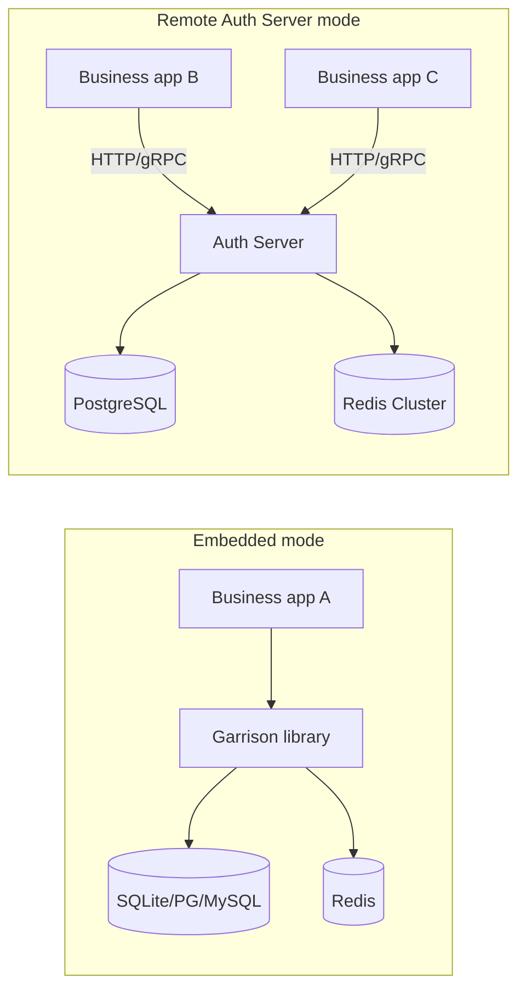

# 🚀 Garrison Deployment Guide

This document describes deployment considerations for Garrison in production, covering deployment architecture, environment configuration, database initialization, cache configuration, TLS termination, and the production checklist.

> For architecture see the [🏗️ Architecture doc](./ARCHITECTURE.md); for configuration items see the [⚙️ Configuration Guide](./CONFIGURATION.md); for the security policy see the [🔒 Security doc](./SECURITY.md).

## 📋 Table of Contents

- [Deployment Architecture Overview](#️-deployment-architecture-overview)
- [Environment Variables](#️-environment-variables)
- [Database Initialization](#️-database-initialization)
- [Cache Configuration](#-cache-configuration)
- [TLS / HTTPS Termination](#-tls--https-termination)
- [Panic Policy and Task Isolation](#️-panic-policy-and-task-isolation)
- [Dependency Locking](#-dependency-locking)
- [Production Checklist](#-production-checklist)
- [Docker Deployment](#-docker-deployment)

---

## 🏗️ Deployment Architecture Overview

<div align="center">



</div>

Garrison supports two deployment modes:

| Mode | Description | Applicable scenarios |
|------|------|----------|
| **Embedded** | Garrison embedded in the business process as a library, the `backend-embedded` feature | Monolithic applications, small/medium deployments |
| **Remote Auth Server** | A standalone authentication server called over HTTP/gRPC, the `backend-remote` + `auth-server` features | Microservice architectures, multi-system shared auth centers |



---

## ⚙️ Environment Variables

Production **must** configure the following environment variables:

| Variable | Description | Example |
|------|------|------|
| `GARRISON_TOKEN_NAME` | Token cookie/header name | `garrison_token` |
| `GARRISON_TIMEOUT` | Session timeout (seconds) | `2592000` (30 days) |
| `GARRISON_ACTIVE_TIMEOUT` | Active timeout (seconds, -1 follows timeout) | `-1` |
| `GARRISON_IS_SHARE` | Multi-device session sharing | `false` |
| `GARRISON_IS_CONCURRENT` | Allow concurrent logins | `true` |
| `GARRISON_JWT_SECRET` | JWT signing key (must change in jwt mode) | **random 32+ bytes** |
| `GARRISON_REDIS_URL` | Redis connection address | `redis://127.0.0.1:6379` |

> ⚠️ **JWT key**: production must replace the default `jwt_secret`; generate a random key with `openssl rand -hex 32`. Weak keys are rejected by `GarrisonConfig::validate()`.

For the full configuration table see the [⚙️ Configuration Guide](./CONFIGURATION.md).

---

## 🗄️ Database Initialization

### Automatic migrations

Garrison can run SQL migrations automatically at startup (with the corresponding `db-*` feature enabled):

```rust
// Embedded migration SQL (embedded-migrations feature)
// the migrations/ directory is packaged at compile time via include_dir!
```

### Manual migrations

Manual migrations are recommended in production for precise control:

```bash
# SQLite
sqlite3 garrison.db < migrations/sqlite/core/001_init.sql
sqlite3 garrison.db < migrations/sqlite/core/002_role_hierarchy.sql

# PostgreSQL
psql -U garrison -d garrison -f migrations/postgres/core/001_init.sql

# MySQL
mysql -u garrison -p garrison < migrations/mysql/core/001_init.sql
```

Migration files live under `migrations/{backend}/core/` and run in numbered order.

---

## 💾 Cache Configuration

### Redis deployment modes

Garrison supports 4 Redis deployment modes (the `RedisDeploymentMode` enum):

| Mode | Description | Configuration |
|------|------|------|
| `Single` | Single node | `redis://host:port` |
| `Sentinel` | Sentinel mode | sentinel addresses + master name |
| `Cluster` | Cluster mode | multiple node addresses |
| `MasterSlave` | Primary-replica mode | primary + replica addresses |

### Three-tier cache architecture

With the `three-tier-cache` feature enabled, Garrison uses L1 (process memory) → L2 (Redis) → L3 (database). TTL writes carry an automatic ±10% random jitter to prevent cache avalanches.

---

## 🔐 TLS / HTTPS Termination

With the `tls` feature, the Garrison Auth Server supports HTTPS/TLS termination (based on `axum-server` + `rustls`):

```toml
[dependencies]
garrison = { version = "0.9.0", features = ["tls", "auth-server"] }
```

```rust
// TLS configuration is loaded via axum-server's RustlsConfig
// supports PEM certificates + PKCS8 private keys
```

### Certificate hot reload (`tls-cert-watch`)

With `tls-cert-watch` enabled on top of `tls`, the framework watches the certificate and key files (200ms debounce) and swaps in the new configuration when the files change:

```toml
garrison = { version = "0.9.0", features = ["tls-cert-watch", "auth-server"] }
```

- Covers both "overwrite in place" and "write temp file + rename" certificate-replacement techniques; the external and internal ports share the configuration, new handshakes use the new certificate immediately, existing connections stay up, and the process does not restart.
- Half-written or invalid PEMs are not swapped in: the old certificate keeps serving, the failure logs at `error`, and the next file event retries.
- Watched paths are normalized first (relative paths made absolute, parent directory canonicalized, file name kept as-is), so relative paths and paths containing symbolic-link prefixes both work; when the leaf is a symlink its directory entry is watched, so re-pointing the link is caught.

> In production, terminating TLS at the reverse proxy (Nginx / Envoy) is recommended; the Auth Server should only listen on the internal network.

---

## ⚠️ Panic Policy and Task Isolation

`Cargo.toml`'s `[profile.release]` sets `panic = "unwind"` (restored from `abort` in v0.9.0-rc.1). Semantics:

- On `panic` the process unwinds the stack; `catch_unwind` can isolate a single task's panic.
- The `catch_unwind` implementations in `src/stp/context.rs`, `src/listener/mod.rs`, `src/listener/manager_impl.rs`, `src/plugin/manager_impl.rs`, and `src/health/registry.rs` implement "isolate single-task panics, avoid polluting global state" and work correctly under `unwind`.
- A single listener's panic during listener broadcast / SSO channel dispatch does not terminate the whole auth node.

### Production recommendations

- Pair with a process supervisor (systemd `Restart=on-failure` / k8s `restartPolicy: Always`) so abnormal exits are restarted automatically.
- `panic` proactively only for unrecoverable scenarios; recoverable errors should flow through `Result`/`GarrisonResult`.

---

## 🔒 Dependency Locking

This repository commits `Cargo.lock`, and CI builds with `--locked` to guarantee a reproducible dependency tree. After changing dependencies, run `cargo generate-lockfile` again and commit the updated `Cargo.lock`.

---

## ✅ Production Checklist

Confirm item by item before deployment:

| Check | Required | Description |
|--------|:----:|------|
| JWT key replaced with a random strong key | ✅ | `GARRISON_JWT_SECRET` ≥ 32 bytes |
| Redis connection configured | ✅ | Memory-only caching is not recommended in production |
| Database initialized | ✅ | Migration SQL executed or auto-migrate enabled |
| `is_share` / `is_concurrent` set per business needs | ✅ | Defaults `false` / `true` |
| TLS enabled (or terminated at a reverse proxy) | ✅ | Plaintext token transmission is forbidden |
| `cargo audit` clean | ✅ | Local release-script precheck (`scripts/release.sh`, requires 0 CRITICAL); on CI the advisory check of `cargo deny check` covers the same scope |
| `cargo deny check` passes | ✅ | Licenses and dependency security |
| Log level set to `info` or `warn` | ⚠️ | Avoid `debug`/`trace` leaking sensitive data |
| Sensitive values in env vars use secret management | ⚠️ | Vault / K8s Secret recommended |
| Back-Channel Logout queue table created with migrations | ⚠️ | Under the `backchannel-logout` feature, `017_oauth2_backchannel_queue.sql` runs automatically with migrate_core |
| RP back-channel endpoints configured per client | ⚠️ | With `backchannel-logout` enabled, configure notification endpoints per client; the framework does no RP discovery fetch |
| `field-encryption` key configured | ⚠️ | Enabling the feature without a key is fail-closed at startup; key rotation uses the change_key/check_key ops interfaces |

### Static security posture audit (`doctor`, `cli-ops`)

Run `garrison doctor` before deployment to get a read-only ✓/✗/! report over the current configuration and compiled feature surface. It reuses the framework's existing validators and does not start services or connect to dependencies:

```sh
# Standard profile: report only; exits 0 unless a Fail finding exists.
cargo run --features "cli-ops,auth-server" --bin garrison -- doctor

# Strict profile: any Warn also produces a nonzero exit code.
cargo run --features "cli-ops,auth-server" --bin garrison -- doctor --profile strict
```

Exit-code semantics:

- Standard: `0` when there are no Fail findings; `1` when any Fail is present.
- Strict: `0` only when there are no Fail and no Warn findings; `1` otherwise.

Use `--profile strict` as a CI gate or container startup probe: a nonzero exit means the security posture has regressed (the report lists the offending Finding IDs). The 9 stable Finding IDs are listed in [CONFIGURATION.md](CONFIGURATION.md) · Doctor checks. The report is never altered by the profile — only the exit-code threshold changes.

---

### Back-Channel Logout operations notes (backchannel-logout)

- Queue backlog observation: `SELECT status, COUNT(*) FROM oauth2_backchannel_queue GROUP BY status` — steady growth of `pending` means the RP endpoint is unreachable or delivery throughput is insufficient; `failed` rows are deliveries abandoned after exceeding MaxTtl (default 24h) (explicitly warned, never silently dropped).
- Handling failed rows: `failed` rows are not auto-deleted (visible for audit); after confirming they are unneeded, ops cleans them by `id`. Retries never double-deliver (drain is idempotent).
- RP endpoint requirements: must accept the `logout_token` POST as `application/x-www-form-urlencoded`; redirects count as delivery failure (redirects are not followed, preventing a POST downgrade to GET losing the token).
- Multi-instance: queue rows are claimed for consumption by `next_attempt_at`, safe for multi-instance; RPs inside their backoff window are not re-batched.

## 🐳 Docker Deployment

The repository provides two image lines (multi-stage builds, cargo-chef dependency caching + reproducible `--locked` compilation):

| Variant | Dockerfile | Base image | Applicable scenarios |
|------|-----------|---------|---------|
| **debian-slim** | `docker/Dockerfile` | `debian:bookworm-slim` | Default recommendation: shell debugging available, ships `ca-certificates` |
| **distroless** | `docker/Dockerfile.distroless` | `gcr.io/distroless/cc-debian12:nonroot` | Minimal attack surface: no shell / package manager |

Behaviors shared by both variants:

- **Non-root runtime**: the debian variant uses `uid 1000` (the `garrison` user); the distroless variant ships `65532:65532` nonroot. Listening ports 8080/8081 are both unprivileged.
- **Built-in HEALTHCHECK**: probes `/healthz` on the container's external port (the liveness probe mounted by sdforge under the `server-health-check` feature — constant 200 as long as the process is alive, bypassing rate-limit/audit middleware). Note this is **liveness** semantics, not the readiness semantics of the library consumer's `/health/live`.
- **Version only in OCI labels** (`org.opencontainers.image.version/revision`): garrison has no runtime version endpoint and does no fake injection.

### Building images

```bash
# debian-slim variant (default)
docker build \
  --build-arg VERSION=0.9.0 \
  --build-arg GIT_SHA=$(git rev-parse HEAD) \
  -t garrison-auth:local .

# distroless variant
docker build -f docker/Dockerfile.distroless \
  --build-arg VERSION=0.9.0 \
  --build-arg GIT_SHA=$(git rev-parse HEAD) \
  -t garrison-auth:local-distroless .
```

`VERSION` / `GIT_SHA` are for OCI labels only; when `GIT_SHA` is absent it records `unknown`.

> ⚠️ **Rolling sources and reproducibility (an explicit, on-record acceptance decision)**: the base images (`debian:bookworm-slim` / `gcr.io/distroless/cc-debian12:nonroot`), `CHEF_IMAGE` (the `lukemathwalker/cargo-chef:latest-rust-1` rolling tag), and rustup stable are all rolling sources, so builds are not bit-level reproducible. For release builds, pin the above base images and `CHEF_IMAGE` by digest (`CHEF_IMAGE` can be overridden via `--build-arg CHEF_IMAGE=<image>@sha256:<digest>`).

### Runtime environment variables (container)

| Variable | Required | Default | Description |
|------|:---:|------|------|
| `GARRISON_INTERNAL_API_KEY` | ✅ | none (fail-closed) | Internal API Key; startup is refused without it. The length floor (32 bytes) is enforced uniformly by the **library layer** `garrison::server::MIN_INTERNAL_API_KEY_LEN` (the bin no longer carries its own copy); shorter keys refuse startup in the strict tier (generate with `openssl rand -hex 32`). The reference deployment defaults to the strict tier; library consumers that bypass the bin default to the non-strict tier (warn only, turning into refusal at 1.0) |
| `GARRISON_EXTERNAL_PORT` | — | `8080` | External port (the HEALTHCHECK probe follows this value automatically) |
| `GARRISON_INTERNAL_PORT` | — | `8081` | Internal port (`check-*` management plane, requires X-API-Key) |
| `GARRISON_EXTERNAL_BIND` / `GARRISON_INTERNAL_BIND` | — | `127.0.0.1` | External / internal bind addresses (secure-by-default, local-only; **the image presets `0.0.0.0`** for container port mapping — set `0.0.0.0` explicitly when running on a host and needing external access). Only IPv4/IPv6 literals are accepted; invalid values refuse startup. Since 1.0 the library-level `AuthServerConfig::default()` also binds `127.0.0.1` (breaking change); container deployments must set `0.0.0.0` explicitly via these variables or `with_external_bind`/`with_internal_bind` |
| `GARRISON_TRUSTED_PROXIES` | — | empty (trust no XFF) | Trusted proxy IP list (comma-separated). Configure only when deployed behind a trusted reverse proxy; XFF parsing (rate-limit keys / client IP) activates only after configuration. Only loopback / RFC 1918 / link-local / IPv6 ULA addresses accepted; invalid or public values refuse startup |
| `GARRISON_MAX_LOGIN_COUNT` | — | `10` | Maximum concurrent sessions per account; the earliest login is kicked beyond it; explicit `0` = unlimited (overriding the framework default of `0`) |
| `GARRISON_SEED_PRIMARY_AMR` | — | `true` | Whether login seeds the primary authentication factor into the session (`amr=["pwd"]`/AAL 1/`auth_time`). Security-sensitive deployments are advised to set `false` explicitly — the reference deployment's login does not verify credentials, so the default seeding would assert a password authentication that never happened into the factor ledger, misleading downstream step-up decisions (see `seed_primary_amr` in docs/CONFIGURATION.md) |
| `GARRISON_EXTERNAL_LOGIN_ENABLED` | — | `false` | External login endpoint switch (secure-by-default). The framework's login does not verify credentials — **the business layer must have injected credential verification before enabling**; when enabled and the external bind is non-loopback, `GARRISON_EXTERNAL_LOGIN_ACK` must also be set, otherwise startup is refused |
| `GARRISON_EXTERNAL_LOGIN_ACK` | conditional | none | The explicit risk acknowledgement for the scenario above: the value must be exactly `i-understand-no-credential-check` (case-sensitive); missing or mismatched values refuse startup |
| `GARRISON_STRICT_SECURITY` | — | `true` | Strict security tier. The reference deployment is **always fail-closed**: keys below the floor and un-ACKed external login exposure are both rejected by the library layer's `AuthServerConfig::validate()` before initializing the DAO and running migrations. `false` is a one-time escape hatch only for keys not yet rotated (same conditions degrade to library warnings). Through the bin's bootstrap this variable accepts only `true`/`false` (case-insensitive); invalid values refuse startup; the library layer reading the same variable warns on invalid values and falls back to the new default `true` (single-version rollback: `GARRISON_STRICT_SECURITY=false`) |
| `GARRISON_HEALTH_DETAILS` | — | `false` | Whether the internal `/readyz` passes through `checks[].details` (may contain internal dependency topology; by default stripped, keeping only name/healthy). Accepts `1`/`true`/`yes`/`on` and `0`/`false`/`no`/`off` (case-insensitive); unrecognized values warn and take the default |
| `GARRISON_API_KEY_LOCKOUT_THRESHOLD` / `GARRISON_API_KEY_LOCKOUT_WINDOW_SECS` | — | `10` / `300` | Internal API Key auth-failure lockout: after same-source-IP consecutive failures (missing/wrong/duplicate `X-API-Key`) reach the threshold, all requests get 429 + `Retry-After` for the window; a successful authentication resets it; threshold `0` = disabled |
| `GARRISON_RATE_LIMIT_BACKEND` | — | unset (config default Memory) | Rate-limit storage for the login firewall hook and `RateLimitStrategy`: requires the `rate-limit-redis` feature; `redis` also needs `GARRISON_REDIS_URL` (use `rediss://` in production; dev/test may use `redis://` with `OXCACHE_ALLOW_INSECURE_REDIS=I_UNDERSTAND_THE_RISKS`); unknown values / empty URLs refuse startup |
| `GARRISON_WORKER_THREADS` | — | CPU cores | Number of tokio worker threads |
| `GARRISON_MAX_BLOCKING_THREADS` | — | `512` | Tokio blocking-thread cap |

For the full `GARRISON_*` configuration see the [⚙️ Configuration Guide](./CONFIGURATION.md).

### Multi-instance rate limiting (rate-limit-redis)

In multi-instance deployments, in-process rate-limit counters scale with the instance count. With `rate-limit-redis` enabled, the login firewall hook and `RateLimitStrategy` can switch to an independent Redis rate-limit runtime (session/token data does not migrate):

```bash
GARRISON_RATE_LIMIT_BACKEND=redis
# TLS required in production; dev may use redis:// with OXCACHE_ALLOW_INSECURE_REDIS=I_UNDERSTAND_THE_RISKS
GARRISON_REDIS_URL=rediss://redis.example:6380/0
```

- **Coverage**: login frequency / account failure counters (`fw:ip:*` / `fw:acct:*`) and the `RateLimitStrategy` sliding window; `BruteForceStrategy`'s ban ledger, `DDoSStrategy`, OAuth2 `/token`, invitation codes, SMS/email quotas, API Key / account lockout, and the edge `rate_limit_middleware` still operate independently on their own backends (see [ROADMAP · rc.4 known limitations](./ROADMAP.md)).
- **Session data**: stays in the instance-local DAO; for cross-instance session sharing use sticky sessions, stateless JWT, or evaluate candidate A (switching the whole DAO to Redis — not adopted).
- **Failure semantics**: a failed connection at startup refuses to start; runtime Redis errors propagate upward (login is fail-closed), never silently falling back to memory.
- **Key space**: a dedicated Redis DB or instance is recommended; do not mix `fw:*` / `rl:*` with oxcache cache keys.

### Docker Compose example

`docker/docker-compose.example.yml` is the minimal runnable single-machine example (local build + fail-loud API Key validation + healthcheck + an optional commented Redis block):

```bash
export GARRISON_INTERNAL_API_KEY='<strong random key>'
docker compose -f docker/docker-compose.example.yml up -d
docker compose -f docker/docker-compose.example.yml ps   # STATUS should be healthy
```

> ⚠️ Both variants' healthchecks use the absolute path `/app/garrison healthcheck` (distroless has no `/usr/local/bin` symlink, and PATH does not include `/app`). For protocol-integration external dependencies see `docker-compose.e2e.yml`.

### Custom feature surface

The image defaults to `FEATURES=auth-server,cache-memory,server-health-check,tracing-log` — the minimal surface aligned with `[[bin]] auth_server`'s `required-features` and the probe routes. Production combinations (pulling in database backends etc.) can override:

```bash
docker build --build-arg FEATURES=production -t garrison-auth:prod .
```

> Switching the surface without feature gating makes `cargo build` fail at `required-features` validation (fail-fast, no half-built images).
>
> ⚠️ Switching `FEATURES` invalidates cargo-chef's dependency cache (precompiled deps key on the feature surface), so the first build on a new surface recompiles dependencies fully (about 10-20min); later builds hit the cache and become incremental again.
>
> ⚠️ Combinations like production that include embedded database backends such as `db-sqlite` need a writable data volume: hardened deployments often mount the container root filesystem (including `/app`) read-only, so SQLite's on-disk path must be a mounted data volume with its data directory specified, otherwise startup/migration writes fail.

### Multi-arch builds

The builder stage targets `x86_64-unknown-linux-gnu`. `docker buildx build --platform linux/amd64,linux/arm64` is technically feasible (arm64 goes through QEMU emulation with significantly longer dependency compilation; a native arm64 runner is recommended); CI currently builds amd64 only.

---

## 📚 Related Documents

| Document | Description |
|------|------|
| [🏗️ Architecture](./ARCHITECTURE.md) | Design principles and module layout |
| [⚙️ Configuration](./CONFIGURATION.md) | Full configuration reference |
| [🔒 Security](./SECURITY.md) | Security policy and vulnerability reporting |
| [🛠️ Development](./DEVELOPMENT.md) | Development and debugging guide |
| [🔧 Troubleshooting](./TROUBLESHOOTING.md) | Common issues and solutions |
