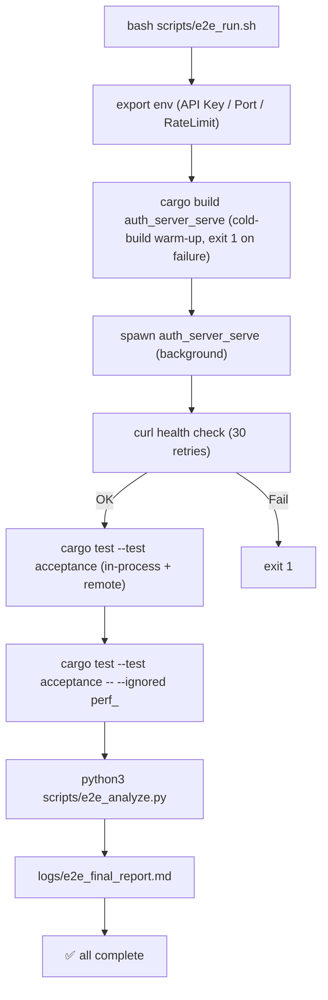

# 🛠️ Development Standards

This document describes the Garrison project's development environment setup, project structure, TDD workflow, code standards, and debugging tips. All contributors must read this document before committing code.

- Repository: <https://github.com/Kirky-X/garrison>
- License: Apache-2.0
- Author: Kirky-X <Kirky-X@outlook.com>
- MSRV: Rust 1.97.1 (`rust-version` in `Cargo.toml`, taken from the sibling-ecosystem rc-line dependencies' `rust-version`)
- Design reference: the 13-feature-domain domain modeling

> For the contribution workflow see [🤝 CONTRIBUTING.md](./CONTRIBUTING.md); for architecture see the [🏗️ Architecture doc](./ARCHITECTURE.md).

## 📋 Table of Contents

- [Development Environment Setup](#-development-environment-setup)
- [Project Structure](#-project-structure)
- [TDD Workflow](#-tdd-workflow)
- [Test-Writing Standards](#-test-writing-standards)
- [Code Style](#-code-style)
- [Git Workflow](#-git-workflow)
- [Debugging Tips](#-debugging-tips)
- [Common Command List](#-common-command-list)
- [E2E / Performance / Penetration Testing](#e2e--performance--penetration-testing)

---

## 🧰 Development Environment Setup

### 1.1 Rust toolchain

Garrison requires Rust 1.97.1+: `Cargo.toml`'s `rust-version = "1.97.1"` comes from the `rust-version = "1.97.1"` declared by each sibling-ecosystem dependency on the rc line (confers / oxcache / dbnexus / sdforge / limiteron / inklog / trait-kit) — i.e. the lowest toolchain the dependency graph accepts; below that, `cargo check --locked` refuses outright. Install the stable toolchain via rustup:

```bash
# install rustup (if not installed)
curl --proto '=https' --tlsv1.2 -sSf https://sh.rustup.rs | sh

# install the stable toolchain
rustup install stable
rustup default stable

# verify versions (must be >= 1.97.1)
rustc --version
cargo --version
```

The local toolchain follows rustup's default channel; confirm the toolchain in use is ≥ 1.97.1 (the CI test matrix explicitly verifies `1.97.1` / `stable` / `beta`).

### 1.2 System dependencies

The following system dependencies serve the build chain (the `cargo llvm-cov` coverage face depends on the standard build chain too):

```bash
# Debian / Ubuntu
sudo apt update
sudo apt install -y libssl-dev pkg-config

# verify
pkg-config --exists openssl && echo "openssl OK"
```

### 1.3 Cloning the repository and local dependencies

Garrison uses the crates.io-published `oxcache 0.5` (per-entry TTL + `ttl_sync()` queries) and `dbnexus 0.6` (SQLite / PostgreSQL / MySQL multi-backend); no local dependency clones are needed:

```bash
# 1. clone Garrison
git clone https://github.com/Kirky-X/garrison.git
cd garrison

# 2. verify the build (all features enabled)
cargo build --features full
```

### 1.4 Verification

```bash
# full build
cargo build --features full

# full tests (all 5454 lib tests should pass)
cargo test --features full

# Lint (zero warnings)
cargo clippy --features full -- -D warnings

# Format check
cargo fmt --all -- --check
```

---

## 🧩 Project Structure

```text
garrison/
├── src/                      # source
│   ├── core/                 # core layer: token / permission / auth
│   │   ├── token/mod.rs
│   │   ├── permission/mod.rs
│   │   └── auth/mod.rs
│   ├── stp/                  # authentication logic module (split across files)
│   │   ├── mod.rs            # re-exports
│   │   ├── core.rs           # the GarrisonCore trait
│   │   ├── session/          # the SessionLogic trait (mod.rs + helpers.rs + tests.rs)
│   │   ├── permission.rs     # the PermissionLogic trait
│   │   ├── token.rs          # the TokenLogic trait
│   │   ├── mfa.rs            # the MfaLogic trait
│   │   ├── password.rs       # the PasswordLogic trait
│   │   ├── interface.rs      # the GarrisonInterface trait
│   │   ├── util/             # the GarrisonUtil static facade (mod.rs + tests.rs)
│   │   ├── parameter.rs      # ParameterQuery
│   │   └── tests.rs          # integration tests
│   ├── session/mod.rs        # session management (GarrisonSession + SessionExpiryListener)
│   ├── account/              # the account security engine (added v0.6.0)
│   │   ├── credential/       # Credential SPI + PasswordCredential + TotpCredential
│   │   ├── policy/           # PasswordPolicyEngine + 12+ rules
│   │   ├── lockout/          # UserLockoutStrategy
│   │   ├── disable/          # account disabling / DisableRepository (added v0.7.0)
│   │   ├── authflow/         # the AuthenticationFlow DSL
│   │   └── metrics.rs        # AccountMetrics Prometheus metrics
│   ├── protocol/             # protocol layer (feature-gated)
│   │   ├── jwt/mod.rs
│   │   ├── oauth2/mod.rs
│   │   ├── sso/              # SSO single sign-on + SAML 2.0 + the OIDC RP
│   │   │   ├── mod.rs
│   │   │   ├── server.rs     # the SsoServer trait + CenterIdConverter + SsoChannel
│   │   │   ├── saml.rs       # the SAML 2.0 skeleton (added v0.6.0)
│   │   │   ├── oidc.rs       # the OIDC RP skeleton (added v0.6.0)
│   │   │   └── channel.rs    # RedisPubSubSsoChannel (added v0.6.0)
│   │   ├── sign/mod.rs
│   │   ├── apikey/mod.rs
│   │   └── temp/mod.rs
│   ├── secure/               # security layer (feature-gated)
│   │   ├── totp/mod.rs
│   │   ├── sign/mod.rs
│   │   ├── httpbasic/mod.rs
│   │   └── httpdigest/mod.rs
│   ├── dao/                  # data access layer
│   │   ├── mod.rs            # the GarrisonDao trait + RedisDeploymentMode + RedisConfig
│   │   ├── oxcache_impl.rs   # the oxcache implementation
│   │   ├── dbnexus_impl.rs   # dbnexus initialization + GarrisonMigration
│   │   └── repository/       # the Repository layer (13 traits + Dbnexus*Repository implementations)
│   ├── context/              # request-context abstraction
│   │   ├── mod.rs
│   │   ├── axum_adapter.rs   # the axum adapter
│   │   ├── actix_adapter.rs  # the actix-web adapter (added v0.4.2)
│   │   ├── warp_adapter.rs   # the warp adapter (added v0.4.2)
│   │   └── tenant.rs         # the tenant resolver (added v0.5.0)
│   ├── config/mod.rs         # the configuration system (GarrisonConfig + confers + remember_me)
│   ├── annotation/mod.rs     # the annotation system (including CheckAccessToken/CheckClientToken)
│   ├── router/mod.rs         # route permissions (GarrisonRouter + group())
│   ├── strategy/             # strategy pattern + registry
│   │   ├── mod.rs
│   │   └── registry.rs       # the strategy registry (6 strategy traits)
│   ├── exception/mod.rs      # the exception system
│   ├── listener/mod.rs       # event listening (feature-gated, 31 event variants)
│   ├── plugin/mod.rs         # the plugin system
│   ├── manager/mod.rs        # the GarrisonManager global manager
│   ├── json/mod.rs           # JSON templates
│   ├── i18n.rs               # internationalization (fluent-rs)
│   ├── error.rs              # error type definitions
│   ├── prelude.rs            # prelude
│   ├── cli/                  # the CLI face of the single-root binary (sdforge CliBuilder + inventory registration)
│   │   ├── mod.rs            # the healthcheck subcommand (registered unconditionally)
│   │   ├── serve.rs          # the serve subcommand (migrated from the auth_server bin; needs auth-server + cache-memory)
│   │   └── ops.rs            # the ops command group (migrated from the garrison-cli bin; needs cli-ops + dependency features)
│   ├── main.rs               # the single-root binary entry (a thin Tokio runtime + sdforge dispatch shell)
│   └── lib.rs                # the crate entry
├── tests/                    # integration tests
├── examples/                 # example code (a standalone workspace member)
├── migrations/               # database migration scripts
│   ├── sqlite/core/          # SQLite migrations
│   ├── mysql/core/           # MySQL-compatible migrations
│   ├── postgres/core/        # PostgreSQL migrations
│   └── duckdb/core/          # DuckDB migrations
├── benches/                  # benchmarks (criterion)
├── macros/                    # the proc-macro crate garrison-macros (#[check_login] etc.)
├── locales/                  # i18n resource files (zh.ftl / en.ftl)
├── docs/                     # documentation
├── Cargo.toml
├── rustfmt.toml              # formatting configuration
└── README.md
```

### Source layering

| Layer | Directory | Responsibility |
|----|------|------|
| Core layer | `src/core/` | token generation/verification, permission checks, login authentication |
| Facade layer | `src/stp/` | the `GarrisonLogic` trait + the `GarrisonUtil` static facade |
| Protocol layer | `src/protocol/` | OAuth2 / SSO / JWT / signing / API Key / temporary credentials |
| Security layer | `src/secure/` | TOTP / signing / HTTP Basic / HTTP Digest |
| Support layers | `src/dao/` `src/context/` `src/config/` etc. | data access, context, configuration, annotations, routing, exceptions |

---

## 🔄 TDD Workflow

<div align="center">



</div>

Garrison mandates test-driven development (TDD). Every task must strictly follow the 5 steps below, with no step skipped:

### 3.1 The five-step loop

1. **Define the interface** — write the `trait` and `struct` signatures (method signatures + types) with no implementation, including `///` doc comments
2. **Write tests** — covering three classes of scenarios:
   - happy path
   - error path
   - boundary cases
3. **Implement** — write the minimal implementation that satisfies the tests
4. **Tests pass** — `cargo test --features full` must pass entirely
5. **Format and lint** — `cargo fmt` + `cargo clippy --features full -- -D warnings`, then `git commit`

> Implementing first and backfilling tests is forbidden. The coverage gate is line coverage ≥ 95% (CI `--fail-under-lines 95`); new code must not lower total coverage.

### 3.2 A test-driven example

```rust
// Step 1: define the interface
/// Verify whether the current session is logged in.
pub async fn check_login() -> GarrisonResult<bool>;

// Step 2: write tests
#[cfg(test)]
mod tests {
    use super::*;

    #[tokio::test]
    async fn check_login_returns_true_when_session_valid() {
        // happy path
    }

    #[tokio::test]
    async fn check_login_returns_false_when_session_expired() {
        // error path
    }

    #[tokio::test]
    async fn check_login_returns_false_when_token_empty() {
        // boundary case
    }
}

// Step 3: implement
pub async fn check_login() -> GarrisonResult<bool> {
    // minimal implementation to make the tests pass
}
```

---

## 🧪 Test-Writing Standards

### 4.1 Test serialization (#[serial_test::serial])

Tests that mutate the global singleton (e.g. `GarrisonManager`) or environment variables (`std::env::set_var`) must be annotated `#[serial_test::serial]` to avoid concurrent multi-threaded pollution:

```rust
#[cfg(test)]
mod tests {
    use serial_test::serial;

    #[tokio::test]
    #[serial]
    async fn test_manager_init() {
        // mutates the global singleton; must be serial
        GarrisonManager::builder()
    .dao(dao)
    .config(config)
    .interface(interface)
    .build()
    .await.unwrap();
        assert!(GarrisonManager::is_initialized());
    }

    #[test]
    #[serial]
    fn test_env_var_override() {
        std::env::set_var("GARRISON_TIMEOUT", "3600");
        // ...
        std::env::remove_var("GARRISON_TIMEOUT");
    }
}
```

> **Rule of thumb**: as soon as a test calls `GarrisonManager::builder().build().await`, `std::env::set_var()`, or mutates a `once_cell` global, it must carry `#[serial]`.

### 4.2 Test naming conventions

Test function names use `snake_case`; follow the `<method_under_test>_<condition>_<expected_result>` pattern:

```rust
#[test]
fn validate_rejects_invalid_token_style() { ... }

#[test]
fn toml_overrides_multiple_fields() { ... }

#[test]
fn env_overrides_toml() { ... }
```

### 4.3 One-line conformance-suite wiring for new DAO backends

When adding a `GarrisonDao` implementation (built-in, or a custom backend under the `testing` feature), run the conformance suite with the `dao_conformance_tests!` macro instead of hand-writing per-method drift assertions:

```rust
garrison::dao_conformance_tests! {
    backend: my_dao,          // module name + key-name prefix
    make: || async { MyDao::new().await.map(|d| Arc::new(d) as Arc<dyn GarrisonDao>) },
    caps: [basic, atomic, concurrent, ttl, keys],  // choose per backend capability
    // serial: true,           // optional: add #[serial] when depending on env vars/global singletons
    // ignore: "requires X",   // optional: for external-dependency backends (e.g. needing DATABASE_URL)
}
```

| Capability tier | Selection criteria |
|--------|---------|
| `basic` | Always selected (core KV / counters / rename contracts) |
| `atomic` | Always selected (SETNX / GETDEL / CAS atomic primitives; methods required at compile time) |
| `concurrent` | Mandatory when the backend claims in-process atomicity (locks / atomic primitives) — exactly one winner, no lost updates, no skipped decrements |
| `ttl` | The backend supports per-entry TTL (real wall clock, one 3s sleep) |
| `keys` | The backend implements `keys()` (do not attach when it defaults to `NotImplemented`) |

- `make` creates a fresh empty instance per test (compatible with shared-storage backends); construction failure panics (fail-loud)
- All key names are isolated with the `<backend>:` prefix; assertion messages carry the prefix for locating
- The `ttl` tier uses the real wall clock — mind the CI time budget; decorator-style implementations (e.g. `AloneCache`) may attach only
  `basic` + `atomic`, with concurrent/ttl proven by the inner backend

### 4.4 Coverage requirements

Garrison's coverage gate is **line coverage ≥ 95%** (the CI gate `cargo llvm-cov --features "full" --fail-under-lines 95`; measured about 95.8% on 2026-10-14). New code must not lower total coverage.

The per-module figures below are target lines (expectations set by Kirky.X), **not CI gates**:

| Module type | Target line (not a CI gate) |
|---------|-------------------|
| Core modules (core/stp/session/config/context/manager) | ≥ 95% |
| Protocol/security plugins | ≥ 90% |
| Web adapter layer | Integration tests covering the main middleware paths suffice |

- 5800+ tests passing (5454 lib + 416 acceptance E2E, 5870 total) + doc-tests (`cargo test --list` measured, as of 2026-10-28)
- 100% coverage is not the goal, but every branch must have a corresponding test case
- Raising coverage by "not writing tests" is forbidden

---

## 📏 Code Style

### 5.1 Naming conventions

| Type | Style | Examples |
|------|------|------|
| Functions / variables | `snake_case` | `check_login`, `user_id` |
| Types / Structs / Enums / Traits | `CamelCase` | `GarrisonManager`, `GarrisonLogic` |
| Constants / static items | `SCREAMING_SNAKE_CASE` | `DEFAULT_TIMEOUT`, `TOKEN_HEADER` |

### 5.2 Doc comments

All `pub` items (functions, structs, enums, traits, constants) must carry `///` doc comments:

```rust
/// Verify whether the current session is logged in.
///
/// Reads the current token from the task_local context and checks session validity.
///
/// # Returns
/// - `Ok(true)`: logged in and the session has not expired
/// - `Ok(false)`: not logged in or the session is invalid (when `throw_on_not_login = false`)
/// - `Err(GarrisonError::NotLogin)`: thrown when not logged in and `throw_on_not_login = true`
pub async fn check_login() -> GarrisonResult<bool> {
    // ...
}
```

### 5.3 Error handling

- All fallible operations return `GarrisonResult<T>` (i.e. `Result<T, GarrisonError>`)
- `unwrap()` / `expect()` are **forbidden** in non-test code
- Propagate errors with the `?` operator
- Custom error types implement `thiserror::Error`

### 5.4 Async conventions

Trait methods are declared with the `async_trait::async_trait` macro:

```rust
#[async_trait]
pub trait GarrisonLogic: Send + Sync {
    async fn get_permission_list(&self, user_id: &str) -> GarrisonResult<Vec<String>>;
}
```

### 5.5 clippy and rustfmt

```bash
# clippy zero warnings (the CI standard)
cargo clippy --features full --lib --tests -- -D warnings

# format check
cargo fmt --all -- --check

# docs zero warnings
cargo doc --no-deps --features full
```

> Suppressing clippy warnings with `#[allow(...)]` is forbidden (unless there is a strong reason, explained in the PR).

---

## 🌿 Git Workflow

### 6.1 Branch strategy

| Branch | Purpose | Naming convention |
|------|------|---------|
| `main` | The trunk, always releasable | - |
| Feature branches | New feature development | `feat/<scope>-<short-desc>` |
| Fix branches | Bug fixes | `fix/<scope>-<short-desc>` |
| Docs branches | Documentation updates | `docs/<short-desc>` |

### 6.2 Commit conventions

Following [Conventional Commits](https://www.conventionalcommits.org/en/v1.0.0/):

```text
<type>(<scope>): <subject>
```

| type | Description |
|------|------|
| `feat` | New feature |
| `fix` | Bug fix |
| `docs` | Documentation change |
| `refactor` | Refactoring (no behavior change) |
| `test` | Tests added/changed |
| `chore` | Build/tooling/dependencies |

Common scopes: `protocol-jwt`, `secure-totp`, `cache-memory`, `db-sqlite`, `web-axum`, `core`, `stp`, `session`, `config`, etc.

For the detailed commit conventions and PR process see [CONTRIBUTING.md](./CONTRIBUTING.md).

---

## 🐛 Debugging Tips

### 7.1 cargo test

```bash
# run all tests
cargo test --features full

# run a single test
cargo test --features full test_name

# run showing println! output
cargo test --features full -- --nocapture

# run only the integration tests
cargo test --features full --test axum_integration
```

### 7.2 cargo clippy

```bash
# zero-warning check
cargo clippy --features full --lib --tests -- -D warnings

# see the specific suggestions
cargo clippy --features full --lib --tests
```

### 7.3 RUST_LOG logging

Control log levels via the `RUST_LOG` environment variable:

```bash
# only the garrison modules at debug level
RUST_LOG=garrison=debug ./your-server

# global debug + garrison trace
RUST_LOG=debug,garrison=trace ./your-server

# only specific modules
RUST_LOG=garrison::core::auth=trace,garrison::session=debug ./your-server
```

### 7.4 Printing the full stack trace

Print the full call stack on panic:

```bash
RUST_BACKTRACE=1 ./your-server

# full backtrace (including dependency library frames)
RUST_BACKTRACE=full ./your-server
```

### 7.5 Browsing the docs

Generate and view the crate docs (API docs for all features):

```bash
cargo doc --no-deps --features full --open
```

---

## 🛠️ Ops subcommands (the single-root garrison binary)

The ops command group lives in the library layer at `src/cli/ops.rs` (migrated from the standalone `garrison-cli` bin; the `cli-ops` feature + related faces), mounted into the single-root `garrison` binary via the sdforge CLI face (inventory registration + `CliBuilder` dispatch); argument parsing uses sdforge's `cli` feature (which transitively pulls clap) — garrison no longer depends on clap directly. Subcommands whose features are missing are cfg-trimmed and report unrecognized when invoked (explicit failure).

| Subcommand | Function | Key arguments |
|--------|------|---------|
| `healthcheck` | Liveness probe of the local serve's external port `/healthz` (the former `garrison-healthcheck` probe bin and `garrison-cli healthcheck` merged into a top-level subcommand; the decision function is `src/health/probe.rs`) | `--port` (default reads `GARRISON_EXTERNAL_PORT`, falling back to 8080) |
| `key-rotate` | Generates a new signing key (OS CSPRNG 256-bit) and emits paste-ready env/CLI config snippets; `--session-key` additionally generates an independent session key | — |
| `user-hash` | Generates an Argon2id password hash (`Argon2Hasher::with_pool`, reusing the R02 concurrency token pool), emitting env/CLI/YAML config snippets (aligned with tinyauth `create_user.go:85-128`) | `--user` `--password` (or `GARRISON_CLI_PASSWORD`) `--pool-size` `--escape-dollar` |
| `one-time-access-token` | Issues a short-lived login credential for a given user (writes a `app_user_ext` registry row; **the one-shot consumption semantics require the business to wire atomic deletion of the registry row into the login path** — without wiring it is a replayable bearer credential within the TTL) | `--db-url` `--user` `--tenant-id` `--ttl-seconds` (≤ 86400) `--secret` `--migrate` `--migrations-dir` |
| `change-key` | Full re-encryption of field at-rest encryption (R17) to a new master key: transactional batch processing, reporting scanned/reencrypted/legacy counts; the KV data plane is the deployment database's `garrison_kv` table (`DbnexusKvDao`, `018_kv_store.sql`, idempotent table creation via `ensure_table`) | `--db-url` `--tenant` `--key key_id:hex` (the first is the master key, repeatable; decrypting legacy rows requires the old key) `--batch-size` |
| `check-key` | Decryptability validation for field at-rest encryption (changes no rows); a non-zero legacy count = migration not converged, run change-key to converge; the KV data plane is the same as change-key (the `garrison_kv` table) | `--db-url` `--tenant` `--key` `--pattern` |
| `vacuum-kv` | Cleans expired rows from the deployment database's `garrison_kv` table (deleting only `expire_at <= now`; NULL permanent rows untouched; idempotent, returns the count); `--sweep-legacy-session-keys` additionally sweeps raw-key rows left over from the session-key digest upgrade (`token:session:` prefixed rows whose remainder is not 64 lowercase hex chars, including `timeout=0` permanent leftovers — expiry cleanup does not converge for them) | `--db-url` `--sweep-legacy-session-keys` |

Build and run:

```bash
cargo build --features cli-ops,account-credential,protocol-zeroize,db-sqlite,protocol-jwt,config-yaml,field-encryption,dao-key-index --bins
cargo run --features cli-ops,account-credential,protocol-zeroize,db-sqlite,protocol-jwt,config-yaml,field-encryption,dao-key-index --bin garrison -- user-hash --user admin
```

The `export/import` subcommands are explicitly out of scope (an R16 scope decision).

## 📝 Common Command List

| Task | Command |
|------|------|
| Full build | `cargo build --features full` |
| Default-features-only build | `cargo build` |
| Run all tests | `cargo test --features full` |
| Run a single test | `cargo test --features full test_name` |
| Clippy check (zero warnings) | `cargo clippy --features full --lib --tests -- -D warnings` |
| Format | `cargo fmt --all` |
| Format check | `cargo fmt --all -- --check` |
| Coverage run | `cargo llvm-cov --features "full" --fail-under-lines 95` (CI's exact scope; for an Lcov report append `--lcov --output-path coverage/lcov.info`) |
| Generate docs | `cargo doc --no-deps --features full --open` |
| Production build | `cargo build --release --features production` |
| Check dependency updates | `cargo update --dry-run` |
| View expanded macros | `cargo expand --features full --lib` |
| View the dependency tree | `cargo tree --features full` |
| View feature enablement | `cargo tree --features full -e features` |

### Feature quick reference

| Feature | Description |
|---------|------|
| `default` | `backend-embedded` (only the in-process auth backend, as the minimal bootable configuration) |
| `full` | All features enabled (the development first choice) |
| `production` | The recommended production combination (cache-redis + db-postgres + web-axum + a protocol/security subset + observability + tenant isolation + auth-server + abac + firewall-waf + three-tier cache etc., see the `[features]` production section of Cargo.toml) |
| `development` | The recommended development combination (cache-memory + db-sqlite + web-axum) |

> For troubleshooting see [troubleshooting.md](./TROUBLESHOOTING.md).

---

## 9. Database Migration Time-Field Conventions

Garrison provides 3 database backends (PostgreSQL, MySQL, SQLite), each with its own SQL-dialect migration files (`migrations/<backend>/core/`). `migrations/duckdb/` keeps the same-kind dialect migration files, but the repository has no `db-duckdb` feature (`Cargo.toml` carries only `db-sqlite` / `db-postgres` / `db-mysql`) and no DuckDB code path exists in `src/` — users cannot select the DuckDB backend.

### Time-field formats

| Migration file | Time-field type | Format | Notes |
|----------|------------|------|------|
| `001_init.sql` (7 core tables) | TEXT / VARCHAR(30) | ISO 8601 (`CURRENT_TIMESTAMP`) | A legacy design |
| `003+` newly added migration tables | BIGINT / INTEGER | Unix seconds | The unified convention |

### New-migration conventions

**New migration tables must store Unix-seconds timestamps in `BIGINT` (PostgreSQL/DuckDB) or `INTEGER` (SQLite/MySQL).** Do not mix with the TEXT/VARCHAR format of `001_init.sql`.

Reasons:

- Unix-seconds integers support direct numeric comparison (`WHERE created_at >= ?`) with no string parsing
- Consistent with the `now_unix()` return type (`i64`) in the Rust code
- Consistent across backends (TEXT timestamps use VARCHAR(30) on MySQL and TEXT elsewhere, adding confusion)

### The existing tables' TEXT timestamps

The 7 tables of `001_init.sql` (`app_user`, `app_role`, `app_permission`, `app_auth_method`, `app_session`, `app_login_log`, `app_user_ext`) keep their TEXT types. Migration would be a destructive operation whose risk outweighs the benefit (there is currently no cross-table time JOIN).

---

## E2E / Performance / Penetration Testing

Garrison provides a complete end-to-end (E2E) test matrix under `tests/acceptance/` (the test target is `--test acceptance`), covering three dimensions: API interface tests, performance-baseline tests, and penetration tests. All E2E tests are built on a dual-track architecture of `RemoteContext` remote mode + in-process mode — repeatable, observable, and analyzable.

### Overall architecture



### One-shot execution: `scripts/e2e_run.sh`

`scripts/e2e_run.sh` is the E2E entry; it automatically: builds `auth_server_serve` (a cold build may take minutes; split from the readiness probe to avoid misreporting compile time as "service not ready") → starts the background process → waits for the health check → runs the E2E / performance / penetration tests in sequence → aggregates the Markdown combined report.

```bash
# one-shot with default configuration
bash scripts/e2e_run.sh

# or override defaults with custom env
EXAMPLE_INTERNAL_API_KEY=my-key \
GARRISON_EXTERNAL_PORT=9090 \
GARRISON_INTERNAL_PORT=9091 \
GARRISON_RATE_LIMIT=100000 \
bash scripts/e2e_run.sh
```

> The script runs under `set -euo pipefail` strict mode; any sub-step failure exits immediately with a non-zero code. `trap cleanup EXIT INT TERM` kills the background `auth_server_serve` process on exit, avoiding zombie leftovers.

### Environment variables

| Variable | Default | Description |
|--------|--------|------|
| `EXAMPLE_INTERNAL_API_KEY` | **no default; must be set explicitly** | The internal API Key. The script is fail-closed: exit code 1 when unset (no more hard-coded default key, preventing production misuse of the e2e test key). Example: `EXAMPLE_INTERNAL_API_KEY=$(openssl rand -hex 16) bash scripts/e2e_run.sh` |
| `GARRISON_EXTERNAL_PORT` | `8080` | External port (login / refresh / logout endpoints) |
| `GARRISON_INTERNAL_PORT` | `8081` | Internal port (check-login / check-permission / check-role endpoints, requiring `x-api-key`) |
| `GARRISON_RATE_LIMIT` | `100000` | Rate-limit threshold (the performance tests need RPS ≥1000/5000, far above the default 100) |

> Remote mode (when CI already runs the server) connects directly via the three envs `GARRISON_E2E_EXTERNAL_URL` / `GARRISON_E2E_INTERNAL_URL` / `GARRISON_E2E_API_KEY`, skipping the `spawn_child` step.

### Output files (`logs/`)

| File | Format | Writer | Content |
|------|------|--------|------|
| `logs/perf.jsonl` | JSONL (one LoadReport per line) | `perf_util::append_perf_report` of `tests/acceptance/concurrency.rs` | Performance-baseline test report (P50/P95/P99/RPS, with the build tier `profile`) |
| `logs/e2e_final_report.md` | Markdown | `scripts/e2e_analyze.py` | The combined report (HTTP stats / performance baseline / penetration matrix / exception list) |

> `scripts/e2e_analyze.py` also tries to read `logs/e2e_http.jsonl` and `logs/pentest_report.json`, but the current test suites no longer produce those two files — when missing, the corresponding report sections are explicitly marked "absent".

### Performance-baseline tests (`tests/acceptance/concurrency.rs`, the `perf_util` module)

The performance tests use a self-implemented `LoadRunner` (about 100 lines of Rust, no external dependencies), covering 3 endpoints:

| Test name | Endpoint | Baseline P99 | Baseline RPS | Baseline error rate | Default ignore |
|--------|----------|---------|---------|-----------|------------|
| `perf_login_p99_under_200ms_1000rps` | `/api/v1/auth/login` | < 200ms | ≥ 1000 | < 0.1% | `#[ignore]` |
| `perf_check_login_p99_under_50ms_5000rps` | `/api/v1/auth/check-login` | < 50ms | ≥ 5000 | < 0.1% | `#[ignore]` |
| `perf_check_permission_p99_under_50ms_5000rps` | `/api/v1/auth/check-permission` | < 50ms | ≥ 5000 | < 0.1% | `#[ignore]` |

#### Triggering the performance tests

The performance tests default to `#[ignore]` (keeping regular CI fast) and need an explicit `--ignored`:

```bash
# perf tests alone (release mode recommended)
cargo test --test acceptance --features "full testing" --release -- --ignored perf_ --test-threads=1 --nocapture

# or one-shot via e2e_run.sh (debug mode may miss targets; data is recorded anyway)
bash scripts/e2e_run.sh
```

> **Debug vs Release differences**: in debug mode P99/RPS may miss targets (audit logs writing synchronously to stderr + no optimizations + subprocess overhead). Validate the performance baselines in `--release` mode. The spec anticipated this deviation: when a performance test fails, record the actual figures and analyze the bottleneck, but do not block task completion.

### The penetration tests' 7 attack classes (`tests/acceptance/security.rs`, `acc_sec_021`–`acc_sec_030`)

The penetration tests cover the main OWASP Top 10 attack vectors — a 7-attack-class × N-payload matrix. The former standalone `tests/e2e/pentest/` suite has been merged into `security.rs`'s acceptance scenarios with the payload sets preserved as-is:

| Attack class | Acceptance scenario | Payloads | Description |
|---------|---------|-----------|------|
| SQL injection | `acc_sec_022_sql_injection_login_id_no_crash_no_leak` | 8 | Boolean blind / error-based / data destruction / comment bypass / command execution / time blind; also asserts the response body contains no SQL error keywords |
| XSS cross-site scripting | `acc_sec_023_xss_login_id_not_reflected` | 10 | `<script>` / onerror / svg onload / `javascript:` pseudo-protocol / `data:` URI |
| CSRF cross-site request forgery | `acc_sec_024_csrf_api_mode_origin_behavior` | — | Origin/Referer validation (API mode is naturally immune to Cookie CSRF) |
| Authentication bypass | `acc_sec_021_forged_tokens_authentication_bypass_rejected` | 10 | Empty values / `"null"` / `"admin"` / JWT alg:none / Bearer confusion |
| Privilege escalation | `acc_sec_026_normal_user_admin_privilege_denied`, `acc_sec_030_unknown_token_cannot_access_protected_admin` | — | Cross-tenant isolation + unauthorized access (`admin:*`) |
| Session hijacking | `acc_sec_029_session_hijack_concurrent_login_disabled_kicks_old_device` | — | Concurrent-login mutual kick (`is_concurrent=false`) |
| Brute force | `acc_sec_027_brute_force_same_login_100_attempts_429`, `acc_sec_028_dictionary_100_logins_no_crash` | — | 100 same-login_id attempts locked + a 100-entry dictionary login_id attack |

Additionally `acc_sec_025_cross_tenant_token_isolation` covers cross-tenant token isolation. All scenarios use `is_denied` to uniformly judge "denial semantics" (`data=false` / non-empty `error_code` / 4xx); no finding files are written to disk — assertions appear directly in the test results.

#### Triggering the penetration tests

```bash
# penetration scenarios alone
cargo test --test acceptance --features "full testing" acc_sec_02 -- --nocapture --test-threads=1
```

### The E2E test matrix (`tests/acceptance/`)

The API acceptance scenarios are split by domain; the target is `acceptance` (submodules registered by `tests/acceptance.rs` via `#[path]`):

| Domain | Files | Covered scenarios |
|----|------|---------|
| Authentication / protocols | `authentication.rs`, `protocol_jwt.rs`, `protocol_mixed.rs`, `protocol_oauth2.rs` | login/logout/refresh/check-permission/check-role/kickout, multi-protocol mixed runs |
| Authorization | `rbac.rs` | The role/permission matrix and privilege-escalation boundaries |
| Sessions | `session.rs` | Lifecycles, concurrency, invalidation |
| Security | `security.rs` | TOTP / HTTP Basic & Digest / password policy / HIBP / masking / XSS cleansing / constant-time comparison + penetration scenarios |
| Storage / repository | `storage.rs`, `repository.rs` | Three-tier cache and Repository contracts |
| Resilience | `resilience.rs` | Fault injection and recovery |
| Web | `web_axum.rs`, `web_actix.rs`, `web_warp.rs`, `web_smoke.rs` | The three framework adapters and middleware paths |
| QR login | `qrlogin.rs` | Web QR display + App confirmation, two-ticket separation |

Test counts per domain are in the [🧪 Test Scenario Matrix](TEST_SCENARIOS.md).

### Log analysis and report generation

#### The Python side: `scripts/e2e_analyze.py`

```bash
# scan the logs/ directory by default
python3 scripts/e2e_analyze.py

# a custom log directory
python3 scripts/e2e_analyze.py --log-dir /path/to/logs
```

Generates `logs/e2e_final_report.md` with 4 sections:

1. **HTTP interaction statistics**: total requests / status-code distribution / P50/P95/P99 / average latency
2. **The performance-baseline comparison table**: actual P99/RPS/error rate vs target baselines, ✅ met / ❌ missed marks; below-target `profile=debug` items are marked ⚠️ soft warning (consistent with `assert_perf_baseline`'s non-blocking debug scope; under release builds ❌ is a hard gate)
3. **The penetration-test matrix**: the 7 attack classes × N payloads table + a detailed finding list (payload / endpoint / status / bypassed / severity / snippet)
4. **The abnormal-request list**: 5xx requests / timed-out requests (≥5s) / response bodies >4KB warnings

### Manually triggering each test type

```bash
# 1. full acceptance tests (in-process + remote, excluding #[ignore] performance)
cargo test --test acceptance --features "full testing" -- --nocapture

# 2. performance tests only (#[ignore])
cargo test --test acceptance --features "full testing" -- --ignored perf_ --test-threads=1 --nocapture

# 3. penetration scenarios only
cargo test --test acceptance --features "full testing" acc_sec_02 -- --nocapture --test-threads=1

# 4. generate the Markdown combined report only (no tests; based on existing logs/)
python3 scripts/e2e_analyze.py --log-dir logs
```

> For more specmark change notes see `specmark/changes/e2e-pentest-observability/`.

---

<a id="ci-test-commands"></a>

## 🧪 CI-Consistent Test Commands (migrated from README)

Tests are organized in the three layers "unit → acceptance/integration → example-level integration"; for the scenario inventory and real-service matrix see the [🧪 Test Scenario Matrix](TEST_SCENARIOS.md). The commands below match CI exactly:

<details>
<summary>📄 Code · bash</summary>

```bash
# unit tests (the two feature faces of the CI test job)
cargo test --no-default-features --features "default" --lib --locked
cargo test --features "full" --lib --locked

# acceptance / integration tests (the CI integration-test job; services include Redis and PostgreSQL)
cargo test --features "full" --tests --no-fail-fast

# the acceptance matrix (the full + testing feature face)
cargo test --test acceptance --features "full testing"

# performance baselines (the #[ignore] perf_* cases of the concurrency domain)
cargo test --test acceptance --features "full testing" perf_ -- \
    --nocapture --test-threads=1 --ignored

# doc tests (the CI Linux/MSRV legs)
cargo test --features "full" --doc --locked

# one-shot E2E (auth_server_serve smoke + full acceptance + perf baseline + report aggregation)
bash scripts/e2e_run.sh
# the local full pipeline (compose real-service bootstrap + static gates + all tests + feature matrix + bench)
bash scripts/e2e_matrix.sh

# lint and format gates
cargo clippy --no-default-features --features "default" -- -D warnings
cargo clippy --features "full" -- -D warnings
cargo fmt --all -- --check

# coverage gate: line coverage no lower than 95%
cargo llvm-cov --features "full" --fail-under-lines 95

# dependency security gate
cargo deny --all-features --locked check

# benchmarks (--bench limits to the criterion target, avoiding also running lib unittests)
cargo bench --bench garrison_benchmark --features full --locked -- --quick
```

</details>

> Build dependency: `protoc` (required by the sdforge build script; CI installs it via taiki-e/install-action).

### 📊 Test scale

About 5994 tests (5454 lib unit + 416 acceptance / integration + 116 example-level + 8 proc macros; lib and acceptance counts measured via `cargo test --list`, examples and proc macros counted statically by attribute, as of 2026-10-28) and 6 Criterion benchmark scenarios; the coverage gate is line coverage no lower than 95% (measured about 95.15% on 2026-10-14). For the counting methodology and details see [🧪 Test Scenarios · Test Scale](TEST_SCENARIOS.md#-test-scale-statistics).
