# 🗺️ OWASP Top 10 (2021) Mapping

This document maps the ten risk categories of **OWASP Top 10 – 2021** one by one onto Garrison's defense mechanisms and remaining responsibility boundaries, complementing [THREAT.md](./THREAT.md) (the STRIDE view) and [SECURITY_ASVS.md](./SECURITY_ASVS.md) (the item-by-item ASVS 4.0 self-assessment) — the three documents answer "attacker view / standard cross-reference / risk leaderboard" respectively.

---

> **Positioning statement**: the mapping is a capability cross-reference, not a certification; a "framework" marking denotes a mechanism built into the framework (with an evidence link), while a "business/deployer" marking denotes that fully handling that risk requires cooperation from the application or deployment layer.
>
> Applicable version: 0.9.0.

---

## OWASP Top 10 Mapping Overview

## A01 – Broken Access Control

| Dimension | Content |
|------|------|
| Framework mechanisms | RBAC permission model (the `permission` policy engine, roles/permissions/wildcard matching); ABAC/Cedar attribute decisions (the `abac` feature, with policy provenance); multi-tenant isolation (`tenant-isolation`, DAO-layer physical isolation with automatic per-tenant key prefixes + session-tenant binding: sessions created within a tenant context are bound to the tenant, `check_login` validates consistency, and stateless JWTs bind via the `tid` claim — a client-controlled `X-Tenant-Id` cannot reuse another tenant's session across tenants); API Key namespace enforcement (`verify_with_namespace`, keys from another namespace cannot pass, preventing IDOR); the cross-tenant login-identifier registry prevents leakage (`app_user_identifier` conflicts are re-checked within the tenant scope — taken by another tenant returns a neutral "already registered", leaking no user_id); firewall allow/deny paths and Host validation (`firewall-waf`, `waf_allowed_hosts` against Host-header poisoning) |
| Business responsibilities | Data modeling of the permission model (role/policy definitions) and least-privilege grants; correct wiring of the tenant resolver (`tenant_resolution_middleware`); multi-tenant deployments override `get_permission_list_in_tenant` / `get_role_list_in_tenant` to provide tenant-scoped permission data (delegating to the global methods by default); business object-level authorization (e.g. resource-ownership checks) executes at the application layer |

## A02 – Cryptographic Failures

| Dimension | Content |
|------|------|
| Framework mechanisms | Argon2id password hashing by default (m=19456/t=2/p=1, the OWASP-recommended tier, locking tests + [ADR-0001](adr-0001-argon2id-password-hashing.md)); secure randomness uniformly reads the OS CSPRNG via `getrandom::fill` ([ADR-0002](adr-0002-csprng-policy.md)); the unified constant-time comparison primitive (`secure-ct-eq`, subtle, [ADR-0003](adr-0003-constant-time-comparison.md)); API Key secrets stored as sha256 hashes (CWE-916, plaintext never stored); JWT algorithm allowlist (fail-fast on minimum HS key length + asymmetric `KeyMaterial` type binding, RSA ≥2048 bits validated in config); unified masking of tokens in events/logs (CWE-532, `secure-masking`) |
| Business responsibilities | TLS termination and certificate management (reverse-proxy layer; see the [SECURITY.md](SECURITY.md) security-configuration recommendations); JWT key generation strength and 90-day rotation; encryption of sensitive fields at rest (downstream storage encryption is outside the framework's jurisdiction) |

## A03 – Injection

| Dimension | Content |
|------|------|
| Framework mechanisms | Data access goes uniformly through dbnexus parameterized queries (the DAO trait abstraction; no public outlet for string-concatenated SQL); XSS protection (`secure-xss`, output-escaping strategies); input sanitization (`secure-sanitize`, allowlist cleansing); request filtering (`firewall-waf`, banned headers/params blocklist + method allowlist); login identifiers and key concatenation go through escaping utilities (e.g. namespace validation rejects prefixes containing `:`; `protocol-temp` issue-parameter validation) |
| Business responsibilities | Parameterization discipline in the business's own SQL/ORM; context-aware escaping on the template-rendering side; parameter review for third-party downstream (search/cache syntax) injection |

## A04 – Insecure Design

| Dimension | Content |
|------|------|
| Framework mechanisms | Security design documented: the STRIDE threat model ([THREAT.md](./THREAT.md), six dimensions × framework-defense/business-responsibility matrix); cryptographic selection rationale ([three ADRs](adr-0001-argon2id-password-hashing.md)); item-by-item ASVS 4.0 V2/V3 self-assessment on record ([SECURITY_ASVS.md](./SECURITY_ASVS.md)); safe-by-default design principles (external login endpoints off by default, Digest defaults to SHA-256, rate limiting fail-closed, SimpleToken generate returns Err when unsigned) |
| Business responsibilities | Business-flow-level threat modeling (abuse analysis of forgot-password / invitation-registration orchestration); design review when combining framework mechanisms into complete authentication flows |

## A05 – Security Misconfiguration

| Dimension | Content |
|------|------|
| Framework mechanisms | Fail-fast startup config validation (`validate_core`: token_style allowlist, JWT algorithm-key-type matching, Argon2 parameter floors + explicit risk-acceptance bits, bcrypt cost range, remember-me time consistency etc.; invalid configs refuse to start); config security rule sets (`config-security-rules`: JWT key strength + weak-key blocklist, CORS combination validation); elimination of dangerous defaults (`cookie_secure` defaults to true, `throw_on_not_login` defaults to true); explicit alerts on degraded paths (a structural warn when refresh rotation is not injected) |
| Business responsibilities | Production hardening checklist ([DEPLOYMENT.md](./DEPLOYMENT.md)); environment-variable secret management (never in version control); config adaptation for newly added validation items when upgrading framework versions |

## A06 – Vulnerable and Outdated Components

| Dimension | Content |
|------|------|
| Framework mechanisms | Layered dependency gates: `cargo deny` (RustSec advisories/licenses/banned sources/source verification, PR-blocking) + `cargo audit` (release gate, 0 CRITICAL) + `cargo vet` (vendor audit records, publicly reviewable under `supply-chain/`) + Semgrep/gitleaks CI scans + SBOM (CycloneDX, Release assets) + Artifact Attestations (SLSA provenance) — details in [SECURITY.md supply chain and gates](SECURITY.md); the rationale for handling known advisories is public (the RUSTSEC-2023-0071 ignore rationale is re-reviewed as the path evolves) |
| Business responsibilities | The downstream's own transitive-dependency gates (SBOM diffing); keeping framework versions current (the supported-versions table in [SECURITY.md](SECURITY.md)) |

## A07 – Identification and Authentication Failures

| Dimension | Content |
|------|------|
| Framework mechanisms | Brute-force protection (`firewall-bruteforce` IP-level failure-count bans + `account-lockout` account lockout + `firewall-ratelimit` GCRA/sliding window, with the distributed backend `rate-limit-redis`); weak-password protection (`account-policy` complexity rules + `policy-hibp` breach-corpus k-anonymity checks); slow hashing offloaded via `spawn_blocking` (protecting workers from login storms) + timing-aligned username enumeration defense (dummy verify); TOTP locked to the three official RFC 6238 vector sets (`secure-totp`); JWT alg-confusion adversarial coverage across the whole chain (`alg=none`/cross-key-type/tampering all rejected); session precondition checks for the second-factor family (`check_safe`/`check_disable` explicitly reject invalid/revoked tokens instead of merging with "MFA not enabled" / "not banned" into a lenient result); authenticator lifecycle (`protocol-invitation` one-shot invitation codes, the `account-authflow` condition engine) |
| Business responsibilities | Uniform authentication-failure messaging (the last mile of enumeration defense); MFA orchestration (the TOTP primitive is ready); front-end safekeeping of session credentials (closing the XSS surface) |

## A08 – Software and Data Integrity Failures

| Dimension | Content |
|------|------|
| Framework mechanisms | Audit-chain integrity (`audit-inklog`/`audit-log`, chained hashes + an OS-CSPRNG chain-head salt, tamper-evident and verifiable); atomicity on critical paths (DAO `get_and_delete` one-shot consumption semantics + loom interleaving-exhaustion verification against double-spend; rate-limit Lua scripts execute atomically); build-artifact integrity (Artifact Attestations, `gh attestation verify` proves artifacts come from this repo's CI); layered release gates (lint→test→deny→doc→version→publish→release→verify) |
| Business responsibilities | Trusted update sources (obtain from crates.io / GitHub Releases with attestation verification); business data-integrity constraints (DB foreign keys/uniqueness) defined at the application schema layer |

## A09 – Security Logging and Monitoring Failures

| Dimension | Content |
|------|------|
| Framework mechanisms | Full authentication events (`listener`: Login/Logout/Kickout/Replaced/TokenExpired/TempCredentialConsumed etc., token fields uniformly masked); structured logs (`audit-inklog` JSON + SIEM export via `audit-inklog-siem`, the inklog degradation path); metric capture (`metrics-prometheus`, login/verification/permission metrics); distributed tracing (`otlp`); anomalous-behavior analysis (`anomalous-detector-dual`, periodic + burst detection) |
| Business responsibilities | Centralized log collection/alert thresholds/retention policy (SIEM integration); off-site audit-log archiving (WORM storage — local files can be modified by root, see the repudiation dimension of [THREAT.md](./THREAT.md)); dashboard construction |

## A10 – Server-Side Request Forgery (SSRF)

| Dimension | Content |
|------|------|
| Framework mechanisms | Outbound request sites are converged: OIDC discovery / token endpoints / SAML metadata fetching all take trusted IdP URLs **explicitly specified by configuration** (`KeycloakConfig.base_url` etc.); there is no path that derives outbound targets from user input; `firewall-waf` provides Host/method/parameter entry filtering |
| Business responsibilities | SSRF protection for the application's own outbound-fetch capabilities (webhooks, URL previews etc.) — target allowlists, intranet-range bans, redirect review — belongs to the application layer; network reachability of the framework-managed IdP URLs is guaranteed by the deployer's network policy |

---

## Coverage Summary

Of the ten risk categories, A01/A02/A05/A06/A07/A08/A09 have framework-level mechanisms with regression-test anchors; A03/A04 have framework foundations whose completeness depends on business composition; A10 has converged framework-internal outbound surfaces, while generic SSRF belongs to the application layer. For fine-grained item-by-item comparison (with the "satisfied/partial/not-applicable" three-state ratings) see [SECURITY_ASVS.md](./SECURITY_ASVS.md); for the attack-path view see [THREAT.md](./THREAT.md).
