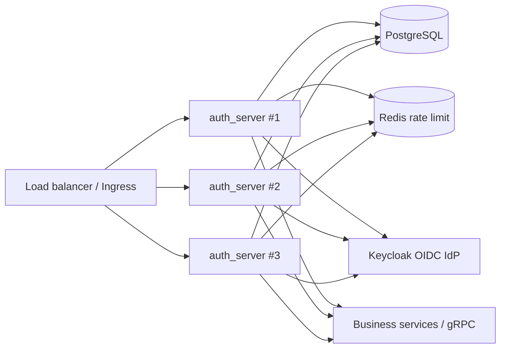

# 🏭 Garrison Reference Production Cases (v1.0 Gate Artifact Complete · Self-Hosted Reference)

> **Positioning statement**: this document is the **repository-side artifact** of the v1.0 "production case document" gate, and it is complete. All cases are **self-hosted reference deployments** (reproducible from the in-repo `auth_server` / `examples` / `docker-compose`), **not customer cases**; they contain no customer names, procurement scale, or unmeasured production metrics. The 1.0.0 release must wait for external conditions such as a third-party audit (see the ROADMAP "v1.0.0 Stable" gate table). Real deployment experience is welcome via the template at the end (reviewed and merged by maintainers after desensitization).

## 📋 Table of Contents

- [Case A: auth_server multi-instance + PostgreSQL + Redis + Keycloak](#-case-a-auth_server-multi-instance--postgresql--redis--keycloak)
- [Case B: embedded single machine](#-case-b-embedded-single-machine)
- [Case submission template](#-case-submission-template)
- [Honesty boundaries](#-honesty-boundaries)

---

## 🧭 Case A: auth_server multi-instance + PostgreSQL + Redis + Keycloak

**Applicable scenarios**: microservices / multi-system shared auth center; cross-instance session revocation, OIDC federation, and centralized auditing are required.

### Topology



### Capacity assumptions (design figures, not measured promises)

| Dimension | Reference value | Notes |
|------|---------|------|
| Instance count | 3 | Stateless deployment, horizontally scalable |
| Peak login RPS | 500 | Login includes the Argon2 slow hash; back-computed from `argon2_pool_size` and the CPU budget |
| Stateless verification RPS | 5000 | The `check_login_stateless` / `check_permission` hot path |
| Session storage | Instance-local DAO (oxcache) | Multi-instance needs sticky sessions or stateless JWT; for global session sharing evaluate candidate A (switching the whole DAO to Redis — not adopted) |
| Rate-limit storage | Dedicated Redis (`rate-limit-redis`) | The login hook and `RateLimitStrategy` share counters across instances |
| Database | PostgreSQL 16 | Migrations run via startup auto-migrate or offline |

### Key configuration

```bash
# Reference deployment (auth_server)
GARRISON_RATE_LIMIT_BACKEND=redis
GARRISON_REDIS_URL=rediss://redis-limiter.example:6380/0
GARRISON_STRICT_SECURITY=true
GARRISON_INTERNAL_API_KEY=<openssl rand -hex 32>
GARRISON_EXTERNAL_BIND=0.0.0.0   # containers only; bare-host runs default to loopback
```

- `rate-limit-redis` covers the **login firewall hook** (`fw:ip:*` / `fw:acct:*`) and `RateLimitStrategy`; the remaining rate-limit surfaces (`BruteForceStrategy` ban ledger / `DDoSStrategy` / OAuth2 `/token` / invitation codes / SMS/email quotas / API Key and account lockout / edge `rate_limit_middleware`) still operate independently on their own backends (see [ROADMAP](./ROADMAP.md) · rc.4 known limitations).
- Redis failure semantics: a failed connection at startup refuses to start; runtime errors propagate upward (login is fail-closed), with no silent fallback to memory.
- Use separate instances/databases for the rate-limit Redis and the business cache; do not mix `fw:*` / `rl:*` keys with oxcache cache keys.

### Failure drills

| Drill | Expected | Evidence |
|------|------|------|
| Redis rate-limit instance down | The new instance fails to start (fail-closed); running instances return errors for login requests instead of letting them through | The unreachable cases in `tests/redis_limiter_backend.rs`; `scripts/chaos_redis.sh` |
| PostgreSQL primary switchover | Session/audit writes fail briefly, then recover; no silent write loss (DAO errors propagate) | `docker/docker-compose.e2e.yml` + `scripts/e2e_matrix.sh` S3pg |
| TLS certificate rotation | `tls-cert-watch` hot-reloads in-process, no restart needed | [DEPLOYMENT · TLS](./DEPLOYMENT.md) |
| Keycloak unreachable | OIDC login fails with an explicit error; local password login is unaffected | `tests/keycloak_oidc.rs` / e2e S3kc |

### Reproducible evidence

- End-to-end matrix: `scripts/e2e_matrix.sh` → `logs/e2e_matrix_report.md`
- Performance acceptance: `scripts/e2e_run.sh` → `logs/perf.jsonl` + `scripts/e2e_analyze.py`
- Rate-limit dual instance: `GARRISON_TEST_REDIS_URL=... cargo test --features full --test redis_limiter_backend`
- Security evidence: `scripts/security_evidence.sh` → `logs/security-evidence.md`

---

## 📦 Case B: embedded single machine

**Applicable scenarios**: monolithic applications, edge nodes, development/test environments; single instance, or a rate-limit scope that may scale per instance.

| Dimension | Reference value | Notes |
|------|---------|------|
| Deployment form | Library embedded in the business process | `backend-embedded` |
| Storage | SQLite (`db-sqlite`) | Single writer; multi-instance requires PostgreSQL/MySQL |
| Rate limiting | `rate_limit_backend=memory` (default) | In-process counting; the effective multi-instance limit scales with the instance count |
| Sessions | In-process oxcache | Sessions die on process restart; enable `field-encryption` + an external KV for persistent sessions |

**Boundary**: the single-machine case provides no cross-instance session sharing, no cross-instance rate limiting, and no high-availability promise; for production multi-instance deployments refer to Case A.

---

## 📝 Case Submission Template

> How to submit: update this document via GitHub Issue / PR; please desensitize customer names, domains, keys, and exact traffic figures. Maintainers review against the criteria "reproducible, verifiable, no exaggeration".

```markdown
### Case name
- Industry / scale (optional, desensitized):
- Deployment form: embedded / auth_server / hybrid
- Topology: instance count, database, cache, IdP, gateway
- Version: garrison version + key feature combination
- Key configuration: sessions / rate limiting / encryption / audit (desensitized)
- Capacity & SLO: peak RPS, P99, availability target (state whether measured or design figures)
- Problems encountered and solutions: symptom → root cause → fix → regression evidence
- Evidence links: logs / reports / reproduction scripts (public parts only)
```

---

## 🧾 Honesty Boundaries

- The cases in this document are **reference deployments**, not customer endorsements; they contain no customer logos, contract sizes, or unmeasured production numbers.
- The capacity tables are design figures; actual capacity varies with CPU, Argon2 parameters, database, and network — run your own load tests using the same-machine baseline methodology from [PERFORMANCE](./PERFORMANCE.md).
- The rate-limit coverage follows [ROADMAP](./ROADMAP.md) · rc.4 known limitations; do not read `rate-limit-redis` as "all rate-limit surfaces are distributed".
- The security audit status follows [SECURITY_AUDIT](./SECURITY_AUDIT.md); a reference deployment is not a third-party certification or compliance attestation.
