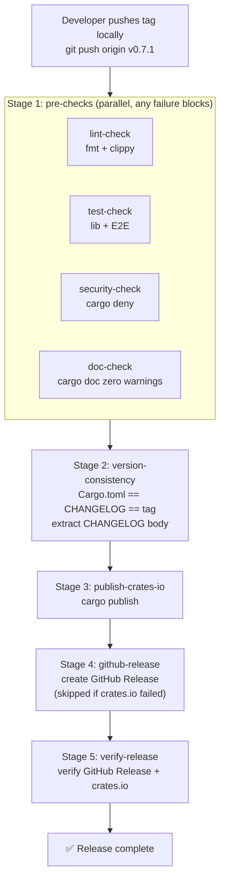

# 📦 Release Workflow

This document describes the release process of the Garrison project, following rules 18/19/21 plus the project_memory security/quality gate requirements.

## 📋 Table of Contents

- [Release flow diagram](#-release-flow-diagram)
- [Version conventions](#-version-conventions)
- [Pre-release checklist](#-pre-release-checklist)
- [Local prechecks](#-local-prechecks)
- [Release steps](#-release-steps)

---

## 🔄 Release Flow Diagram

<div align="center">



</div>



> **Note**: the release is triggered by a developer pushing the tag locally; CI does not create tags. The `version` input of `workflow_dispatch` is passed via an environment variable (shell-injection safe).

## 📏 Version Conventions

- **Git tag format**: `v{Major}.{Minor}.{Patch}` (e.g. `v0.7.1`), semver-compliant
- **Cargo.toml `[package].version` field**: `{Major}.{Minor}.{Patch}` (e.g. `0.7.1`)
- **docs/CHANGELOG.md**: each release adds a `## [{version}] - {YYYY-MM-DD}` section
- **Rule-29 exception**: the `[dependencies]` versions in Cargo.toml use the `x.x` format (no patch segment), but `[package].version` still uses `x.x.x` (consistent with crates.io / the git tag)
- **Workspace members**: `macros/Cargo.toml` and `examples/Cargo.toml` both use `version.workspace = true` with no standalone version field. The sed in the `bump-version` subcommand replaces only the first `^version = ".+"` line (i.e. the main package's `[package].version`), and **does not** touch the main `Cargo.toml`'s `[workspace.package].version` — the latter must be synced manually, otherwise workspace-member versions drift from the main package

## ✅ Pre-Release Checklist

The following checks must pass before a release (any failure blocks the release):

| Check | Command | Pass criteria | Rule basis |
|--------|------|---------|---------|
| Formatting | `cargo fmt --all -- --check` | No diffs | Rule 18 |
| Clippy | `cargo clippy --features full --lib --tests -- -D warnings` | 0 warnings | Rule 18 |
| Lib tests | `cargo test --features full --lib` | 0 failed | project_memory |
| E2E tests | `cargo test --features full --test '*'` | 0 failed | project_memory |
| Doc build | `RUSTDOCFLAGS="-D warnings" cargo doc --features full --no-deps` | 0 errors (the very command run at step 6 of `scripts/release.sh`) | project_memory |
| Security audit | `cargo audit` | 0 CRITICAL | Rule 19 |
| Dependency audit | `cargo deny check` | 0 failures | Rule 18 |
| Version consistency | `scripts/release.sh check-version` | Cargo.toml == CHANGELOG, tag absent | Rule 21 |

> **In-doc link drift is only caught by the release pipeline**: the doc job in `ci.yml` runs
> `cargo doc --no-deps --features full` without `-D warnings`, so rustdoc's `unresolved link` /
> `links to private item` / `redundant explicit link target` appear as warnings in CI and are
> ignored; once you change in-doc links inside `///` / `//!` (new types, moved modules, or
> writing internal items into public docs), you must run that command locally before release.

## 🔍 Local Prechecks

Run the local precheck script before tagging:

```bash
# Full precheck (all checks)
./scripts/release.sh precheck

# Version consistency only
./scripts/release.sh check-version 0.7.1

# Generate a changelog section (extracted from git log, version optional)
./scripts/release.sh gen-changelog v0.7.0..HEAD 0.7.1

# Reproducible-build verification (two independent builds compared byte by byte)
scripts/verify_reproducible_build.sh
```

### Reproducible Build

`scripts/verify_reproducible_build.sh` builds the garrison library twice independently and
compares the sha256 of `libgarrison.rlib` byte by byte. It complements the **Artifact
Attestations (build provenance)** on Release assets: attestation answers "does the artifact
come from this repo's CI", while the reproducibility check answers "do identical inputs
produce identical bytes" — downstream users can cross-verify acquired artifacts with both.

Prerequisites and boundaries:

- Reproducibility presumes the **same rustc toolchain + same Cargo.lock** (enforced via
  `--locked --frozen`); re-verify after toolchain or dependency changes (the
  `reproducible-build` job of CI `security.yml` anchors this on every PR).
- Build inputs are pinned: `SOURCE_DATE_EPOCH` fixed timestamp, `--remap-path-prefix` to
  eliminate local absolute-path differences; between the two builds only garrison's own
  fingerprints and artifacts are cleaned (dependency caches are reused).
- The script has negative-control semantics: any source change necessarily changes the hash
  (verified); there is no false-positive pass of the "build never happened" kind.

## 🚀 Release Steps

### 1. Bump the version

Use the script or edit `Cargo.toml` manually:

```bash
./scripts/release.sh bump-version 0.7.1
```

or edit manually:

```toml
[package]
version = "0.7.1"  # old 0.7.0 → new 0.7.1
```

### 2. Update CHANGELOG.md

Add a new version section after `## [Unreleased]`:

```markdown
## [0.7.1] - 2026-07-20

### Security
- Fixed the XXX vulnerability (CVE-XXXX-XXXXX)

### Added
- Added the XXX feature

### Changed
- Changed XXX behavior

### Fixed
- Fixed the XXX bug
```

You can use `./scripts/release.sh gen-changelog v0.7.0..HEAD 0.7.1` to auto-generate an oneline draft, then classify it manually into the sections above.

### 3. Run local prechecks

```bash
./scripts/release.sh precheck
```

Proceed to the next step after all checks pass.

### 4. Commit the version change

```bash
git add Cargo.toml docs/CHANGELOG.md
git commit -m "chore(release): bump version to 0.7.1"
```

### 5. Tag

```bash
git tag -a v0.7.1 -m "Release v0.7.1"
git push origin v0.7.1
```

### 6. Trigger the CI release workflow

The tag push automatically triggers `.github/workflows/release.yml`, with 5 stages and 8 jobs:

1. **lint-check** (stage 1, parallel): fmt + clippy
2. **test-check** (stage 1, parallel): lib + E2E tests
3. **security-check** (stage 1, parallel): cargo deny (advisory/license/ban/source; the standalone cargo-audit job has been removed — cargo-deny already covers the advisory checks, avoiding two ignore lists. `cargo audit` remains a local precheck step, see the checklist above)
4. **doc-check** (stage 1, parallel): cargo doc zero warnings
5. **version-consistency** (stage 2): Cargo.toml == CHANGELOG == tag, extracts the CHANGELOG body
6. **publish-crates-io** (stage 3): `cargo publish` to crates.io
7. **github-release** (stage 4): creates the GitHub Release from the CHANGELOG body (depends on crates.io success, avoiding a half-release)
8. **verify-release** (stage 5): verifies the GitHub Release + crates.io index propagation

If stage 3 fails, stage 4 does not run (avoiding the half-release state where the GitHub Release exists but crates.io has not published). A `concurrency` block prevents concurrent releases.

### 7. Verify the release

The verify-release job automatically runs a double verification:

- GitHub Release: `gh release view v{version}`
- crates.io: `curl https://crates.io/api/v1/crates/garrison` (6 retries over 60 seconds, waiting for index propagation)

Manual verification is also possible:

```bash
gh release view v0.7.1
cargo search garrison
```

### 8. Done

- Notify the users/team
- If a fix is needed after the release, see the "Rollback" section below

## Rollback

If a serious problem is found after release:

1. **Published crates.io versions cannot be retracted**, only yanked (`cargo yank --vers 0.7.1`)
2. **Delete the GitHub Release**: `gh release delete v0.7.1`
3. **Delete the tag**: `git tag -d v0.7.1 && git push origin :refs/tags/v0.7.1`
4. **Release a fix version**: bump to 0.7.2 and repeat the full process

## Emergency fix (patch release)

Emergency-fix workflow:

1. Create a hotfix branch from the latest tag: `git checkout -b hotfix/0.7.2 v0.7.1`
2. Fix the bug + update the CHANGELOG
3. Run `./scripts/release.sh precheck`
4. Commit + tag `v0.7.2`
5. Merge the hotfix branch back into main: `git checkout main && git merge hotfix/0.7.2`

## Rule Basis

- **Rule 12**: failures must be explicit (no `continue-on-error`; fail rather than warn when cargo-audit/deny are missing)
- **Rule 18**: `--no-verify` bypassing pre-commit / security review is forbidden
- **Rule 19**: tiangang SAST + diting code review are mandatory before release (local prechecks are the equivalent)
- **Rule 21**: docs and code in sync (CHANGELOG + version-consistency check)
- **Rule 26**: three subagents (security/architecture/performance) dispatched in parallel to review before committing
- **project_memory**: cargo doc zero warnings, all tests passing, CHANGELOG updated
