# Reliability Verification Guide (Redis Failure Drills)

Garrison's session/cache chain supports Redis backends (`cache-redis` / `rate-limit-redis`).
This document records how to run the Redis failure drills, the expected behavior, and the
interpretation criteria, for pre-release reliability verification and as the failure-drill
baseline for customer environments.

> Related: [SECURITY.md](SECURITY.md) | [CONFIGURATION.md](./CONFIGURATION.md) | [THREAT.md](./THREAT.md)

## 1. Covered Scenarios

<div align="center">



</div>

| # | Scenario | Fault injection | Simulated real-world failure |
|---|------|----------|----------------|
| 1 | Container pause → resume | `docker pause` / `unpause` | Host memory pressure / OOM freeze / VM suspension |
| 2 | Network disconnect → reconnect | `docker network disconnect` / `connect` | Switch failure / misconfigured security group / cross-AZ network partition |
| 3 | Forced restart | `docker restart` | Redis crash / kernel-upgrade reboot / orchestrator rescheduling |
| 4 | Sentinel primary-replica failover | `docker pause` the primary (chaos profile: master/replica/sentinel) | Sentinel promotes a replica after the primary dies; the old primary demotes back after recovery |

The scenarios cover two typical failure shapes: **process-level failures** (pause/restart —
connections hang or reset) and **network-level failures** (unbinding — the process lives but
is unreachable). The latter is stealthier: the TCP connection may be answered by the docker
userland proxy, so the script judges availability uniformly by the **protocol-level PING
response**, not by "can a TCP connection be established".

## 2. How to Run

### 2.1 Prerequisites

- Docker available and the Redis service of `docker/docker-compose.e2e.yml` up:

  ```bash
  docker compose -f docker/docker-compose.e2e.yml up -d redis
  ```

- No host redis-cli dependency: in-container probing goes through `docker exec`; host-side
  probing uses bash `/dev/tcp` to send a RESP protocol `PING`.

### 2.2 Running

```bash
scripts/chaos_redis.sh            # all four scenarios (default)
scripts/chaos_redis.sh pause      # scenario 1 only
scripts/chaos_redis.sh disconnect # scenario 2 only
scripts/chaos_redis.sh restart    # scenario 3 only
scripts/chaos_redis.sh sentinel   # scenario 4 only (brings up the chaos profile drill topology)
```

Environment variables can override the targets: `GARRISON_CHAOS_CONTAINER` (default
`garrison-e2e-redis`), `GARRISON_CHAOS_HOST` (default `127.0.0.1`),
`GARRISON_CHAOS_PORT` (default `16379`), `GARRISON_CHAOS_TIMEOUT_S`
(single-probe timeout, default 3 seconds).

The script plants a **canary value** before injection and asserts it after recovery
(scenario 3 verifies `/data` volume persistence — a restart loses no data); on interruption
a `trap` releases the pause so no paused leftover state remains. Scenario 4 additionally
waits before injection until Sentinel has learned the replica (`num-slaves ≥ 1`): Sentinel
discovers replicas only via the primary's `INFO` (default refresh period 10s); injecting a
fault into a cold topology (compose just started) without waiting records the "no replica
to promote" race as a drill failure (`-failover-abort-no-good-slave`). The drill topology
(`garrison-chaos-*`) is reclaimed by the script on success, failure, and interruption alike;
on failure/interruption it captures the Sentinel log (last 30 lines) before removing
containers — leaving neither leftover containers nor losing troubleshooting evidence.

### 2.3 Output and exit codes

- Each step prints `[PASS]` / `[FAIL]` lines; any scenario failure makes the script exit `1`.
- Exit code `0` when everything passes.

## 3. Expected Behavior and Interpretation Criteria

### 3.1 During fault injection (degraded-behavior observation)

| Item | Criterion |
|--------|------|
| Injection effective | Host-side protocol PING unresponsive within the scenario (asserted automatically) |
| Scenario 2 isolation shape | In-container `redis-cli ping` still returns PONG (process alive, network-isolated only) |
| Application-side cache operations | Must not panic, must not block worker threads indefinitely; operations end with an error return or a timeout |
| Application-side session/auth paths | During cache unavailability the read path falls back to the DAO (slower but functional); the write path degrades per config or errors out, and must never silently drop credential-grade data |
| Observation means | garrison / oxcache `tracing` logs (connection errors, timeouts, fallback records) and metrics (cache hit-rate drop, error-count rise) |

### 3.2 After the fault clears (recovery verification)

| Item | Criterion |
|--------|------|
| Container health | Back to `health=healthy` within 60 seconds (asserted automatically, 2s polling) |
| Failover (scenario 4) | The replica is promoted by Sentinel within 240 seconds (sdown → election → promotion, full chain; `down-after-milliseconds` is 30s, and host stalls triggering TILT delay detection); the promoted node is writable; **the canary value confirmed via replication before the switchover is readable** (the script waits for replication to catch up before injecting, removing the async-replication race); before injection it also asserts `num-slaves ≥ 1` to confirm Sentinel has learned the replica (cold-topology race); the old primary demotes to replica and rejoins within 60 seconds of recovery |
| Protocol availability | `PING → PONG`; `SET`/`GET` round-trip succeeds (asserted automatically) |
| Data persistence | Scenario 3's canary value survives the restart (`/data` volume in effect; asserted automatically) |
| Application-side reconnection | Cache/rate-limit clients rebuild their connection pools automatically, no application restart; logs show successful reconnects and the hit rate recovers |
| Data consistency | After restart recovery, garrison sessions remain verifiable via the DAO (the cache is an acceleration layer, not the sole source of truth; DAO-backed paths are unaffected by cache restarts) |

### 3.3 Interpretation scope

The script's automatic assertions cover **infrastructure availability** (injection
effective plus recovery, persistence, and Sentinel automatic switchover); the **application-level degraded
semantics** (the last four rows of 3.1) require running an application instance integrated
with garrison during the drill and observing its logs/metrics — criteria as in the tables
above. Cluster shard migration is still outside the script's scope and needs a separate
drill environment.

> **Drill topology vs. production**: scenario 4 uses a single Sentinel + quorum 1 (the
> compose `chaos` profile, for speed and resource reasons) with `down-after-milliseconds`
> relaxed to 30s to absorb host event-loop stalls (in Sentinel TILT mode it only collects
> information without acting; measured stalls of 90s+ exhaust the promotion window of the
> 3s tier, `down_after × 10 = 30s`, aborting failover with
> `-failover-abort-no-good-slave`). Production should run at least 3 Sentinels with
> quorum 2 — a single Sentinel cannot form an election majority safely, so production
> interpretation should replay under the production topology.

## 4. Environment Adaptation

The script defaults to the single-machine Redis of `docker/docker-compose.e2e.yml`. When
adapting to a customer environment:

1. Point the `GARRISON_CHAOS_*` environment variables at the target instances (container
   orchestration environments need `docker exec` / `network` operations replaced with the
   equivalent commands of the orchestration platform);
2. For finance/government customers, have the customer or an assessment body **witness the
   drill on site** and keep the report (the validity boundaries of self-test reports are in
   the supply-chain chapter of [SECURITY.md](SECURITY.md)).
