# 🗺️ Garrison Project Roadmap

This document describes Garrison's (the Rust authentication and authorization framework) version evolution plan and design principles.

> Repository: <https://github.com/Kirky-X/garrison>
> License: Apache-2.0
> Author: Kirky-X <Kirky-X@outlook.com>
> Change management: through the specmark workflow — proposal → design → tasks → archive
> For architecture see the [🏗️ Architecture doc](./ARCHITECTURE.md); for development standards see [🛠️ Development Standards](./DEVELOPMENT.md).

## 📋 Table of Contents

- [Version Overview](#-version-overview)
- [Detailed Version Planning](#-detailed-version-planning)

---

## 📊 Version Overview

<div align="center">



</div>

| Version | Status | Planned completion | Main content |
|------|------|---------|---------|
| 0.1.0 | ✅ Completed | 2026-06-30 | Core infrastructure |
| 0.2.0 | ✅ Completed | 2026-07-01 | Protocols and the security layer |
| 0.2.1 | ✅ Completed | 2026-07-01 | auto-wire fixes + protocol boundary tests + examples engineering |
| 0.3.0 | ✅ Completed | 2026-07-02 | Ecosystem completion and observability (OTLP / gRPC / i18n / metrics) |
| 0.4.0 | ✅ Completed | 2026-07-02 | Closing the 0.2.0 protocol-layer gaps (OIDC / ScopeHandler / SsoServer / AloneCache / ParameterQuery) |
| 0.4.2 | ✅ Completed | 2026-07-05 | Gap closure (dao extensions / strategy-registry / jwt-modes / oauth-2-1 / token-introspection / apikey-namespace / sso-toctou / password-login / secure-password / login-id-type / login-type-multi-account / session-kickout-device / listener-events-extend / repository-layer / web-context-adapters / annotation-macros) |
| 0.5.0 | ✅ Completed | 2026-07-06 | The production-necessities release (multi-tenancy / social login / audit logs / token rotation / protection suites / role hierarchy / decision provenance / the Keycloak OIDC RP / SSO TOCTOU atomization / the annotation system / PostgreSQL / full actix+warp adapters) |
| 0.5.1 | ✅ Merged | 2026-07-07 | The engineering-optimization release (RBAC entities / UserDevice / the permission registry / the request-object API / miette rich errors / JSON tests / the explicit Manager API / confusable-string detection — features merged directly into 0.5.2+ releases) |
| 0.5.2 | ✅ Completed | 2026-07-08 | The architecture-refactor release (the GarrisonLogic trait split / the LoginId newtype removal / the oxcache _sync evaluation / keys performance / the stp module split) |
| 0.5.3 | ✅ Completed | 2026-07-09 | The feature-completion release (the oxcache upgrade / the full stp split / the MySQL backend / the Firewall MaxMindDb production backend) |
| 0.6.0 | ✅ Completed | 2026-07-09 | The account-security-engine release (the account/ module + the Credential SPI + PasswordPolicyEngine + UserLockoutStrategy + the AuthenticationFlow DSL + i18n for social-login errors + AccountMetrics) |
| 0.6.1 | ✅ Completed | 2026-07-10 | gap-closure-remaining closed (remember_me / Redis deployment modes / switch_to / renew_to_equivalent / OAuth2 annotations / group() / SessionExpiryListener / SAML 2.0 / the OIDC RP / the Redis pub/sub SsoChannel — all 11 items closed) |
| 0.6.2 | ✅ Completed | 2026-07-10 | Security and performance enhancements: session idle timeout / XSS protection / rate limiters / masking / cache warm-up |
| 0.6.3 | ✅ Completed | 2026-07-11 | Token auto-renewal / concurrent-login control / device management |
| 0.6.4 | ✅ Completed | 2026-07-11 | WAF / CORS / CSRF / the Redis rate-limit backend |
| 0.6.5 | ✅ Completed | 2026-07-12 | Security alerting / device binding / the ban ledger / second-factor auth |
| 0.6.6 | ✅ Completed | 2026-07-12 | Anonymous sessions / session search / login_token_map persistence |
| 0.6.7 | ✅ Completed | 2026-07-13 | Security and performance enhancements (forbid-priority semantics / WAF-grade firewall / the three-tier cache architecture / progressive SMS-code rate limiting / the AnomalousLoginDetector dual engine) |
| 0.7.0 | ✅ Completed | 2026-07-17 | Microservice architecture + ABAC/Cedar + the OAuth2 Server + dependency optimization + architecture hardening (7 capability domains / 252 TDD tasks / 2968 tests passing) |
| 0.7.1 | ✅ Completed | 2026-07-21 | Security fixes + architecture hardening: 21 security fixes (secure-simple-token / SimpleTokenStyle anti-forgery / the OIDC aud array compatibility / switch_to account-session cleanup / session corrupt-json robustness etc.) + the crate rename bulwark → garrison |
| 0.7.2 | ✅ Completed | 2026-07-21 | Windows CI fixes + config-file security hardening (7 protections: traversal detection/TOCTOU/file-size limits etc.) + gitleaks secret scanning + the .env.example fix |
| 0.7.3 | ✅ Completed | 2026-07-22 | The `#[check_disable]` proc macro + the `check_disable_sync()` synchronous API + the `dao_session!` macro eliminating 53 boilerplate sites + garrison-macros version alignment |
| 0.8.0 | ✅ Completed | 2026-07-24 | The security-hardening release: the constant-time comparison public primitive + JWT weak-key rejection + unified CSPRNG + the API Key security migration (CWE-916 hashed storage + IP-level brute-force protection + IDOR multi-tenant isolation) + the tech-review fix batch (real health-check probes / singleflight lock cleanup / SQL placeholder conversion) + CodeQL false-positive cleanup |
| 0.8.1 | ✅ Completed | 2026-07-24 | The audit-log token-leak fix (CWE-532): live-token truncation for 6 event classes + a built-in blocklist in TokenRefresh + TempCredential recording only value_len + the 64KB SAML input cap |
| 0.9.0-rc.1 | ✅ Completed | 2026-08-25 | In-house library feature absorption + batch dependency upgrades (oxcache 0.5 / dbnexus 0.6 / sdforge 0.5 / trait-kit 0.5 / confers 0.6 / limiteron 0.3) + config-enhancement features (config-yaml/audit/consul/etcd/distributed/schema) + database enhancements (db-sharding/replica/saga) + firewall enhancements (gcra/tower/quota/admission/event/monitoring/parallel) + the unified protocol-domain rename (secure-httpbasic/httpdigest → protocol-*) + the i18n hard-coding fix + function coverage 89.87% → 92.77% |
| 0.9.0-rc.2 | ✅ Completed | 2026-08-26 | fail-closed security hardening: `check_api_key` / `check_abac_with_policy` refuse when dependencies are missing instead of allowing by default; firewall auto-wiring; the `session::dao` crate-internal visibility expansion; the `firewall_hook_injected` marker |
| 0.9.0-rc.3 | ✅ Completed | 2026-10-14 | The security-audit remediation batch R01–R18: the unified error model (request-id / Retry-After / module-prefixed codes) + the Argon2 concurrency token pool + at-rest field encryption (AES-256-GCM) + WebAuthn/Passkey + password reset + the MFA/step-up orchestration foundation + OIDC back-channel logout + OIDC discovery/multi-kid JWKS rotation + the refresh-reuse three-tier classification + multi-tenant hardening (session-tenant binding / the identifier registry / device interfaces) + the single Set-Cookie construction point + the garrison-cli ops face + tightened reference-deployment security baselines |
| 0.9.0-rc.4 | ✅ Completed | 2026-10-20 | SHA-256-digested session keys + DAO atomic-contract fixes (set_if_absent expiry takeover / MySQL ensure_table) + the vacuum_expired primitive + release-pipeline convergence + the Redis rate-limit backend landed (candidate B) + the v1.0 gate repository-side artifacts (the API freeze candidate list / the API diff workflow / the performance baseline committed / cookie security defaults / RefreshTokenRotation concurrency verification) |
| 1.0.0 | 📋 External to-dos (repository-side artifacts complete) | 2027 Q2 | The stable release: of the four gates — API freeze / performance baselines / production cases / security audit — the repository-side artifacts are complete and the third-party security audit is an external to-do; **this round releases 0.9.0 (2026-11-14), not 1.0.0** |

---

## 📝 Detailed Version Planning

### v0.1.0 Core infrastructure (completed)

Release date: 2026-06-30

- ✅ The error-type system (`GarrisonError`)
- ✅ The configuration system (three-tier config sources + `tokio::sync::watch` hot reload)
- ✅ The context abstraction (`GarrisonContext` + the axum adapter + task_local)
- ✅ The DAO abstraction (the `GarrisonDao` trait + oxcache + dbnexus)
- ✅ Dual-mode session management (Account-Session + Token-Session)
- ✅ The core APIs (`GarrisonLogic` + `GarrisonUtil`)
- ✅ The permission-check strategy (`GarrisonPermissionStrategy`)
- ✅ The global manager (`GarrisonManager` + inventory compile-time registration)
- ✅ The axum integration (extractor + `GarrisonRouter` + Interceptor)

**Milestone significance**: completes the minimal "it runs" loop, supporting login, sessions, permission checks, and the axum integration over UUID/Random64 tokens. Serves as the baseline version for evaluating the framework's design philosophy.

#### Known limitations (0.1.0)

- oxcache 0.3's `Cache<K,V>::update` cannot preserve per-entry TTL
- dbnexus 0.2 supports SQLite only (PostgreSQL awaited 0.3+, MySQL awaited 0.4+)
- `GarrisonRouter::route_protected` supports the GET method only

---

### v0.2.0 Protocols and the security layer (completed)

Release date: 2026-07-01

#### The 0.2.0 feature-domain status table

Garrison adopts a 13-feature-domain design; the 0.2.0 progress state:

| # | Feature domain | Module | Feature | 0.1.0 state | 0.2.0 state |
|---|--------|------|---------|-----------|------------|
| 1 | Login authentication | `core/auth` | - | ✅ Completed | 🚧 Refining |
| 2 | Permission authorization | `core/permission` | - | ✅ Completed | 🚧 Refining |
| 3 | Sessions | `session` | - | ✅ Completed | 🚧 Refining |
| 4 | OAuth2 | `protocol/oauth2` | `protocol-oauth2` | ❌ Not started | 🚧 Planning |
| 5 | Single sign-on (SSO) | `protocol/sso` | `protocol-sso` | ❌ Not started | 🚧 Planning |
| 6 | JWT | `protocol/jwt` | `protocol-jwt` | ❌ Not started | 🚧 Planning |
| 7 | Microservice gateway auth | `protocol/sign` | `protocol-sign` | ❌ Not started | 🚧 Planning |
| 8 | API endpoint auth | `protocol/apikey` | `protocol-apikey` | ❌ Not started | 🚧 Planning |
| 9 | Temporary credentials | `protocol/temp` | `protocol-temp` | ❌ Not started | 🚧 Planning |
| 10 | TOTP dynamic codes | `secure/totp` | `secure-totp` | ❌ Not started | 🚧 Planning |
| 11 | Basic auth | `secure/httpbasic` | `secure-httpbasic` | ❌ Not started | 🚧 Planning |
| 12 | Digest auth | `secure/httpdigest` | `secure-httpdigest` | ❌ Not started | 🚧 Planning |
| 13 | Route interception auth | `router` | `web-axum` | ✅ Completed | 🚧 Refining |

#### The protocol layer (protocol-*)

- 🚧 JWT issuance and verification (`protocol-jwt`)
- 🚧 The three OAuth2 modes (`protocol-oauth2`: authorization code / password / client credentials)
- 🚧 SSO single-sign-on tickets (`protocol-sso`)
- 🚧 API signing + nonce anti-replay (`protocol-sign`)
- 🚧 API Key authentication (`protocol-apikey`)
- 🚧 Temporary credentials (`protocol-temp`)

#### The security layer (secure-*)

- 🚧 TOTP dynamic codes (`secure-totp`, RFC 6238)
- 🚧 HMAC signing utilities (`secure-sign`)
- 🚧 HTTP Basic authentication (`secure-httpbasic`)
- 🚧 HTTP Digest authentication (`secure-httpdigest`)

#### Core extensions

- 🚧 Refining the `core/auth` / `core/permission` / `core/token` abstractions
- 🚧 The exception system + JSON templates + the plugin system + listeners
- 🚧 New config fields: `jwt_algorithm`, `sign_window_seconds`, `sso_ticket_ttl_seconds`

**Milestone significance**: covers most of the protocol and security sub-domains of the 13 feature domains; Garrison moves from "usable" to "complete".

---

### v0.2.1 Stability optimization and documentation (completed)

Release date: 2026-07-01

A PATCH release focused on 0.2.0 bug fixes and protocol-layer stability optimization, introducing no new protocols or features.

#### Fixes

- ✅ The auto-wire gap fix: `GarrisonManager::builder().build().await` now auto-injects the PluginManager / ListenerManager / AuthLogic / PermissionChecker into `GarrisonLogicDefault`
- ✅ 4 new builder methods on `GarrisonLogicDefault` (`with_plugin_manager` / `with_listener_manager` / `with_auth_logic` / `with_permission_checker`)
- ✅ The `GarrisonLogicFactoryFn` signature extended with `GarrisonLogicFactoryContext`, supporting factories that inject the manager

#### Test completion

- ✅ Protocol-layer boundary-scenario tests (20 tests across 6 modules): OAuth2 / SSO / JWT / Sign / APIKey / Temp
- ✅ auto-wire integration tests (3 tests): verifying that `GarrisonUtil::login/logout` automatically triggers plugins/listeners
- ✅ Examples engineering reorganization: a workspace member + an independent test file per bin

#### Documentation

- ✅ Fixed the unclosed HTML tags in the `context_request` module's docs
- ✅ `cargo doc --no-deps --features full --workspace` zero warnings

**Milestone significance**: closes 0.2.0's auto-wire gap and protocol boundary-test coverage, laying a stable baseline for the 0.3.0 multi-backend evolution.

---

### v0.3.0 Ecosystem completion and observability (completed)

Release date: 2026-07-02

Focused on ecosystem integration and observability, introducing no new protocol layers.

#### Added (ecosystem integration)

- ✅ OpenTelemetry OTLP distributed tracing (the `otlp` feature, OTLP gRPC export)
- ✅ The gRPC auth interceptor (the `grpc` feature, a `tonic::Interceptor` implementation)
- ✅ Exception-message internationalization (fluent-rs Chinese/English switching; the base layer compiles unconditionally)
- ✅ Prometheus metrics (the `metrics-prometheus` feature)

#### Known limitations (0.3.0)

- The PostgreSQL / MySQL backends still awaited `dbnexus` 0.3+ (deferred to 0.5.0+)
- The actix-web / warp adapters provided only minimal skeletons, without full extractor adaptation

**Milestone significance**: completes production-grade observability and ecosystem integration, laying the foundation for closing the 0.4.0 protocol-layer gaps.

---

### v0.4.0 Closing the protocol-layer gaps (completed)

Release date: 2026-07-02

Focused on the 8 gaps left over from the 0.2.0 protocol layer, implemented via the specmark change
`v0-2-0-protocol-layer-gap-closure`. 7 items completed; gap #4 was deferred to 0.5.0+ due to a spec error.

#### Added (5 feature flags)

| Gap | Feature | Core types | Status |
|-----|---------|---------|------|
| #1 OAuth2 RefreshToken | `protocol-oauth2` (extending the existing feature) | `OAuth2Client::refresh_access_token` | ✅ Done |
| #2 OIDC | `protocol-oidc` | `OidcHandler` (sign_id_token / verify_id_token / discovery_metadata) | ✅ Done |
| #3 Scope Handler | `oauth2-scope-handler` | The `ScopeHandler` trait + `ScopeRegistry` | ✅ Done |
| #5 SSO Server | `protocol-sso-server` | The `SsoServer` trait + `CenterIdConverter` + `SsoChannel` + `DefaultSsoServer` | ✅ Done |
| #6 AloneCache | `alone-cache` | The `AloneCache` decorator + `AloneCacheManager` | ✅ Done |
| #7 ParameterQuery | `parameter-query` | The `ParameterQuery` trait + `ParameterQueryBuilder` | ✅ Done |
| #8 master-slave verification | — | Spec-document verification (covered by oxcache 0.3's sentinel mode) | ✅ Done |
| #4 The annotation system | — | `@CheckAccessToken` / `@CheckClientToken` | ⏸️ Deferred to 0.5.0+ |

#### Post-review fixes (the review pass)

- ✅ M5: `SsoClient::validate_ticket`'s client_id mismatch error type `Config` → `InvalidToken`
- ✅ M6: `SsoTicketData` deduplicated across modules, exported as `pub(crate)`
- ✅ M7: `ParameterQueryBuilder::check_permission/check_role` extracted a `check_common` helper
- ✅ M4: `OidcHandler` added `require_hmac_algorithm()`, returning a `Config` error for asymmetric algorithms
- ✅ L9: the `verify_id_token_tampered_fails` test assertion strengthened to `InvalidToken`
- ✅ M1: a doc warning added for the SSO `validate_ticket` TOCTOU race (awaiting the atomic get-and-delete in 0.5.0+)

#### Test coverage

- 829 lib tests + integration tests + example tests all passing
- tarpaulin coverage 95.43% (2298/2408 lines), above the 95% target

#### Known limitations (0.4.0)

- **Gap #4 deferred**: the spec erroneously referenced `OAuth2Client::validate_client_token` (a nonexistent method). A token introspection (RFC 7662) design or a `OidcHandler::verify_id_token` reuse plan was needed first
- **The SSO TOCTOU race (M1)**: `validate_ticket`'s get→delete is non-atomic; concurrent calls on the same ticket could theoretically replay. Impact is limited within the 60-second TTL window; security-sensitive scenarios should guard with outer locking. Unified fix awaited 0.5.0+

**Milestone significance**: closes the 0.2.0 protocol-layer gaps; the five capabilities — OIDC / Scope Handler / SSO Server / AloneCache /
ParameterQuery — are in place; Garrison's protocol layer moves from "usable" to "complete".

---

### v0.5.0 The production-necessities release (completed)

Completed: 2026-07-06

Focused on production-necessity capabilities. By absorbing the engineering designs of QIdentity (an authentication service) and cedar (a policy engine), garrison moved from "protocol-complete" to "production-usable", while closing the v0.4.0 leftover limitations.

#### Added (production necessities, absorbed from QIdentity)

| # | Feature | Core capability | Source |
|---|---------|---------|------|
| H1 | `tenant-isolation` | Multi-tenant logical isolation: the `tenant_id` field + the `task_local!` TenantContext + enforced Repository filtering + the TenantResolution middleware | QIdentity |
| H2 | `social-wechat` / `social-alipay` | Social login: the `SocialLoginProvider` trait + the WeChat-QR/Alipay providers + the SocialBinding table (the mini-program variant `WechatMiniApp` reserved; implementation deferred to v0.5.1+) | QIdentity |
| H3 | `audit-log` | Audit-log persistence: the `audit_logs` table + 14 listener-event subscriptions + compound-condition queries + automatic masking | QIdentity |
| H4 | `protocol-jwt` (extended) | RefreshToken rotation: the `refresh_tokens` table + tokenHash(SHA-256) + the parentTokenHash chain + keyVersion + reuse detection | QIdentity |
| H5 | `firewall-bruteforce` / `firewall-ratelimit` / `firewall-anomalous` / `firewall-ddos` / `firewall-geoip` / `firewall-maxminddb` | The protection suite: 5 FirewallStrategy implementations + the MaxMindDb production backend (`MaxMindDbGeoLookup` / `MaxMindDbCountryLookup` added in v0.5.3), reusing oxcache as the counting backend | QIdentity |
| H6 | `repository-layer` (extended) | Role hierarchy: the `role_hierarchy` table (child_role/parent_role/tenant_id) + the indirect-ancestor closure + TC precomputation + login-time permission-union caching | cedar |
| H7 | `decision-trace` | Decision provenance: `Decision{allowed, reason, errors}` + the new `authorize()` API, keeping the legacy `check_permission()` API | cedar |

#### Added (Keycloak integration, by user request)

| # | Feature | Core capability |
|---|---------|---------|
| K1 | `keycloak-oidc` | Keycloak as the OIDC IdP: garrison joins as the RP — discovery metadata + JWKS signature verification + ID Token validation (no keycloak-admin-client, keeping the lightweight positioning) |

#### Closing (the v0.4.0 leftovers)

| # | Content | Source |
|---|------|------|
| P1 | SSO TOCTOU atomization: `SsoClient::validate_ticket` switched to the atomic `GarrisonDao::get_and_delete` | v0.4.0 M1 |
| P2 | The annotation system (gap #4): the `@CheckPermission` / `@CheckRole` proc macros | v0.4.0 gap #4 |
| P3 | The PostgreSQL backend: integrated once dbnexus 0.3+ ships (an external dependency, possibly deferred) | v0.4.0 known limitations |
| P4 | Full actix-web / warp Extractor adaptation | v0.3.0 known limitations |

#### Design principles (followed during absorption)

- **Rule 2 simplicity first**: no policy DSL, no keycloak-admin-client
- **Rule 7 expose conflicts**: of QIdentity's UserLevel vs Role dual track, only Role is chosen; cedar's DSL is not mixed with the framework's existing style
- **Rule 11 conventions first**: keep `login_id: i64` + the global singleton; no forced newtype (A-004 done in v0.5.2)
- **Rule 12 explicit failures**: all stubs/degradations must return `Unsupported` errors, avoiding QIdentity's 7 defects
- **Rule 5 deterministic logic**: thresholds/routing/rate-limit rules use explicit configuration, not model decisions

#### Known risks (identified in the pre-mortem)

| Risk ID | Description | Mitigation |
|---------|------|---------|
| F1 | Scope explosion causing an unfinished release | Split into staged releases (v0.5.0/v0.5.1/v0.5.2) |
| F4 | Multi-tenancy incompatible with oxcache | Explicitly logical isolation, not schema-dependent |
| F5 | Social-login testing difficulty | mockito to simulate WeChat/Alipay responses |
| F10 | dbnexus 0.3+ blocking | P3 may defer to v0.5.1 without blocking the v0.5.0 main body |

**Milestone significance**: completes the production necessities (multi-tenancy/social login/auditing/protection/role hierarchy/decision provenance/Keycloak); garrison moves from "protocol-complete" to "production-usable".

---

### v0.5.1 The engineering-optimization release (merged into 0.5.2+)

Completed: 2026-07-07

Focused on engineering optimization and developer experience, absorbing QIdentity's RBAC entity model and cedar's engineering-design ideas. Features merged directly into the main branch and shipped with 0.5.2+; no standalone 0.5.1 version was released.

#### Added (engineering optimization)

| # | Feature | Core capability | Source |
|---|---------|---------|------|
| M1 | `repository-layer` (extended) | The RBAC entity model: the `roles`/`permissions`/`role_permissions`/`user_roles` tables + configurable role initialization | QIdentity |
| M2 | `repository-layer` (extended) | The UserDevice entity: the `user_devices` table + the MAX_DEVICES config + block/unblock + UA parsing (the ua-parser crate) | QIdentity |
| M3 | `permission-registry` | The permission registry: a lightweight schema declaring and validating the `permission -> required_roles` mapping at startup | cedar |
| M4 | `authorize-api` | The request-object API: `AuthRequest{principal,action,resource,context}` + `authorize(req) -> Decision` | cedar |
| M5 | `garrison-error` (extended) | miette rich errors: GarrisonError carrying structured context (solving A-008) + the existing variants kept + a new source chain | cedar + A-008 |
| M6 | `garrison-testing` | JSON test cases: a declarative authorization-test format, complementing specmark | cedar |
| M7 | `manager-explicit` | The explicit Manager API: keeping the global singleton + adding the explicit `Manager::authorize(req)` API | cedar |
| L6 | `security-confusable` | Confusable-string detection: scanning permission strings at startup, warning on Unicode homoglyphs | cedar |

**Milestone significance**: completes engineering optimization and developer experience; the permission model moves from "string matching" to "declarative + explainable".

---

### v0.5.2 The architecture-refactor release (completed)

Completed: 2026-07-08

Focused on architecture refactoring and code quality, solving the architectural problems identified by the diting review. Breaking changes allowed (the 0.x stage permits them under semver).

> **Implementation-decision revision**: the original plan was a `#[deprecated]` transition period, but at the apply stage the user decided on direct deletion (no backward compatibility), clearing the technical debt completely.

#### Refactoring (architecture optimization)

| # | Content | Core change | Status | Commit |
|---|------|---------|------|--------|
| A-002 | The GarrisonLogic trait split | The 21-method god trait split into 5 business sub-traits (SessionLogic/PermissionLogic/TokenLogic/MfaLogic/PasswordLogic, with the super-trait `GarrisonCore`), **deleting GarrisonLogic directly** (no deprecated transition) | ✅ Completed | `cbcedcb` `7c86a99` `bc63645` |
| A-004 | The LoginId migration | **The LoginId newtype deleted**, using `String`/`&str` across the stack (object-safe, usable as `dyn`) | ✅ Completed | `a52f8e0` |
| A-009 | The oxcache _sync API blocking evaluation | Conclusion: keep the `_sync` APIs (<1μs on the in-memory backend vs spawn_blocking's 10-50μs), documenting the performance constraints | ✅ Completed | The evaluation document was removed along with the `docs/decisions/` directory (commit `65917514`) |
| A-010 | The keys full-scan performance evaluation | Conclusion: defer to oxcache 0.5+ (`Cache.backend` is `pub(crate)`), documenting the known limitation | ✅ Completed | The evaluation document was removed along with the `docs/decisions/` directory (commit `65917514`) |
| A-011 | Splitting src/stp/mod.rs | The 164KB single file split into 10 responsibility files (done together with A-002) | ✅ Completed | `cbcedcb` `a52f8e0` `bc63645` |

#### The compatibility strategy

- ~~All breaking APIs marked `#[deprecated]` + doc warnings~~ **Revised: deleted directly, no transition**
- ~~At least one minor-version transition period (marked in v0.5.2 → removed in v0.6.0)~~ **Revised: deleted directly in v0.5.2**
- ~~The old trait kept as a type alias forwarding to the new one~~ **Revised: no type alias**
- The Manager holds the concrete type `Arc<GarrisonLogicDefault>` (not a trait object); callers must explicitly `use` the sub-traits

**Milestone significance**: the architecture debt is cleared, preparing for the v1.0.0 API freeze.

---

### v0.5.3 The feature-completion release (completed)

Completed: 2026-07-09

Focused on feature completion, implementing 4 completions (A-015/A-014/A-012/A-013) via the specmark change `v0-5-3-feature-completion`. Closes the stp-split leftovers, the MySQL backend, and the Firewall MaxMindDb production backend, and upgrades oxcache.

#### Completion (closing the feature loop)

| # | Content | Core change | Status | Commit |
|---|------|---------|------|--------|
| A-015 | The oxcache upgrade + decision-doc sync | Upgraded `oxcache` to 0.3.3 (per-entry TTL + `ttl_sync()` queries); updated the A-010 decision document and the `src/dao/mod.rs` comments | ✅ Completed | `e3b89c6` |
| A-014 | The full stp/mod.rs split | The 164KB `src/stp/mod.rs` split into 11 responsibility files (adding `tests.rs` + `interface.rs` + `util.rs`); the 6 `impl trait for GarrisonLogicDefault` blocks moved to their sub-files; mod.rs finally 12.4KB / 284 lines | ✅ Completed | `d5b945e` `5862e77` `57c9e59` `bc52803` |
| A-012 | The MySQL backend enabled + testcontainers integration tests | Enabled the `db-mysql` feature; added the `testcontainers = "0.27"` dev-dependency; created `tests/db_mysql_testcontainers.rs` (11 `#[serial]` integration tests); created 6 MySQL-compatible migration files under `migrations/mysql/core/` | ✅ Completed | `904718a` |
| A-013 | The Firewall MaxMindDb production backend | Added the `maxminddb = "0.29"` dependency + the `firewall-maxminddb` feature; implemented `MaxMindDbGeoLookup` (GeoIP2-City) + `MaxMindDbCountryLookup` (GeoIP2-Country); 14 tests + GeoLite2 test data | ✅ Completed | `a9e23ba` |

#### Deviation notes

- **db-mysql is not in the `full` aggregate feature**: dbnexus forbids db-sqlite and db-mysql simultaneously (`compile_error!`), so db-mysql must be enabled separately
- **The stp split yields 11 files (not the spec's 10)**: v0.5.3 added `tests.rs` to host the integration tests and mod.rs references it via `#[cfg(test)] mod tests;`; the spec's acceptance criteria were revised in sync (10→11 files, mod.rs < 5KB→< 15KB)

#### Verification results

- `cargo test --features full --lib`: 1336 passed; 0 failed
- `cargo clippy --features full --lib --tests -- -D warnings`: zero warnings
- `cargo test --features "db-mysql" --test db_mysql_testcontainers`: 11 passed (needs Docker)
- `cargo test --features "firewall-maxminddb" --lib maxminddb`: 14 passed
- `cargo doc --no-deps --features full`: 10 pre-existing warnings (`decision.rs` broken intra-doc links + `web_actix`/`web_warp` unclosed HTML tags, not introduced by v0.5.3)

#### Known limitations

- In `cargo test --features full --workspace`, `tests/integration/tenant_isolation.rs` has a pre-existing failure (left over from v0.5.2's LoginId migration, not introduced by v0.5.3)

**Milestone significance**: the feature-completion release, closing the stp-split leftovers, the MySQL backend, and the Firewall MaxMindDb production backend — the last feature-loop closure before the v1.0.0 API freeze.

---

### v0.6.0 The account-security-engine release (completed)

Completed: 2026-07-09

Focused on building the account-security capability hub, implementing 4 core capabilities (E-001/E-002/E-003/E-004) + 4 technical-debt cleanups (B-001/B-002/C-001/D-001) via the specmark change `v0-6-0-account-security-engine`. Introduces the `account/` module as the account-security capability hub, providing the Credential SPI, the password-policy engine, the user-lockout strategy, and the AuthenticationFlow DSL, plus the i18n social-login error messages and Prometheus metrics.

#### Added (the account security engine)

| # | Content | Core change | Status | Commit |
|---|------|---------|------|--------|
| E-001 | The account/ module skeleton + the Credential SPI | Created the top-level `account/` module; the `Credential` trait as the unified credential-model SPI; the `PasswordCredential` + `TotpCredential` implementations; `DaoCredentialRepository` based on `GarrisonDao`; migrated `PasswordHasher` to `account/credential/password.rs` (deleting the `secure-password` feature) | ✅ Completed | `003443a` `c99f03c` `0933a74` `1e5f3cb` `e395763` `ca67934` |
| E-002 | PasswordPolicyEngine | The `PasswordPolicyRule` trait + `PasswordPolicyEngine` + `PasswordPolicyContext`; 6 core rules (length/complexity/history/dictionary/username-similarity/sequences) + 6 extension rules (repeated characters/keyboard patterns/dates/common passwords/context-sensitivity/unique-character count) | ✅ Completed | `19dd442` `92edce5` `b00c2c2` |
| E-003 | UserLockoutStrategy + GarrisonFirewallStrategy | `UserLockoutConfig` + `WaitStrategy` + `LockoutState`; `UserLockoutStrategy` for user-based login lockout; `GarrisonFirewallStrategy` integrated into the GarrisonFirewall framework; **breaking**: `FirewallContext.login_id` `i64`→`String` | ✅ Completed | `644e78d` `09d1556` `527a19b` |
| E-004 | The AuthenticationFlow DSL | The `AuthStep` enum + `AuthenticationFlow` + `AuthContext` + `AuthResult`; the streaming `FlowBuilder`; the `FlowRegistry` inventory compile-time registration; the `AuthExecutor` core executor (5-field constraints); the `SocialProvider` + `SsoServer` step extensions; 5 built-in flows | ✅ Completed | `cad6560` `d5c5c90` `a9b28c8` `4e0f67c` `dae13c2` `31cdfd1` |
| C-001 | Fluent i18n for social-login error messages | The `loc!` macro (the i18n base layer compiles unconditionally); the `translate_detail` function; 38 ftl keys (wechat 12 + alipay 8 + keycloak 18) in both Chinese and English; 46 error-construction sites wired | ✅ Completed | `cda9338` |
| D-001 | AccountMetrics Prometheus metrics | The `AccountMetrics` struct (4 metrics: credential_verify_duration / policy_validate_duration / lockout_triggered_total / authflow_execute_duration); `type = ()` when the feature is disabled | ✅ Completed | `f1dac15` |

#### Technical-debt cleanup

| # | Content | Core change | Status | Commit |
|---|------|---------|------|--------|
| B-001 | Fixing cargo doc's 10 warnings | 8 broken intra-doc links + 2 unclosed HTML tags | ✅ Completed | `c2583bf` |
| B-002 | The tenant_isolation integration-test fix | `login_id: i64` → `&str` aligned with the `GarrisonInterface` signature (7 changes) | ✅ Completed | `0eb8929` |

#### Breaking changes

1. **The `PasswordHasher` migration**: moved from `src/secure/password.rs` to `account/credential/password.rs`, with the `secure-password` feature deleted (merged into the `account` feature)
2. **The `FirewallContext.login_id` type change**: `i64` → `String` (all FirewallStrategy implementations need signature updates)

#### Verification results

- `cargo test --features full --lib`: 1463 passed; 0 failed
- `cargo clippy --features full --lib --tests -- -D warnings`: zero warnings
- `cargo doc --no-deps --features full`: zero warnings (fixing v0.5.3's leftover 10 warnings)
- `cargo test --features "full audit-log" --test integration tenant_isolation`: 1 passed (fixing the v0.5.3 leftover failure)

#### Known limitations

- `AuthExecutor` metrics are passed explicitly via `execute_with_metrics` only, not yet wired into `GarrisonManager`'s auto-injection chain (awaiting the v0.7.0+ Manager refactor)
- Flows registered in the `FlowRegistry` via inventory are fixed at compile time; runtime dynamic registration needs the `register` method

**Milestone significance**: the account-security-engine release, introducing the account/ module as the account-security capability hub with the complete capability set from credential storage to authentication-flow orchestration, completing the account-security dimension for the v1.0.0 API freeze.

---

### v0.6.1 gap-closure-remaining (✅ Completed)

Via the specmark change `gap-closure-remaining`, 11 capability-domain gaps were closed, with **all gaps between the origin documents and the implementations fully closed, zero residue**.

#### Added (capability-domain closures)

| # | Content | Core change |
|---|------|---------|
| — | The remember-me extended session timeout | The `remember_me_enabled` / `remember_me_timeout` config fields + environment-variable overrides + validate logic |
| — | The Redis deployment-mode enum | The `RedisDeploymentMode` enum (Single / Sentinel / Cluster / MasterSlave) + the `RedisConfig` struct |
| — | Identity switching switch_to | The `switch_to(login_id)` API for temporary identity switching |
| — | Token replacement renew_to_equivalent | The `renew_to_equivalent()` API, replacing the token while preserving session state |
| — | OAuth2 annotations | The `CheckAccessToken` / `CheckClientToken` annotation variants + route-interception integration |
| — | Route grouping group() | The `GarrisonRouter::group()` method for route grouping with unified middleware application |
| — | The session-expiry callback | The `SessionExpiryListener` trait + the async callback mechanism |
| — | The SAML 2.0 backbone | The `SamlProvider` trait + the `DefaultSamlProvider` implementation |
| — | The OIDC RP backbone | The `OidcProvider` trait + the `DefaultOidcProvider` implementation |
| — | The Redis pub/sub SsoChannel | The `RedisPubSubSsoChannel` implementation + the `SsoChannel` / `SsoServer` trait integration |

**Milestone significance**: closes all remaining capability gaps — remember_me / identity switching / token replacement / OAuth2 annotations / route grouping / the session-expiry callback / SAML 2.0 / the OIDC RP / the Redis pub/sub SsoChannel, eleven capabilities all in place.

---

### v0.7.0 Microservice architecture + ABAC/Cedar + the OAuth2 Server (✅ Completed)

Via the specmark change `v0.7.0-microservice-abac-oauth2-hardening`, 7 capability domains (D1-D7) were completed — 252 TDD tasks, 2968 tests passing.

#### D1: Architecture hardening

- Unified error types: `GarrisonError` / `GarrisonResult` across the whole codebase
- mod.rs hardening: mock code moved to a standalone `mock.rs`; impl blocks moved to `impl.rs`
- The `secure-sanitize` feature: the general input-sanitization `sanitize_input()` function

#### D2: Dependency optimization

- clippy zero warnings (all modes + feature combinations)
- cargo doc zero warnings
- Feature-combination tests: all 10 combinations passing

#### D3: The microservice architecture

- The `backend-remote` feature: the remote backend adapter
- `src/server/server_impl.rs` + `src/server/config.rs` + `src/server/middleware.rs` + `src/server/oauth2_routes.rs` + `src/server/sdforge_routes.rs`: the authentication-server implementation
- `src/bin/auth_server.rs`: the standalone authentication-server binary

#### D4: ABAC/Cedar DSL

- The `abac` feature: the Cedar DSL-based attribute access control engine
- `src/abac/engine.rs` + `src/abac/policy.rs`

#### D5: The OAuth2 Server

- The `oauth2-server` feature: the full OAuth2 Server
- `/oauth2/authorize` + `/oauth2/token` + `/oauth2/revoke` + `/oauth2/introspect`
- PKCE enforced (S256) + the redirect_uri allowlist + state CSRF protection

#### D6: Quality improvements

- Feature-combination tests + clippy/doc warning cleanup + cargo-audit

#### D7: Security review

- tiangang SAST: 0 CRITICAL
- diting: 88/100 (0 CRITICAL + 0 HIGH)
- All 10 dimensions of the security.md security checks passing

**Milestone significance**: the microservice architecture is in place, with the ABAC/Cedar + OAuth2 Server security capabilities completed, meeting the production-grade security gates.

---

### v0.9.0-rc.1 In-house library feature absorption + dependency upgrades (✅ Completed)

Completed: 2026-09-07

Focused on absorbing the in-house libraries' features and batch dependency upgrades, implemented through multiple specmark changes. The core work: in-house library feature absorption, batch dependency upgrades, config/database/firewall enhancement features, the unified protocol-domain rename, the i18n hard-coding fix, and function-coverage improvements.

#### The batch dependency upgrades

| Dependency | Old version | New version |
|------|--------|--------|
| oxcache | 0.4 | 0.5.0-rc.2 |
| dbnexus | 0.5 | 0.6.0-rc.2 |
| sdforge | 0.4 | 0.5.0-rc.2 |
| trait-kit | 0.4 | 0.5.0-rc.2 |
| confers | 0.5 | 0.6.0-rc.2 |
| limiteron | 0.2 | 0.3.0-rc.2 |
| inklog | 0.2 | 0.3.0-rc.2 |

#### Added features (in-house library absorption)

- Config enhancements: `config-yaml` / `config-audit` / `config-consul` / `config-etcd` / `config-distributed` / `config-schema`
- Database enhancements: `db-sharding` / `db-replica` / `db-saga`
- Firewall enhancements: `firewall-gcra` / `firewall-tower` / `firewall-quota` / `firewall-admission` / `firewall-event` / `firewall-monitoring` / `firewall-parallel`
- Cache enhancements: `cache-batch`
- Audit enhancements: `audit-inklog-http`

#### The unified protocol-domain rename

- `secure-httpbasic` → `protocol-httpbasic`
- `secure-httpdigest` → `protocol-httpdigest`

#### The i18n hard-coding fix

- Multiple rounds of global fixes for hard-coded Chinese in error messages
- Fluent translation resources completed (including the invitation event translations)

#### Quality metrics

- Function coverage: 89.87% → 92.77%
- Lib test count: 4374+ (this subsection is a historical snapshot of the 0.9.0-rc.1 milestone, not the current value; the current lib test count follows [🧪 Test Scenarios · Test Scale](TEST_SCENARIOS.md#-test-scale-statistics))
- 0 failing tests

**Milestone significance**: the in-house library features fully absorbed, dependency versions unified to the rc.2 series, the config/database/firewall capabilities greatly enhanced, protocol-domain naming unified, and the i18n hard-coding issues fully fixed.

---

### v0.9.0-rc.3 The security-audit remediation batch (✅ Completed, 2026-10-14)

Release date: 2026-10-14 (shipped with 0.9.0-rc.3)

The large-scale hardening batch R01–R18 driven by external security-audit conclusions, merged into main and awaiting the rc.3 release:

- ✅ The unified error model (R04): `RateLimited` (429) + `prefixed_code()` + `retry_after_secs()`; the response body's `error_id` / `request_id`; the three frameworks' `X-Request-ID` middleware
- ✅ The Argon2 concurrency token pool (R02) memory-DoS protection + lazy login-time re-hashing (R11)
- ✅ At-rest field encryption (R17): AES-256-GCM + AAD tenant/table/key binding + migration-time dual reads; garrison-cli's `change-key` / `check-key` (R16)
- ✅ The WebAuthn/Passkey credential SPI and registration/authentication ceremonies (R07)
- ✅ The OIDC discovery endpoint + multi-kid JWKS rotation (R08)
- ✅ The refresh-token reuse three-tier classification and concurrent-race tolerance (R06)
- ✅ The MFA/step-up orchestration foundation (R09): the factor ledger + per-client chains + RequiredActionProvider + recovery codes
- ✅ The password-reset flow (R14): enumeration safety / ActionToken one-shot consumption / two-phase race protection
- ✅ OIDC Back-Channel Logout persistent delivery (R15)
- ✅ The two-phase authorize ticket + consent memory (R18)
- ✅ The single Set-Cookie construction point (R01) + the transaction-bound OnCommit event-dispatch semantics (R05)
- ✅ Multi-tenant hardening: session-tenant binding / the identifier registry's tenant re-check / device-interface tenant isolation
- ✅ The deprecated-config-key registry (R12): a smooth 0.x→1.0 upgrade
- ✅ Tightened reference-deployment (the auth_server bin) security baseline + the credit activity write-path throttle aggregation (R13)
- ✅ The constant-time comparison primitive choke-point closure (ADR-0003 decision 2)

**Milestone significance**: focused on fail-closed semantics, at-rest encryption, multi-tenant isolation, the complete protocol ops face, and tightened reference-deployment baselines. Item-level details in [CHANGELOG.md](CHANGELOG.md) · 0.9.0-rc.3.

#### Known limitations (0.9.0-rc.3)

- The `rate_limit_backend` configuration (`GARRISON_RATE_LIMIT_BACKEND`) at the rc.3 release was only a config placeholder + startup fail-closed validation (unknown values / `redis` without `GARRISON_REDIS_URL` refuse startup), **not driving the rate-limit implementation switch** — rate-limit implementations uniformly follow the `GarrisonDao` backend (`GarrisonDaoDistributedLimiter`), and the reference deployment's (auth_server) KV is in-process oxcache, so multi-instance rate-limit counters were not shared. The distributed rate-limit candidate directions at rc.3 (rc.4 chose B):
  - **A) Switching the auth_server's whole DAO to the oxcache Redis backend**: sessions / tokens / lockout keys migrate to Redis (multi-instance session sharing becomes available), requiring a product decision on data placement + the `_sync` atomic-method migration (oxcache's `with_redis_config` currently only stores configuration — the M4 note in `src/dao/oxcache_impl.rs`);
  - **B) Connecting the rate limiter alone to Redis storage**: the limiteron `Storage` adapter + `RateLimitStrategy` construction wiring + dedicated multi-instance semantics verification, with session placement unchanged.
  > → rc.4 partially closed this with candidate B (the v0.9.0-rc.4 section below); the uncovered surfaces remain in rc.4's known limitations.

---

### v0.9.0-rc.4 Security fixes and the rate-limit backend landed (✅ Completed, 2026-10-20)

Completed: 2026-10-20 (`0.9.0-rc.4`)

#### Completed (shipped with rc.4)

- ✅ SHA-256 digesting of session-credential storage keys (the single point `session::token_key`; legacy sessions invalidated once, old raw keys converged by `vacuum_expired` / `garrison-cli vacuum-kv`)
- ✅ `DbnexusKvDao::set_if_absent` expiry-takeover atomization (SQLite/PG single-statement conditional upsert; MySQL transaction + row lock), closing the trait-contract race
- ✅ The `DbnexusKvDao::ensure_table` MySQL `VARCHAR(255)` branch fix
- ✅ The `GarrisonDao::vacuum_expired` primitive + `garrison-cli vacuum-kv` (with `--sweep-legacy-session-keys`)
- ✅ Release-pipeline convergence and idempotency (rc prerelease derivation / tag-level concurrency / `cargo publish --locked` idempotency)
- ✅ A new `dbnexus_kv_sqlite` instance in the DAO conformance contract net (expiry takeover / 8-writer concurrency / vacuum counts)

#### Added: the rate-limit backend switch (candidate B)

- ✅ `LimiterBackend` / `LimiterRuntime`: the rate-limit execution face abstracted from the concrete `GarrisonDaoDistributedLimiter` type into a switchable backend
- ✅ `RedisLimiterBackend` (`rate-limit-redis`): oxcache `RedisBackend` connection management + limiteron `RedisDistributedLimiter` Lua atomic counting/sliding windows; a 1s eval timeout; fail-closed on startup connection failure
- ✅ The login firewall hook (`GarrisonFirewallCheckHookDefault`) auto-wiring: the manager injects the Redis runtime when `rate_limit_backend=redis`; `Memory` behavior unchanged
- ✅ `RateLimitStrategy::from_garrison_config` / `with_runtime`: manual strategy construction can switch per configuration too
- ✅ The `auth_server` environment variables written into `GarrisonConfig` (previously validated but not applied)
- ✅ `reset()` now goes through `LimiterBackend::reset_prefix`, letting the Redis backend clear cross-instance counters
- ✅ Real-Redis dual-instance acceptance (`tests/redis_limiter_backend.rs`: shared counters / sliding windows / TTL / captcha answers / prefix cleanup / unreachable fail-closed)

#### The v1.0 gate repository-side artifacts (rc.4)

- ✅ The API freeze candidate list: `docs/en/API_FREEZE_CANDIDATES.md` (Stable / Stable-with-feature / Experimental / Internal tiers)
- ✅ The PR-level API diff: `.github/workflows/api-surface-diff.yml` (report-only, structured JSON artifacts)
- ✅ The performance baseline committed: `docs/en/benchmarks-v1.0-baseline.md` + `scripts/perf_compare.sh` (regression-threshold verdicts; reads the archived markdown baseline directly, no local criterion baseline directory needed)
- ✅ Cookie security defaults: non-`development` profiles default `Secure=true`, `HttpOnly`, `SameSite=Lax`, overridable via configuration
- ✅ RefreshTokenRotation concurrency verification: under the `loom-test` feature, concurrent rotations of the same token have exactly one winner (16 rounds of dual threads + 4-party concurrency; **the verification means are real tokio threads + real SQLite race sampling, not `loom::model` interleaving exhaustion** — this path's atomicity is guaranteed by a database conditional UPDATE + the rows_affected verdict, a storage-layer CAS that `loom::model` cannot model since it cannot emulate a real database's write-transaction serialization; the pure in-process atomic-consumption paths remain covered by `loom::model` case exhaustion)

#### Known limitations (0.9.0-rc.4)

- **Coverage**: only the login firewall hook and `RateLimitStrategy`; the following remain independent counters and do not follow `rate_limit_backend` — `BruteForceStrategy`'s ban ledger, `DDoSStrategy`, OAuth2 `/token` rate limiting, invitation-code brute-force protection, SMS/email quotas, API Key lockout, account lockout, and the auth_server edge `rate_limit_middleware` (an in-process token bucket)
- **The Redis failure semantics**: a failed startup connection refuses to start; runtime Lua/network errors propagate upward (login refused), with no silent fallback to memory
- **TLS**: non-TLS `redis://` is subject to oxcache policy; production must use `rediss://`; dev/test may set `OXCACHE_ALLOW_INSECURE_REDIS=I_UNDERSTAND_THE_RISKS`
- **Latency**: up to 4 Redis EVALs per login (2 record + 2 check); the P99 impact needs deployment-specific load testing
- **Key space**: `fw:*` / `rl:*` get no extra prefix; a dedicated Redis DB/instance is recommended, avoiding mixing with oxcache cache keys

---

### The candidate pool (backlog, rolling evaluation)

The following items come from the security self-assessment and audit conclusions, recorded as candidates for future changes:

- **The web adapter layer's cookie safe-by-default**: delivered — cookie security defaults consolidated into the single construction point `src/context/cookie.rs` (`build_set_cookie_value` emits `HttpOnly` constantly; `Secure` follows `config.cookie_secure`, defaulting `true` for non-`development` profiles and `false` for `development`; `SameSite=None` downgrades to `Lax` in non-Secure contexts; `production` + Secure contexts resolve the `__Host-` / `__Secure-` prefixes); regression coverage in `tests/web_security.rs` (default tiers, explicit overrides, the None→Lax downgrade). The OWASP ASVS self-assessment V3.4 updated in sync (see `docs/en/SECURITY_ASVS.md`).
- **The MFA orchestration foundation abstraction**: delivered (R09, the `stp::mfa` factor ledger + per-client chains + RequiredActionProvider + recovery codes); the TOTP/WebAuthn providers are wired; the remainder is extending to more authentication-factor providers.
- **FIDO2/WebAuthn (Passkey) formal certification**: `protocol-webauthn` has merged (`src/protocol/webauthn/`, with challenge / credential / service complete); the remaining work is formal certification by an FIDO Alliance-accredited lab (a frequent enterprise-procurement question).
- **The OIDC discovery endpoint**: delivered — both `/oauth2/jwks.json` and `/.well-known/openid-configuration` metadata endpoints have registered routes (`src/server/oauth2_routes.rs`, the latter controlled by the `enable_openid_configuration` switch).
- **Multi-kid JWKS rotation**: delivered — `JwksKeystore` (`src/oauth2_server/jwks.rs`) provides the multi-kid keystore ledger; once injected, the JWKS endpoint publishes from the library first (the single-key `jwks_source` is the degraded path).
- **The loom race-verification extension**: delivered — the one-shot credential consumption path is covered by `loom::model` interleaving exhaustion (`src/protocol/temp/tests.rs`); the RefreshTokenRotation race is covered by real concurrent-rotation cases under the `loom-test` feature (`src/protocol/jwt/refresh.rs`: 16 rounds of dual threads + 4-party concurrency, exactly one winner per token with the rest hitting the consumed/reuse detection). **An honest statement of the verification boundary**: RefreshTokenRotation's atomic consumption is guaranteed by a database conditional UPDATE (`WHERE token_hash = ? AND revoked = 0`) + the `rows_affected` verdict — a storage-layer CAS; `loom::model` can only exhaust interleavings of in-process synchronization primitives and cannot model a real database's write-transaction serialization, so this path is **not loom interleaving exhaustion** (never advertised under a loom-coverage scope).
- **The distributed rate-limit candidate A (switching the auth_server's whole DAO to Redis)**: not adopted, kept in backlog — the `_sync` atomic-method migration + the session-data placement decision cost too much; rc.4 adopted candidate B.
- **The distributed rate-limit candidate B (the rate limiter alone on Redis)**: landed (rc.4, the "v0.9.0-rc.4" section), covering the login firewall hook and `RateLimitStrategy`; the remaining rate-limit surfaces stay for later batches.

> Last reviewed: 2026-10-20 (the rc.4 release).

### v1.0.0 The stable release (📋 repository-side complete / external to-dos)

Planned completion: 2027 Q2

| Gate | Status | This round's starting artifacts |
|------|------|-------------|
| The API freeze (the semver stability promise) | ✅ Repository-side artifacts complete | [API stability tiers](API_STABILITY.md) · [the API freeze candidate list](API_FREEZE_CANDIDATES.md) · `scripts/api_surface.sh` · the PR diff workflow (report-only) |
| Performance benchmarks | ✅ The repository-side baseline committed | `docs/en/benchmarks-v1.0-baseline.md` · `scripts/perf_compare.sh` · [the Performance guide · v1.0 baseline capture](PERFORMANCE.md#-v10-performance-baseline-capture) |
| Production case documents | 📋 Self-hosted references (not customer cases) | [Reference production cases](PRODUCTION_CASES.md) |
| Security audit | 📋 Third-party audit awaiting external | [The security audit readiness package](SECURITY_AUDIT.md) · `scripts/security_evidence.sh` |

> This round releases **0.9.0**; 1.0.0 ships separately once the third-party audit and external conditions complete.
>
> Gate scope: this round delivers "reproducible baselines / templates / evidence packages" and does not claim the 1.0 API freeze or a third-party security audit is complete.

**Milestone significance**: releases the 1.0 stable version with backward-compatibility promises and production-usability evidence, entering long-term maintenance.

---

## The Version Compatibility Policy (SemVer)

Garrison follows [SemVer](https://semver.org/) semantic versioning:

| Version change | Allowed change types | Example |
|---------|---------------|------|
| **patch** (0.1.0 → 0.1.1) | Bug fixes and docs only, **breaking** no API | Fixing the session-renewal panic |
| **minor** (0.1 → 0.2) | New features and APIs allowed, **breaking** no existing API | Adding `protocol-jwt` |
| **major** (0.x → 1.0) | Breaking changes allowed, only under major design flaws | The last chance before the API freeze |

### The breaking-change transition strategy

Before 1.0 (the 0.x stage), minors may carry breaking changes to clear technical debt. The strategy:

1. **Prefer `#[deprecated]` marking + doc warnings**, kept for at least one minor-version transition before removal
2. **Direct deletion is allowed for technical-debt clearance** (e.g. v0.5.2 deleting the `GarrisonLogic` god trait and the `LoginId` newtype), but it must:
   - Mark the breaking change explicitly in the CHANGELOG
   - Provide a migration guide
   - Record the decision rationale in the ROADMAP
3. After the transition period, removal happens in a major (after 1.0, SemVer is followed strictly)

### The backward-compatibility promise

- **After v1.0.0**: SemVer strictly; breaking changes only in majors
- **The 0.x stage**: the core APIs (`GarrisonManager` / `GarrisonUtil` / `GarrisonConfig`) stay as stable as possible; protocol/security-layer APIs may change in minors — pinning exact patch versions is recommended in production

---

## Design Principles

Garrison follows four principles throughout its version evolution:

### 1. Domain modeling first

The 13-feature-domain domain modeling, the static utility class + global configuration API philosophy, implemented in idiomatic Rust:

- `trait` instead of Java interfaces
- `async fn` + `tokio` instead of thread pools
- `inventory` instead of SPI reflection
- Feature gating instead of Maven profiles

### 2. Abstraction first

All core components follow the **trait + Default** pattern; any component can be replaced with a custom implementation, and the framework's defaults apply only when not overridden.

### 3. Feature gating

Compile on demand, reducing binary size. Each feature domain maps to one cargo feature, with aggregates enabling common combinations in one line. Garrison stays usable in resource-sensitive Edge, WASM, and embedded scenarios.

### 4. Backward compatibility

Follow semver; breaking changes prefer a deprecation-period transition.

---

## Change Management

All version evolution is managed through the **specmark workflow**:

```text
explore → propose → apply → archive
```

- `explore`: the exploration stage, clarifying needs and feasibility
- `propose`: the proposal stage, producing proposal / design / specs / tasks
- `apply`: the implementation stage, advancing per the tasks
- `archive`: the archiving stage, syncing the delta spec into the main spec library

Every change must pass an impact analysis before merging; HIGH / CRITICAL risk changes need explicit evaluation before proceeding.

---

> This roadmap is a continuously rolling document; actual release timing and content may adjust with community feedback. Follow [GitHub Releases](https://github.com/Kirky-X/garrison/releases) for the latest.
> Last synced: 2026-11-16 (0.9.0 released).

---

<a id="readme-roadmap-snapshot"></a>

## 🗺️ The README Roadmap Snapshot (migrated from README)

<table style="width:100%; border-collapse: collapse">
<tr><th style="text-align:center">Status</th><th style="text-align:left">Area</th><th style="text-align:left">Items</th></tr>
<tr><td align="center">✅</td><td>Core engine</td><td>Login auth + permission check + dual-mode session + axum/actix/warp adapters</td></tr>
<tr><td align="center">✅</td><td>Protocol layer</td><td>JWT / OAuth2 / SSO / OIDC / SAML 2.0 / API Key / TOTP / Basic / Digest / Sign</td></tr>
<tr><td align="center">✅</td><td>Security and protection</td><td>Account security engine / protection suite / firewall / multi-tenancy / audit logging</td></tr>
<tr><td align="center">✅</td><td>Microservice architecture</td><td>backend-remote / Auth Server / ABAC / OAuth2 Server / gRPC</td></tr>
<tr><td align="center">✅</td><td>Observability</td><td>tracing / metrics-prometheus / OTLP / i18n</td></tr>
<tr><td align="center">✅</td><td>Security hardening (landed, shipped with 0.9.0)</td><td>Fail-closed acknowledgement for external login endpoints, password-login timing side-channel alignment, OAuth2 password grant rate-limit fail-closed, JWT blacklist write retry, SAML Destination/Audience strict by default, SSO secret ≥32 bytes + HMAC message envelope for pub/sub, check_safe/check_disable session preconditions, multi-tenant isolation hardening (session-tenant binding / identifier registry / device APIs). Scope note: since 1.0 the library-level <code>AuthServerConfig</code> also binds 127.0.0.1 by default with <code>strict_security=true</code> (rejecting empty/short internal API keys and un-ACKed external login); container deployments must set <code>0.0.0.0</code> explicitly (see [CHANGELOG.md](CHANGELOG.md) · 1.0 Breaking)</td></tr>
<tr><td align="center">📋</td><td>v1.0.0 Stable</td><td>API freeze + performance benchmarks + production case studies</td></tr>
</table>
