# 🛡️ Garrison Threat Model (THREAT.md)

This document describes Garrison's threat model: organized by the six **STRIDE** dimensions, each stating **which attacks the framework defends against** and **which responsibilities remain with the business/deployer**. It is the project's formal statement of professionalism and liability boundaries — the framework does not replace the deployer's security responsibility, and the boundary between the two must be clear.

> Applicable version: 0.9.0. The threat model evolves with versions; changes that alter the attack surface (new protocols, new parsing entry points) should update this document within the same change.
>
> Related documents: [SECURITY.md](SECURITY.md) (vulnerability disclosure and SLA) | [OWASP_TOP10.md](./OWASP_TOP10.md) (Top 10 category mapping) | [ARCHITECTURE.md](./ARCHITECTURE.md) (layered architecture) | [DEPLOYMENT.md](./DEPLOYMENT.md) (deployment hardening)

## 📋 Table of Contents

- [System Boundaries and Trust Assumptions](#-system-boundaries-and-trust-assumptions)
- [STRIDE Matrix](#-stride-matrix)
- [Attack Surfaces and Existing Defense Index](#-attack-surfaces-and-existing-defense-index)
- [Explicitly Undefended Attacks](#-explicitly-undefended-attacks)

---

## 🌐 System Boundaries and Trust Assumptions

| Boundary | Trust assumption |
|------|---------|
| Application process memory | Trusts the host machine (does not defend against root/kernel-level attacks; a memory-dump analyst can read non-zeroized key residue — enabling `credential-zeroize`/`protocol-zeroize` is recommended) |
| Network transport | **Untrusted** — TLS termination is the reverse proxy's job (the framework does not handle TLS); the link between proxy and framework must be a trusted network |
| Configuration source | Trusts the correctness of startup configuration (`config-security-rules` provides load-time fail-fast validation: JWT key strength + weak-key blocklist, CORS combinations; SSRF/TLS have no corresponding config objects in GarrisonConfig and are not validated — TLS is terminated by the reverse proxy) |
| Dependency graph | Partially trusted — `cargo deny` (RustSec/licenses/banned sources), gitleaks, cargo vet audit records, and the SBOM form the supply-chain gates (see the supply-chain chapter of [SECURITY.md](SECURITY.md)) |
| Cryptographic primitives | Trusts the RustCrypto stack (argon2/bcrypt/sha2/hmac/subtle/jsonwebtoken rust_crypto); no hand-written cryptographic primitives |
| Client input | **Completely untrusted** — all external input (HTTP headers/XML/JSON/JWT/SAML) is treated as malicious |

## 🔴 STRIDE Matrix

### S — Spoofing

| Framework defenses | Business responsibilities |
|---------|-----------|
| JWT signature verification: key-type-aware algorithm allowlist (Secret→HS family / RSA PEM→RS family / EC PEM→ES family / Ed PEM→EdDSA, `validate_algorithm_match` double validation + alg-confusion adversarial tests), HS-family minimum key length ≥32 bytes fail-fast, `leeway=0` strict expiry, mandatory `nbf` validation (`src/protocol/jwt/handler.rs`) | **JWT key custody**: `GARRISON_JWT_SECRET` environment-variable injection, 90-day rotation (the [SECURITY.md](SECURITY.md) security-configuration recommendations) |
| HTTP Basic/Digest: RFC 7617/7616 parsing and verification, Digest defaults to SHA-256 (MD5 only as an explicit fallback, see [known security considerations](#-explicitly-undefended-attacks)) | Account security of downstream identity sources (LDAP/user databases) is the business's responsibility |
| TOTP (locked to the official RFC 6238 vectors, `src/secure/totp/`) | Authenticator app distribution and account-recovery flows |
| API Key: `sha256` hashed storage (CWE-916) + constant-time comparison (CWE-208) + secret returned only once | Security of API Key distribution channels and 180-day rotation discipline |
| OAuth2/OIDC/SAML: one-shot `state` with binding validation, `nonce` validation, mandatory id_token signature verification (fail-closed), SAML XML signature verification (`protocol-saml`, ECDSA-SHA256 fail-closed design) | Custody and source validation of OAuth client_secret / SAML IdP public keys |
| Login brute-force protection: `firewall-bruteforce` (IP-level failure counting and bans, `with_current_ip` injection + `extract_client_ip` against X-Forwarded-For forgery) | The reverse proxy must pass the real client IP correctly (trusted_proxies configuration) |

### T — Tampering

| Framework defenses | Business responsibilities |
|---------|-----------|
| Anti-forgery for requests: CSRF tokens (`web-cors`/`web-csrf`, CSPRNG 32B), API signature HMAC (`protocol-sign`, nonce + time window anti-replay) | HTTPS enforcement at the front end and reverse proxy (HSTS, disabling legacy TLS) |
| Audit-log tamper protection: `AuditEventChain` chained hashes (`audit-log`/`audit-inklog`) with an OS-CSPRNG chain-head salt (`getrandom::fill`) | **External archiving** of audit logs (WORM storage/SIEM — local files can be modified by root) |
| Security response headers: `web-security-headers` (X-Content-Type-Options/X-Frame-Options/HSTS/Cache-Control) | Access control and transport encryption for the database and Redis (`rediss://` + AOF) |
| Config anti-drift: load-time validation by `config-validation`/`config-security-rules` | Filesystem permissions on configuration and key files (600/700) |

### R — Repudiation

| Framework defenses | Business responsibilities |
|---------|-----------|
| Full-event auditing: `listener/audit` covers all non-gated events (login/logout/replacement/invitation/credit etc., 30+ event types) with unified token masking | Audit-log retention periods and external immutable storage (compliance retention is set by the business) |
| API Key `last_used_at` tracking + `owner_id` attribution records | **Application-layer** business auditing of critical business operations (the framework audits authentication events; business actions must be recorded by the business) |
| SIEM export of login/logout/ban events (`audit-inklog-siem`, TCP/UDP buffering and reconnect on disconnection) | SIEM-side integrity and alerting rule configuration |

### I — Information Disclosure

| Framework defenses | Business responsibilities |
|---------|-----------|
| Token masking: unified masking of tokens in audit events (`secure-masking`, CWE-532) | **Access control of the log-aggregation system** (after framework masking, the aggregation platform still needs authentication) |
| Key zeroization: `credential-zeroize`/`protocol-zeroize` (memory overwritten on Drop); manual redaction of `jwt_secret` in Debug | **Explicitly enable** the zeroize features in production (off by default to preserve zero overhead); encrypted swap / core-dump disablement policies |
| API Key secrets returned only once at generation; only hashes stored | Error responses must not leak internal details (framework error codes are structured; the business layer must not echo `GarrisonError` verbatim to end users) |
| CORS: explicit allowlist in `web-cors` | Correct CORS allowlist configuration (a permissive `*` is the business's decision) |
| Password strength: the `account-policy` password policy + HIBP breach-corpus checks (`policy-hibp`, k-anonymity never leaks the original password) | Password policy thresholds set per business risk |

### D — Denial of Service

| Framework defenses | Business responsibilities |
|---------|-----------|
| Rate limiting: `firewall-ratelimit` (sliding window/GCRA), the `rate-limit-redis` distributed backend, `firewall-ddos`, `firewall-admission` (AIMD adaptive concurrency) | **Upstream infrastructure**: CDN/cloud WAF/SYN protection (the framework is at the application layer and cannot defend transport-layer floods) |
| Brute force and bans: `firewall-bruteforce` (IP-level counting bans) + `ban-sync` (cross-instance sync) | Capacity planning and high availability for Redis/database (DAO fallback pressure during cache penetration) |
| Stable slow-hash timing: Argon2id/bcrypt offloaded via `spawn_blocking`, never blocking the reactor; the Argon2 concurrency token pool (`password_hasher.argon2_pool_size`, default 1) bounds simultaneously executing Argon2 instances — **QPS rate limiting × memory residency two-layer protection**: rate limiting constrains the arrival rate, the permit pool constrains the memory upper bound ≈ `pool_size × m_cost` (verify-path permits compute residency from the stored hash's embedded `m_cost`; mixed legacy deployments evaluate by `max(configured m, stored m)`; permit lifetime == hash execution, so no cancellation ordering oversells) | Tune `argon2_pool_size` to the memory budget ([CONFIGURATION.md](CONFIGURATION.md)); the `PasswordVerifier::verify` synchronous convenience path bypasses the pool (direct verification with default parameters, suited to low-frequency admin scenarios), while high-frequency verification should use the pooled `PasswordCredential::verify` / `login_with_password` path |
| Parser robustness: `fuzz/` four-entry fuzzing (SAML XML/OIDC discovery/JWT/HTTP auth headers) regression | Extend the fuzz targets in sync when adding parsing entry points (see fuzz/Cargo.toml) |

### E — Elevation of Privilege

| Framework defenses | Business responsibilities |
|---------|-----------|
| Authorization engines: RBAC (`permission-rbac`) + ABAC (cedar-policy, the `abac` feature) + `forbid`-priority semantics (`core-advanced`) | **Correctness of permission-model configuration** (the framework enforces rules; the rules themselves are defined by the business — least privilege) |
| Multi-tenant isolation: `tenant-isolation` (DAO-layer per-tenant key prefixes + namespace enforcement, preventing IDOR); session-tenant binding (sessions created within a tenant context are bound to the tenant, `check_login` validates the binding against the request's tenant — a client-controlled `X-Tenant-Id` cannot reuse another tenant's session across tenants; stateless JWTs bind via the `tid` claim and validate at verification; unbound legacy sessions pass, converging gradually as sessions rotate); RBAC tenant data sources (the `get_permission_list_in_tenant` / `get_role_list_in_tenant` callbacks + request-level tenant resolution and tenant-segment cache keys) | The business definition of tenant boundaries (which resources belong to which tenant); multi-tenant deployments (`login_id` may repeat across tenants) override `GarrisonInterface::get_permission_list_in_tenant` / `get_role_list_in_tenant` to provide tenant-scoped data (delegating to the global methods by default, behavior unchanged) |
| Session-hijack detection: `session-hijack-detection` (IP-change alerts/kick) + `device-binding` | Extra protection for admin accounts (enforced MFA, dedicated network policy) |
| Account lockout: `account-lockout` + `account-authflow` (condition evaluation such as IP allowlists) | The unlock flow for lockout policy (preventing lockout abuse) |

## 🎯 Attack Surfaces and Existing Defense Index

| Attack scenario | Defense location | Adversarial tests |
|---------|---------|---------|
| JWT alg confusion / none algorithm | `protocol::jwt` verify pins a single algorithm + the library layer rejects none | `src/protocol/jwt/tests.rs` |
| JWT weak keys | `MIN_SECRET_BYTES=32` fail-fast + config allowlist validating length per algorithm | `src/config/tests.rs` |
| PKCE downgrade (plain) | `oauth2_server/authorize.rs` enforces S256 (43-char length validation against DoS) | `tests/acceptance/protocol_oauth2.rs` |
| redirect_uri prefix/wildcard bypass | Exact-match client allowlist | `tests/acceptance/protocol_oauth2.rs` |
| refresh token replay | `RefreshTokenRotation` three-tier reuse classification (RecentPrev / OrphanedBranch / StaleLineage) + chained revocation (an explicit warn when not injected); disposal in the table below | Tests embedded in `src/protocol/jwt/refresh.rs` |
| State-parameter forgery/replay | OIDC one-shot `state` + TTL (`protocol/sso/oidc.rs`) | Tests embedded in oidc.rs |
| Lateral use after API Key leakage | sha256 hashed storage + IP-level failure rate limiting + namespace isolation | The API Key security section of [SECURITY.md](SECURITY.md) |
| Timing side channel (token comparison) | The `secure-ct-eq` constant-time public primitive (subtle) | `tests/acceptance/security.rs` (`acc_sec_020_ct_eq_constant_time_semantics`) |
| XML injection/malformed SAML | Length limits + special-character rejection + fail-closed signatures + fuzz regression | `fuzz/fuzz_targets/fuzz_saml_xml.rs` |
| Set-Cookie attribute injection (name/value containing `;`, control-character injection of `Domain=`/removal of HttpOnly) | `context::validate_cookie_name_value` injection validation + the single construction point `context::cookie::build_set_cookie_value` (the three framework adapters / renewal / CSRF write sites all produce via the construction point; after rejection no Set-Cookie is emitted) | Tests embedded in `src/context/cookie.rs`, `src/context/axum_adapter.rs` |
| Cookie subdomain tampering (a malicious subdomain writing a same-Domain cookie over the session token) | No `Domain` by default (host-only); `production` + Secure contexts force the `__Host-` (Path=/ and no Domain) / `__Secure-` prefixes, and browsers reject `__Host-` cookies carrying a Domain | Tests embedded in `src/context/cookie.rs`, `src/web/csrf.rs` |
| SameSite=None in non-Secure contexts (credentials carried cross-site rejected by browsers / attribute inconsistency) | The construction point's None→Lax downgrade invariant (downgrades to `Lax` with a single warn when `cookie_secure=false`), so renewal / CSRF write sites can never emit `SameSite=None` directly | Tests embedded in `src/context/cookie.rs`, `src/router/tests.rs` |
| Login-storm memory DoS (concurrent slow-hash residency stacking: N concurrent × 19 MiB unbounded) | The Argon2 concurrency token pool: `argon2_pool_size` permits bound simultaneous executions (default 1), permits move into the `spawn_blocking` closure — under any cancellation/panic ordering the memory bound equals `pool_size × m_cost`; queuing not rejection, and the pool closes fail-closed; bcrypt stays out of the pool (fixed by decision tests) | Concurrency tests embedded in `src/account/credential/password.rs`, range validation in `src/config/tests.rs` |
| Importing weak-parameter hashes (an attacker injecting an m=1GiB hash → per-login CPU/memory DoS) | The import validation gate `validate_imported_hash`: format allowlist (argon2id/bcrypt variants) + parameter ceilings (m ≤ 1 GiB, t ≤ 10, p ≤ 4, bcrypt ≤ 15) with whole-value rejection on violation; legacy low-tier hashes lazily upgrade to the current tier at login (through the concurrency pool) | Ceiling constants in `src/dao/repository/mod.rs`, tests embedded in `src/account/credential/password.rs` |
| Database/backup leakage reading sensitive credentials directly (OAuth2 tokens, authorization codes, TOTP seeds) | `field-encryption` at-rest encryption: AES-256-GCM + AAD bound to `garrison:{tenant}:{table}:{key}` (moving ciphertext across rows fails decryption, preventing relocation replay); the write path encrypts fully, the read path dual-reads for legacy plaintext rows; keys injected via config-encryption, startup fail-closed without a key | `src/secure/encryption/` (crypto_value/dao/rekey embedded tests) |
| Database/backup leakage reading session credentials from stored key names (the historical `token:session:{token}` format) | Token-Session/anonymous Session storage keys are SHA-256 digested in their remainder (`session::token_key`, raw bearer credentials never land in key names); the upgrade invalidates once, legacy raw-key rows are converged by `vacuum_expired` / `garrison-cli vacuum-kv` (permanent leftover rows swept explicitly via `vacuum-kv --sweep-legacy-session-keys`). **Residual risk**: session values (`TokenSession.token` / `AccountSession.tokens`) still embed the raw token; enable `field-encryption` full-value encryption to mitigate | `src/session/mod.rs` (token_key), `src/dao/dbnexus_kv.rs`, `tests/acceptance/session.rs` |
| WebAuthn assertion replay (a captured authentication response submitted again) | The challenge is staged via DAO `set_if_absent` + TTL and consumed with an atomic read-delete (RowsAffected==0 flags replay) — a second submission of the same assertion is explicitly rejected | `src/protocol/webauthn/challenge.rs`, replay cases in `tests.rs` |
| Authenticator cloning (a cloned device holding the same credential key) | sign_count monotonicity detection: count ≤ the last recorded value flags a clone and rejects; backup flags are persisted with the latest assertion | `src/protocol/webauthn/service.rs`, clone cases in `tests.rs` |
| Binding one authenticator to multiple accounts (credential misappropriation) | The registration ceremony carries `ExcludeCredentials` (a protocol-level line) + a database unique constraint as the concurrency backstop; on conflict, the re-check discloses only the original occupant's user_id, leaking nothing else | `src/protocol/webauthn/service.rs`, contract tests in `src/dao/repository/sqlite/webauthn_credential_repo.rs` |
| Password-reset existence enumeration (probing which emails/phones are registered) | Unknown identifiers take the same path with a dummy token, identical rate-limit counting and response shape (aligned with authgear's anti-enumeration); lockout beyond limits (1-hour window) | `src/account/password_reset/service.rs`, indistinguishability cases in `tests.rs` |
| Reset-token replay/concurrent consumption (double spend) | The jti is registered one-shot via DAO `set_if_absent` + consumed atomically (exactly one of concurrent attempts succeeds); two-phase race protection: a failed consumption rolls back the credential operation | `src/account/password_reset/` (jti concurrency/two-phase rollback cases) |
| Cross-user password change (stealing another's reset token) | The code-subject binding is stored in the authflow session; at consumption `ActionToken.sub` must match the code-subject (a mismatch maps to `NotPermission("pwdreset-subject-binding-mismatch::…")`); restricted sessions can only reach the password-change endpoint | `src/account/password_reset/service.rs`, cross-user token cases in `tests.rs` |
| New password reusing historical passwords | `app_password_history` append + HistoryRule reuse detection (rejecting the most recent N); an append failure rolls back the credential write | History-reuse/rollback cases in `tests.rs` |
| Cross-tenant session reuse (a client-controlled `X-Tenant-Id` carrying another tenant's session/token) | Session-tenant binding: login within a tenant context writes the binding attribute, and `check_login` validates consistency when a tenant context exists and the session is bound (mismatch explicitly rejected with `stp-check-login-tenant-mismatch`); stateless JWTs issue a `tid` claim validated after verify (closing the revocation escape where the jti blocklist is namespaced by the request's tenant); unbound legacy sessions and no-tenant-context behavior unchanged | `src/stp/session/tests.rs` (session binding/cross-tenant rejection/stateless `tid` series), `src/context/tenant.rs` (the `SESSION_TENANT_ATTR_KEY` contract) |
| Forged/revoked tokens bypassing second-factor and ban checks (`check_safe`/`check_disable` leniently passing invalid sessions) | Session precondition checks for the second-factor family: when a token is carried but the session is invalid/revoked, an explicit `Err(Session)` is returned (no longer merged with "MFA not enabled" / "not banned" into a lenient result; the embedded AuthBackend's bool adaptation passes Session errors through unchanged rather than folding them into a bool); for valid sessions the "no MFA configured counts as pass" semantics are unchanged | Tests embedded in `src/stp/mfa.rs`, forged/kicked token cases in `src/backend/embedded.rs` |

### Refresh-token reuse three-tier disposal table

When a rotated refresh token is presented again (replayed/stolen), `detect_reuse` classifies by lineage distance between the submitted token and the surviving chain, then dispatches disposal:

| Sub-type | Determination (walking the chain back) | Typical shape | Disposal |
|-------|---------------------|---------|------|
| `RecentPrev` | Matches the surviving chain head's `parent_token_hash` (1 hop) | Concurrent double send / network retry | Per `recent_reuse_behaviour`: `TheftDetected` (default) revokes the whole chain; `Unauthorised` only rejects this attempt |
| `OrphanedBranch` | Matches an earlier ancestor (>1 hop) | An attacker holding an earlier leaked copy | Same as `RecentPrev` (dispatched per `recent_reuse_behaviour`) |
| `StaleLineage` | No surviving lineage (no children, or all descendants revoked) | Stale copy replay | **Always revokes the whole chain as theft** (not configurable) |

The grace window (`refresh_grace_period_secs`, default 0 = off): within the window, a hit on the same old token returns the existing new token (no re-rotation, tolerating in-flight concurrent double refresh; the budget `refresh_grace_max_uses` defaults to 1, and **replays within the window after exhaustion are disposed per the table above** — by default revoking the whole chain); the concurrent loser (the CAS loser that also missed the grace wait) gets `InvalidToken` without revocation; outside the window, disposal follows the table above. A mid-rotation write failure compensates by deleting the half-built row, leaving the original chain usable (new and old tokens are never valid simultaneously).

## ⛔ Explicitly Undefended Attacks

The following attack surfaces are **outside the framework boundary** and must be defended by the deployer/business:

1. **Transport-layer network attacks** (SYN floods, DNS hijacking, BGP hijacking) — CDN/cloud network-layer protection.
2. **Traffic eavesdropping before TLS termination** — Garrison does not handle TLS; the reverse proxy must be configured correctly.
3. **Host/kernel-level attacks** (memory reads after root escalation, container escape) — process isolation, encrypted swap, least-privilege container runtimes.
4. **Physical access** (disk removal, RAM cold boot) — disk encryption, keys never on disk (KMS/Vault injection).
5. **Business-logic authorization flaws** (privilege escalation in the business rules themselves, e.g. "only delete your own orders" not implemented) — the framework enforces rules the business defines; missing rules are not the framework's fault.
6. **Explicit enablement of deprecated algorithms** (e.g. explicitly selecting HTTP Digest MD5) — the framework provides safe-by-default and warns in the [SECURITY.md known security considerations](SECURITY.md#-known-security-considerations); explicit bypass is a business decision.
7. **Social engineering and credential phishing** — user education, enforced MFA (`secure-totp` must be enabled by the business).
8. **Supply-chain upstream poisoning** (malicious versions published after a crates.io account theft) — `cargo vet` audit records + SBOM + lockfile provide detection and traceability, not absolute a-priori defense.

---

Found an attack surface the threat model does not cover? Report it privately per the [SECURITY.md](SECURITY.md) process (tagged "threat model gap").
